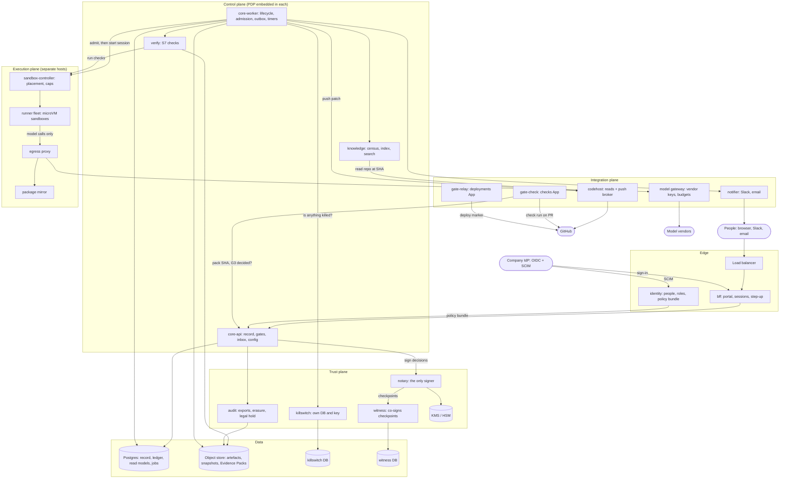
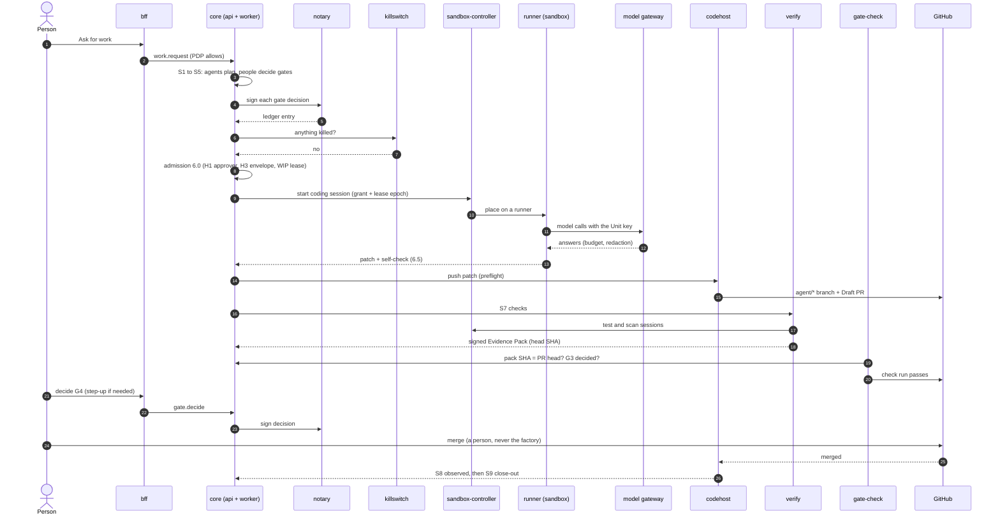

# ADR-0003: Target architecture: seven planes, 18 services, sandboxes on separate hosts

Status: accepted, 2026-11-11 (the user asked for it to be built exactly as written here). It supersedes the container list in PLAN §5 revision 2, which counted 25 containers.

## Context

PLAN §5 listed 25 containers. Most came from the earlier code base's layout, not from a reason. The user rejected that count and asked what the architecture should be with resources left out. The rule this ADR follows:

> A service is its own process only when it **holds a key** the others must not reach, **runs untrusted input**, **must survive the others failing**, or **scales differently**. Each service below names its reason.

This matches comparable systems:
- CI platforms run a control plane, stateless workers, and short-lived runners for untrusted code that never hold control-plane secrets.
- Signing transparency systems (Sigstore: signer, log and witnesses) keep the signer, the log and the witnesses apart, often under separate operators.
- LLM gateways are the one holder of vendor keys.
- A kill switch sits outside the system it stops.

The review's trust boundaries (RV §2, AR1–AR9) are unchanged. ADR-0001 still holds: TypeScript, Postgres, graphile-worker, no Temporal.

## Decision

### 1. Seven planes and 18 services

| Plane | Service | Owns | Why it stands alone |
|---|---|---|---|
| Edge | **bff** | portal, sessions, step-up verification | Holds the session cookies, the OIDC client secret and the step-up verifier key; the only service the internet reaches; scales with users |
| Edge | **identity** | principals, teams, role bindings, SCIM sync, policy bundle, access journal | Ingests SCIM from outside; access changes have their own audit trail |
| Control | **core-api** | record, ledger appends, items, gates, inbox, projects, config | The write authority; stateless, so it scales by adding replicas |
| Control | **core-worker** | lifecycle interpreter, work driver, admission (6.0), outbox relay, timers, loops | Scales apart from the API, so slow work never slows the portal; several replicas are safe because jobs are claimed in Postgres |
| Control | **knowledge** | census, repo index, search, detectors, knowledge lint | Reads whole repos: heavy CPU, untrusted content, high data class; scales with the number of repos |
| Control | **verify** | S7 orchestration (7.1–7.6), Evidence Pack assembly | Many checks run in parallel; load spikes when items reach S7 |
| Trust | **notary** | the only signer, backed by KMS or an HSM | Signatures stay valid even if the control plane is compromised |
| Trust | **witness** | co-signs Merkle checkpoints | Worth something only under a different operator or cloud account |
| Trust | **killswitch** | kills and the two-person release, its own database and key | Must work when everything else is broken (AR9); unreachable counts as killed |
| Trust | **audit** | signed exports to write-once storage, pseudonyms, erasure, retention, legal hold, permission history | Auditors may need access the factory itself does not have |
| Integration | **gateway** | vendor keys, routes, budgets, redaction, tool allow-lists, virtual keys | The only holder of model-vendor keys and the one choke point for model traffic |
| Integration | **codehost** | GitHub reads, the push broker (the only writer to GitHub) | Holds the main App key; one preflight before every write |
| Integration | **gate-check** | the check run on every PR (pack SHA = PR head SHA, G3 decided; the S0, L8 and non-agent profiles) | Its own narrow App (`checks:write`); in codehost, one leak would give both powers |
| Integration | **gate-relay** | G5 release, deploy markers, RELHOLD | Its own narrow App (`deployments:write`) |
| Integration | **notifier** | Slack and email delivery (the portal inbox stays authoritative) | Holds channel credentials and absorbs their outages; decides nothing |
| Execution | **sandbox-controller** | places sessions on runners, enforces class limits and caps, reports free slots | The only thing allowed to create a sandbox |
| Execution | **egress proxy** | the sandboxes' only route out: to the gateway and the mirror | Allows two peers and nothing else |
| Execution | **package mirror** | read-only package cache for repo dependencies | The other peer a sandbox may reach |

The **runner fleet** is a set of hosts, not one service. Each runner host carries the Docker-socket (or microVM) agent the controller talks to. Locally the runner is the Docker daemon behind the in-repo proxy.

### 2. Supporting pieces

| Piece | Local | Production |
|---|---|---|
| Postgres | 1 container, separate databases inside | managed main instance, plus **separate instances** for killswitch and witness |
| Object store | MinIO | an S3-compatible bucket, plus a write-once (object-lock) bucket for audit |
| Key service | kms-local | cloud KMS or HSM |
| Sign-in | dev-oidc | the company IdP (OIDC + SCIM) |
| Telemetry | optional | one OpenTelemetry collector (metrics, logs, traces) |
| Migrations | one job that runs and exits | the same |

### 3. Container count

| | Local (one machine) | Production (one copy each) |
|---|---|---|
| Services | 18 | 18 |
| Supporting containers | Postgres, MinIO, kms-local, dev-oidc | collector (the rest is managed) |
| **Total you run** | **22** | **19**, about 25–30 running copies with high availability |
| Sandboxes on top | up to 4 at once (§5) | runner hosts that scale with the queue |

Locally the services may share one machine, but none of them merge into each other.

### 4. Where everything lives



Only these services talk to the outside world:
- **bff** (people);
- **identity** (SCIM);
- **gateway** (model vendors);
- **codehost**, **gate-check** and **gate-relay** (GitHub);
- **notifier** (Slack and email).

Sandboxes reach only the egress proxy, and through it only the gateway and the mirror.

### 5. One work item end to end



### 6. Scheduling: who owns what

The word "scheduler" covers three things. Each has one owner, and only one of them decides.

**Admission (6.0) is owned by core (core-worker).** It owns the Unit, its lease epoch, the admission grant and the first-in-first-out queue (DM gap 14: the Unit is the only owner of its lease). It is all record events (`unit.admitted`, `lease_changed`, `grant_released`, `wait_entered`), so it can be rebuilt from the record. The checks run in this order, and an unknown answer means wait:

| Check | Asked of | Passes when |
|---|---|---|
| Kill | killswitch | no kill covers the item, project, lane or fleet; unreachable counts as a kill |
| H1, approver | role map (identity) | someone who can decide the gates ahead is available |
| H2, capacity | sandbox-controller | a slot of the right class is free under the caps |
| H3, envelope | gateway | the Unit's budget can be reserved in its budget group |
| WIP, lease | core | nobody else holds the branch lease |

- **Admitted:** core records the grant with a new lease epoch, then asks the controller for a session.
- **HUMAN-WAIT** (X1, X3, E6 or G3o pending): core releases the lease and the slot, keeps the snapshot reference, and pauses the envelope clock. When the person decides, core re-admits the Unit.

**Placement is owned by the sandbox-controller.** It places a granted session on a runner, enforces the class ceilings and caps, reports the free slots H2 reads, and cleans up after a session. It never decides order and never starts what core has not granted. Its state is disposable.

**Timers are owned by core-worker,** through the Postgres job queue (graphile-worker cron and delayed jobs): the B21 SLA, expiry, polls, checkpoints, the stuck sweep. A long human wait is "no event yet".

**People set the limits:**

| Setting | Owner | How it changes |
|---|---|---|
| Sandbox caps per runner host | factory admin | M1 config change |
| Model budgets, budget groups | factory admin | M1, gateway config |
| A project's WIP limit and default envelope | project admin | M1 on the project |
| Step 5.7 Schedule (when a planned item may start) | the plan's design approver, before G3 | on the item; admission honours it |
| Holds and clamps | project admin, or factory admin for the fleet | a control, previewed then applied |
| Stop everything | kill holders | kill switch |

```
person (5.7, holds, caps) ──sets rules──► core admission (decides, records grant + lease)
                                              │ grant
                                              ▼
                                  sandbox-controller (places on a runner)
                                              │ slots free / session ended
                                              └──────────► back to core
```

### 7. Sandboxes and caps

| Class | Runs | Up to | Memory | Network |
|---|---|---|---|---|
| W | the coder agent (6.4) | 60 min | 2 GB | gateway + mirror |
| O | repo tests (6.3, 6.5, S7) | 15 min | 1 GB | mirror |
| V | reviewer and checker agents (S7) | 10 min | 512 MB | gateway |
| P | planning agents with tools (S2–S5) | 10 min | 512 MB | gateway |
| K | scanners (onboarding, S7) | 5 min | 512 MB | none |
| K-exec | onboarding probe | 15 min | 1 GB | mirror |

- **Two caps per runner host,** both config set by the factory admin through M1:
  - a **total** (default 4);
  - a **coding (W) cap** (default 1, `CODING_SESSION_CAP`).

  Sessions over a cap wait in core's queue.
- **The onboarding probe** runs in a dedicated image with the scanners and common libraries baked in at exact versions and checksums (DEC-17 as refined). A repo's own dependencies come through the mirror.
- **Production runners use microVMs** (Firecracker or Kata) behind the same `SandboxPort`. The container class stays as the local and fallback driver. Execution of repo code stays limited to the owner allow-list (DEC-18).

### 8. How services talk

- **Record first.** A service writes the record event and its outbox job in one Postgres transaction, then a worker acts on it (AR1, AR8). No decision exists only in memory.
- **Async work** uses the Postgres job queue (graphile-worker). There is no message broker until the queue is the bottleneck (see "When to split further").
- **Sync calls** are HTTP between services. Each service has its own identity (mTLS, SPIFFE-style); no service trusts another's network position.
- **Policy:** the PDP is embedded in every service, with one policy bundle version. Portal buttons are only hints.
- **Live portal:** server-sent events fed from new record events. The floor and board are read models, rebuildable from the record.
- **Large content** (artefacts, snapshots, Evidence Packs, bundles, audit exports) lives in the object store, addressed by content hash. The record stores only the hashes.

### 9. What survives what

| Failure | Behaviour |
|---|---|
| core-worker down | Nothing is lost; jobs wait and resume (the M9.2 rebuild drill) |
| notary down | Decisions wait as pending and are signed on recovery; kills still apply and are signed later |
| killswitch unreachable | Every enforcement point treats it as a kill |
| gateway down | Agent steps wait; people can still decide gates; nothing is auto-approved |
| A runner compromised | It holds no keys, its network goes only to the gateway and the mirror, and the next session gets a fresh microVM |
| Main Postgres failover | Replicas take over; killswitch and witness are on their own instances and unaffected |

## Consequences

### What exists and what is added

**Already built:** bff, identity, core-api (`core`), core-worker, knowledge, notary, witness, killswitch, gateway, codehost, the Docker-socket proxies (which become the runner side), the package mirror, and the embedded PDP.

| Change | Milestone |
|---|---|
| This ADR; PLAN §5 rewritten | M14, first task |
| Object store (MinIO locally) with a write-once bucket; artefacts and Evidence Packs move to it | M14, early |
| verify, gate-check | M14 |
| sandbox-controller as its own service (split from admission and the Docker driver), plus the total cap per host | M14 |
| gate-relay | M15 |
| notifier | M18 |
| audit (one service), OpenTelemetry collector, outage drills | M19 |
| microVM runner driver | M19 or M20 (needs `/dev/kvm`; built against a fake first) |

These pieces depend on where the factory is deployed, which is not chosen yet:
- managed Postgres, with separate killswitch and witness instances;
- a cloud KMS;
- the witness under a different account;
- load balancing and replicas.

Each has a local equivalent with the same interface.

### What this gives up

- 18 services take more operational work than a monolith: upgrades, monitoring, debugging across services. M19 has to bring that baseline.
- Postgres is the record, the job queue and the read models at once. That is fine for dozens of projects; "When to split further" below says when.

## Rating and what raises it

Rated 2026-11-11: **8/10 as a design, about 5/10 proven** (built and tested against fakes; nothing has run for real yet).

| Aspect | Score |
|---|---|
| Security and trust boundaries | 9 |
| Audit and correctness | 9 |
| Simplicity | 6 |
| Operations | 6 |
| Scalability | 7 |
| Resilience | 7 |
| Proven in practice | 4 |

To raise it:
1. **One real item end to end.** A real repo, a real model and a real PR merged by a person, on the testbed (M15/M16). This is the biggest single step.
2. **A load test.** 3–5 projects with 20–50 items in flight, measuring Postgres, worker latency and sandbox throughput (M19).
3. **Outage drills.** Notary down, killswitch unreachable, Postgres failover, and a runner killed mid-session, each recovering without losing a decision (M19).
4. **An operations baseline.** Metrics, alerts, backups with a tested restore, and a written upgrade procedure (M19).
5. **Split codehost's GitHub access** into a read-only App and a push-only App (open: proposed for M16, needs the user's App change).
6. **Follow the growth path** in "When to split further".

## When to split further

These are not built now. They are the triggers that would justify each split.

| Trigger | Split |
|---|---|
| Job-queue latency over 1 s at the 95th percentile, or more than 1,000 jobs a minute | move async work to a broker, keeping the record-first outbox |
| Read-model queries slow down the primary | read models on replicas, or their own database |
| More than about 200 active repos for knowledge | a dedicated search index |
| Floor fan-out more than about 500 connected portals | a separate event-stream service |
