# AI Software Factory: Domain Model (model-driven design)

Date: 2026-11-08. Author: model-design pass (read-only over the repo; nothing was implemented or changed).
Repo read: `/home/reshif/ai-software-factory` (paths below are relative to it). Spec read: `/home/reshif/aisdlc-council` (`flow/flow-corrected.md`, `NORTH-STAR.md`, `onboarding/ROADMAP.md`, `console/*-contract.md`).

---

## 1. Purpose and how to read

Purpose: one precise, relational picture of the whole Factory, so the front end, the onboarding wizard, access control, integrations (GitHub and others as adapters), model providers (Anthropic, Codex/OpenAI, DeepSeek, anyone as adapters), agent evals and the floor are all built on the same entities and ports, not on each other's JSON.

How to read:
- Section 2 is the map of bounded contexts and who depends on whom. Section 3 has one `erDiagram` per context, then one cross-context diagram.
- Section 4 is the ports/adapters model. Section 5 is agent evals and scoring. Section 6 the state machines. Section 7 maps the floor onto the domain. Section 8 lists gaps and tensions (ranked). Section 9 is the target model and build order.
- Under every diagram there is a table: entity, status, evidence.

Legend (applies to every entity, in tables and in prose):

| Tag | Meaning |
|---|---|
| **BUILT** | Exists in code as a table, dataclass, policy file or contract schema. The file or table is cited. |
| **PARTIAL** | The concept exists but only as a JSON `doc` blob, an event-only fact, a string id with no table, or an interim store. Cited with what is missing. |
| **PROPOSED** | Needed for the user's vision, not built. Never to be read as existing. In diagrams, PROPOSED entities carry the suffix `_P` in their name (for example `Integration_P`). |

Conventions used in the diagrams: types are `string uuid int bool float datetime json`; `PK` primary key, `FK` foreign key, `UK` unique. A `FK` drawn on a column that today is only a plain string with no constraint is marked in the comment `soft` (a reference by id, not enforced). Where the code stores a field inside a JSON `doc`, the diagram shows it as a column only if the doc contract names it; the table says so.

Two facts shape everything else:
1. **The record is the source of truth.** `record_event` (hash chained, append-only, `core/record/models.py:4`) and `ledger_entry` (hash chained, Notary-signed, `core/record/models.py:26`) are authoritative. Almost every other core table is a *read model* rebuilt from them (`work_item_projection`, `fd_*`, `observe_*`, `lifecycle_*`). So many entities below are "event-derived": they have no independent write path and must not get one.
2. **Data sits in four stores today:** core Postgres/Django (`core/*`), the identity journal (`identity/asf_identity/journal.py`: sqlite/PG tables `changes campaigns deltas access_events records audit_log pdp_decisions`), the knowledge store (`knowledge/src/asf_knowledge/onboarding.py:64`: sqlite `jobs ledgers projects`) and code-host local state (`codehost/asf_codehost/*`: sqlite `cha_inbox deploy_marker g5_consumed fp` and the lease file). Plus the Notary and kill-switch sqlite (`security/src/factory_security/notary/state.py:17`, `killswitch/core.py:163`) and the gateway's in-process control plane (`runtime/src/asf_runtime/gateway/core.py:232`).

---

## 2. Bounded contexts map

Eleven contexts plus Audit. Arrows read "depends on / calls". Labels on the arrows name the port or adapter the dependency goes through. Dotted arrows are PROPOSED.

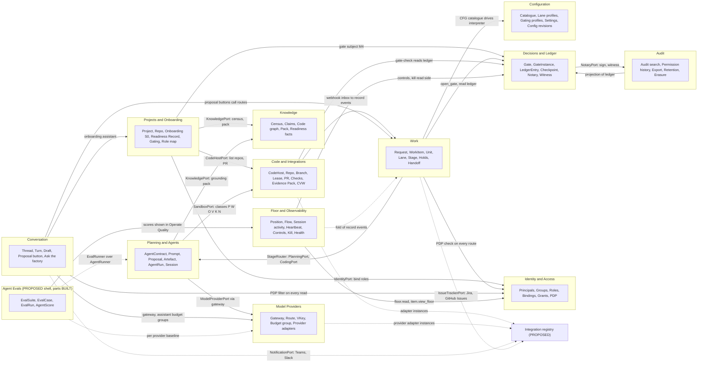

Context ownership in one line each (what each context is the single writer of):
- **Identity and Access** owns who exists and what they may do. Single writer of principals, groups, bindings, grants, qualifications.
- **Projects and Onboarding** owns what a project is and whether it is ready. Single writer of project settings, the S0 record, readiness record versions.
- **Work** owns requests and items. Single writer of the item event stream (`item:<id>`), spawn links, timers, admission grants.
- **Decisions and Ledger** owns gates and signed decisions. Single writer of gate instances and ledger entries (the Notary is the only signer).
- **Planning and Agents** owns what agents are, what they were told, and what they produced.
- **Code and Integrations** owns everything that touches a code host: branches, leases, PRs, checks, evidence.
- **Knowledge** owns what the factory has learned about a repo (census, claims, readiness facts, packs).
- **Model Providers** owns which models may be called for which data class, with what key and budget.
- **Conversation** owns request threads, drafts and the console/assistant turns.
- **Floor and Observability** owns derived views and operational controls (holds, clamps, banners, health).
- **Configuration** owns the versioned catalogue and config revisions.
- **Audit** owns derived, searchable audit views and retention.
- **Agent Evals** owns golden/holdout cases and scores (mostly PROPOSED, see section 5).

---

## 3. Per-context entity-relationship diagrams

### 3.1 Identity and Access

Evidence: `identity/asf_identity/rbac.py` (dataclasses `Principal`, `Group`, `Membership`, `Binding`, `AccessGrant`, `Qualification`), `identity/asf_identity/journal.py:40` (tables), `identity/asf_identity/policy/roles.yaml` (role catalogue, `roles_version 2.0.0`), `policy/sod.yaml`, `policy/service_grants.yaml`, `policy/catalogue_v1.json` and `contracts/policy_actions.json` (action catalogue), `core/bff/asf_bff/store.py:260` (browser session). Access is group based: a principal holds roles only through group membership plus a binding of that group to a role at a scope.

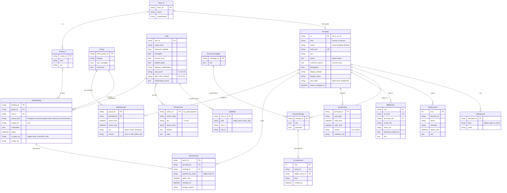

| Entity | Status | Evidence / what is missing |
|---|---|---|
| Principal | BUILT | `rbac.py:63`; persisted as `records(kind, rec_id, doc)` in the identity journal (`journal.py:46`), not a typed table |
| Group | BUILT | `rbac.py:79` (Entra group ids) |
| Membership | BUILT | `rbac.py:87` |
| Role | BUILT | `rbac.py:34` `RoleDef`, loaded from `policy/roles.yaml` (config, M3 bundle change) |
| RoleBinding | BUILT | `rbac.py:97` `Binding` |
| AccessGrant | BUILT | `rbac.py:110` (the M6 second key for approval-capable roles) |
| Qualification | BUILT | `rbac.py:122` |
| PolicyAction | BUILT | `contracts/policy_actions.json`, `policy/catalogue_v1.json` (generated into `roles.yaml` permissions by `rolegen.py`) |
| SodRule | BUILT | `policy/sod.yaml` (static and toxic pairs) |
| AccessChange | BUILT | `journal.py:40` `changes` (doc is JSON) |
| AccessEvent | BUILT | `journal.py:44` `access_events`; projected to core `observe_permission_history` |
| AccessCampaign | BUILT | `journal.py:41` `campaigns` |
| PdpDecision | BUILT | `journal.py:49` `pdp_decisions` |
| IdentityLink | PARTIAL | only `Principal.logins` (a tuple); route `/v1/internal/identity-links/{login}` (`service_grants.yaml`); no own entity |
| BffSession | BUILT | `core/bff/asf_bff/store.py:260` `bff.session` |
| Scope | PROPOSED | `Binding.scope_kind` lists `enterprise, org, team, project, repo, service_env, environment` but only `project` has a table; the others are bare strings |
| Team | PROPOSED | `team_id` exists only as a string in `ProjectMeta` (`core/frontdoor_observe/models.py:22`) and PDP facts; no Team/Org entity |
| ProjectRoleMap | PARTIAL | the per-project role map is in the project doc (`core/projects/settings.py:75`), see 3.2; it is not a set of `RoleBinding` rows |

Note: roles are catalogued as config (`roles.yaml`), so "who can do what" for the front end is already expressible through `me.schema.json` capabilities and `permission_hints.schema.json`; the gap is the project-level mapping (section 8, gap 3).

### 3.2 Projects and Onboarding

Evidence: `core/projects/models.py` (4 tables), `core/projects/settings.py` (project doc helpers), `core/projects/onboarding/s0.json` (step machine config), `contracts/schemas/onboarding.schema.json` (`prr`, `gap`, `card`, `onboarding`), `contracts/schemas/project_records.schema.json` (`role_map`, `gating`, `project_roles`), `core/projects/s0.py` (state sets at lines 41-43).

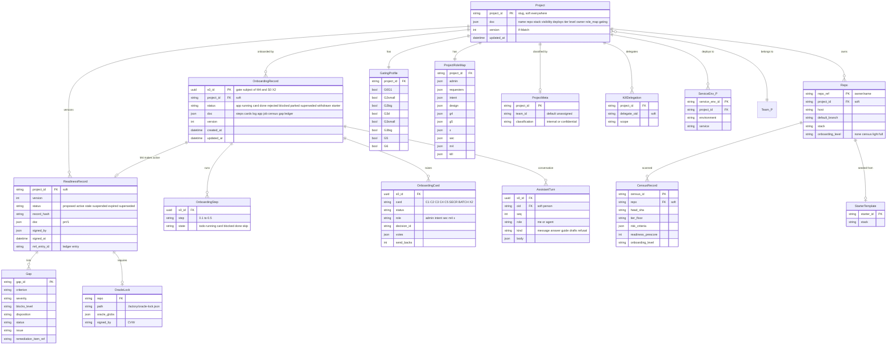

| Entity | Status | Evidence / what is missing |
|---|---|---|
| Project | PARTIAL | `core/projects/models.py:5` `ProjectRecord(project_id, doc, version)`: everything is inside `doc`; no typed columns, no FK from any other table |
| ProjectMeta | PARTIAL | `core/frontdoor_observe/models.py:22`, labelled "interim local registry until the P7/TR-3 project facade owns it"; holds `team_id`, `classification` |
| Repo | PARTIAL | no table; repo lives in `ProjectRecord.doc`, in knowledge `ledgers(project, repo, body)` (`knowledge/.../onboarding.py:65`), in the readiness doc `repo`, and in code-host `ServedRepos` (`codehost/asf_codehost/realgh.py:145`) |
| OnboardingRecord | BUILT | `core/projects/models.py:34` (`s0_id` is the M4 gate subject) |
| OnboardingStep | PARTIAL | `doc.steps` map, steps `0.1..0.5` from `core/projects/onboarding/s0.json` |
| OnboardingCard | PARTIAL | `doc.cards`; shape in `onboarding.schema.json#/$defs/card`; roles from `s0.json` `card_role` |
| AssistantTurn | BUILT | `core/projects/models.py:50`, unique `(s0_id, oid, seq)` |
| ReadinessRecord | BUILT | `core/projects/models.py:17`, unique `(project_id, version)`, status set in comment |
| Gap | PARTIAL | inside the PRR doc; contract `onboarding.schema.json#/$defs/gap`; also `oracle_lock_missing` named gap (`knowledge/.../projects.py`) |
| GatingProfile | PARTIAL | `ProjectRecord.doc.gating`; contract `project_records.schema.json#/$defs/gating` |
| ProjectRoleMap | PARTIAL | `ProjectRecord.doc.role_map`; contract `#/$defs/role_map`; edits emit an access event `role_map_change` (`core/projects/settings.py:6`) |
| KillDelegation | PARTIAL | `doc.kill_delegations` (`project_records.schema.json#/$defs/kill_delegations`) |
| CensusRecord | PARTIAL | contract `census_record.schema.json`; stored in knowledge store `ledgers` body, and summary in `OnboardingRecord.doc` |
| OracleLock | PARTIAL | a file in the repo (`knowledge/.../projects.py` `LOCK_PATH`), signed by the CVW; no record in core |
| StarterTemplate | BUILT | `core/projects/starters.py`, `core/projects/onboarding/starters/` (files) |
| ServiceEnv | PROPOSED | identity has scope kind `service_env` and G5 binds `(service, environment, digest)` (`record/models.py:161` `DeployMarker`), but no environment entity |
| Team | PROPOSED | see 3.1 |

### 3.3 Work (requests, items, lifecycle, units)

Evidence: `core/record/models.py:63` `WorkItemProjection`, `workflow/wf/interpreter.py:24` `ItemState`, `core/lifecycle/models.py` (4 tables), `core/frontdoor_work/models.py` (`Draft`, `Attachment`, `ItemStatus`), `contracts/schemas/work_item.schema.json`, `work_item_request.schema.json`, `request_type.schema.json`, `catalogue/catalogue-v0.4.1.yaml` (`stages gates lanes back_edges timers terminal_states`) and `extensions/catalogue-v0.4.1.lifecycle.yaml`.

```mermaid
erDiagram
  Project ||--o{ WorkItem : "contains"
  RequestType ||--o{ WorkItem : "typed as"
  WorkItem ||--o| Draft : "started from"
  Draft ||--o{ Attachment : "has"
  WorkItem ||--o{ Attachment : "has"
  Lane ||--o{ WorkItem : "bound to"
  Lane ||--o{ LaneStage : "route"
  Stage ||--o{ LaneStage : "in"
  Stage ||--o{ Step : "contains"
  WorkItem }o--|| Stage : "currently at"
  WorkItem ||--o{ Unit : "split into"
  Unit ||--o{ AdmissionGrant : "admitted by"
  WorkItem ||--o{ SpawnLink : "origin of"
  WorkItem ||--o{ FollowUpTimer : "owns"
  WorkItem ||--o{ Question : "asks"
  WorkItem ||--o{ Assumption : "proceeds on"
  WorkItem ||--o{ Hold : "held by"
  WorkItem ||--o{ Handoff : "handed off"
  WorkItem ||--o{ ItemPath : "folds to"
  WorkItem ||--o{ RecordEvent : "stream item"
  BackEdge }o--|| Stage : "from"
  BackEdge }o--|| Stage : "to"
  WorkItem ||--o{ BackEdgeCounter : "counts"
  BackEdge ||--o{ BackEdgeCounter : "limit"

  WorkItem {
    uuid item_id PK
    string project_id FK "soft"
    string state "see lifecycle diagram"
    string lane FK "L0 to L8"
    string stage FK "S0 to S9 incl S8a S8b"
    string owner_of_record "oid soft"
    string risk_class
    string tier
    string catalogue_version
    string catalogue_hash
    json doc "projection document"
    int last_global_seq
  }
  RequestType {
    string type_id PK
    json schema "from catalogue request_types"
  }
  Draft {
    uuid draft_id PK
    string owner_oid FK "soft"
    json doc
    int version
    datetime expires_at "30 days"
  }
  Attachment {
    uuid attachment_id PK
    string owner_oid FK "soft"
    uuid item_id FK
    uuid draft_id FK
    string sha256
    string object_key "sandbox origin store"
    string state "quarantined clean rejected"
  }
  Lane {
    string lane_id PK "L0 to L8"
    string name
    json gate_positions
    string profile "lane profile"
  }
  Stage {
    string stage_id PK "S0 S1 to S7 S8a S8b S9"
    string name
  }
  LaneStage {
    string lane_id FK
    string stage_id FK
    int position
  }
  Step {
    string step_id PK "e.g. 6.0"
    string stage_id FK
    string nature "A D H system"
  }
  Unit {
    string unit_id PK "string, no table"
    uuid item_id FK
    string repo FK "soft"
    string branch "agent item unit"
    int lease_epoch
    string head_sha
    string pr_ref
    string state
  }
  AdmissionGrant {
    string grant_id PK "item unit epoch"
    uuid item_id FK
    string unit_id FK "soft"
    string project_id FK "soft"
    int lease_epoch
    int envelope_cents
    string status "active or released"
    datetime granted_at
    datetime released_at
  }
  SpawnLink {
    uuid item_id PK
    uuid origin_item_id FK
    int origin_seq
    int index
    string edge "B or N edge"
    string kind
    string lane
    string status "open or done"
  }
  FollowUpTimer {
    string timer_key PK "item and timer id"
    uuid item_id FK
    string timer_id "R4 B17 N9 L0"
    datetime due_at
    string status "pending fired satisfied"
  }
  Question {
    string question_id PK
    uuid item_id FK
    string stage
    int round
    string material "blocking or not"
    string state "open answered"
  }
  Assumption {
    string assumption_id PK
    uuid item_id FK
    string source "engine intent plan"
    string text_hash
    string state "open overridden accepted"
  }
  Hold {
    string hold_id PK
    uuid item_id FK
    string reason "H1 H2 kill capacity budget"
    string origin "control id soft"
  }
  Handoff {
    string handoff_id PK
    uuid item_id FK
    string code "D1 E4"
    uuid e4_gate_instance_id FK
    string pack_id
    string choice
  }
  BackEdge {
    string edge_id PK "B1 to B28"
    string from_stage FK
    string to_stage FK
    int limit
  }
  BackEdgeCounter {
    uuid item_id FK
    string edge_id FK
    int taken
  }
  ItemPath {
    uuid item_id PK
    string stage
    string step_state
    json doc
  }
  RecordEvent {
    uuid event_id PK
    string stream_id "item uuid"
    int stream_seq
    int global_seq UK
  }
```

| Entity | Status | Evidence / what is missing |
|---|---|---|
| WorkItem | BUILT | `core/record/models.py:63` projection; engine state `workflow/wf/interpreter.py:24` (`stage, phase, open_gates, approved_gates, counters, holds, handoff, terminal, timers, lease_epoch ...`); contract `work_item.schema.json` |
| RequestType | PARTIAL | contract `request_type.schema.json`, generated from catalogue `request_types`; served by `core/api/request_types.py`; no table |
| Draft, Attachment | BUILT | `core/frontdoor_work/models.py:85,99` |
| Lane, Stage, LaneStage, Step, BackEdge | BUILT (config) | `catalogue/catalogue-v0.4.1.yaml` + lifecycle extension; typed by `workflow/wf/catalogue_model.py:43` `Catalogue`; versioned and content hashed (`sha256_of`). Not DB rows, by design (config, D22) |
| BackEdgeCounter | PARTIAL | `ItemState.counters` (engine) and event derived |
| Unit | PARTIAL | no table. The unit id is a free string in `AdmissionGrant.unit_id` (`core/lifecycle/models.py:50`), in the branch name `agent/<item>/<unit>` (`codehost/asf_codehost/branches.py:20`), in `StageRequest.unit_id` (`workflow/wf/types.py`), in `SessionActivityView` (no unit column), in the `LeaseTable` file. Contract `budget_envelope.schema.json` keys on `unit_id` |
| AdmissionGrant | BUILT | `core/lifecycle/models.py:50` |
| SpawnLink | BUILT | `core/lifecycle/models.py:16` |
| FollowUpTimer | BUILT | `core/lifecycle/models.py:34` |
| Question | PARTIAL | events only (`item.question_*`), projected to `ConsoleTurn` (`frontdoor_work/models.py:20`); schema `question.schema.json`, `questions.v1.schema.json` |
| Assumption | PARTIAL | four different shapes, see section 8 gap 4 |
| Hold | PARTIAL | `ItemState.holds` (engine) and `Control` (observe); no shared entity |
| Handoff | PARTIAL | events `workflow.handoff_started`, `handoff.requested`, `handoff.pack_written`, `handoff.bound` (`core/lifecycle/handoff.py:122,207`); ids differ, see gap 1 |
| ItemPath | BUILT | `core/frontdoor_observe/models.py:33` `ItemPositionView`; contract `item_path.schema.json` |
| RecordEvent | BUILT | `core/record/models.py:4` |

### 3.4 Decisions and Ledger

Evidence: `core/record/models.py` (`GateInstance` 90, `GateNonce` 110, `LedgerEntry` 26, `LedgerCheckpoint` 119, `PreparedDecision` 174, `KillReleaseApproval` 129), `contracts/schemas/ledger_entry.schema.json` (entry types), `gate_card.schema.json`, `decision_surface.schema.json`, `security/src/factory_security/{ledger.py,witness.py,notary/}`, `core/frontdoor_observe/models.py:299` `GateFeasibility`. Gates and their roles: G0..G6, X1..X4, E1..E6, M1..M6 (`flow/flow-corrected.md`; `catalogue` `gates`).

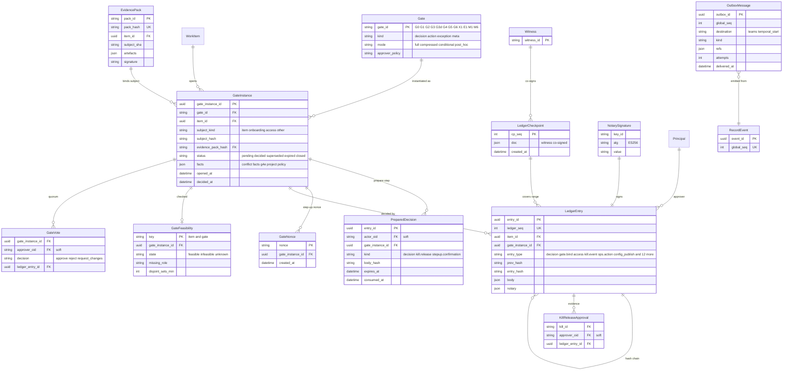

| Entity | Status | Evidence / what is missing |
|---|---|---|
| Gate | BUILT (config) | catalogue `gates` (26 master gates) |
| GateInstance | BUILT | `core/record/models.py:90`; opened by `services.open_gate` (`core/api/services.py:~140`); end states set by `_end_gate` (`:157`) and decide (`:571`) |
| GateVote | PARTIAL | quorum/votes computed from ledger entries; shape in `gate_card.schema.json` (`votes`, `quorum`); no table |
| GateNonce | BUILT | `record/models.py:110` |
| PreparedDecision | BUILT | `record/models.py:174` |
| GateFeasibility | BUILT | `frontdoor_observe/models.py:299` |
| LedgerEntry | BUILT | `record/models.py:26`; 17 entry types in `ledger_entry.schema.json` |
| LedgerCheckpoint | BUILT | `record/models.py:119` |
| NotarySignature, Witness | BUILT | `security/src/factory_security/notary/`, `witness.py`; sqlite `signed consumed legal_holds break_glass` |
| KillReleaseApproval | BUILT | `record/models.py:129` (INV-13 two humans) |
| EvidencePack | BUILT | contract `evidence_pack_manifest.schema.json`; `verification/src/fv/evidence/pack.py`; stored outside core DB |
| OutboxMessage | BUILT | `record/models.py:44`; only destinations seen: `teams` (`record/sinks.py:311`) and `temporal_start` |
| RecordEvent | BUILT | `record/models.py:4` |

### 3.5 Planning and Agents

Evidence: `runtime/src/asf_runtime/planner/agents.py:14` `AgentContract` and the `CONTRACTS` registry (A1, A2, A3 and profiles `A2.clarify A3.shape A2.specify A3.design A3.plan`), `runtime/src/asf_runtime/prompts/*.md` + `prompts.lock.json` (sha256 per `name@version`), `planner/runner.py:89` `PlanningRunner`, `runtime/src/asf_runtime/sandbox/classes.py:26` (`ClassPolicy` P W O V K N, profile selfhost), `contracts/schemas/{worker_adapter,sandbox_session,plan.v2,spec.v1,design.v1,triage.v1,intent.v1,proposal.v1,job.request.v1,job.failed.v1,artefacts}.schema.json`, `core/frontdoor_observe/models.py:71` `SessionActivityView`, `:97` `ObserveJob`, `:112` `ActivityHeartbeat`.

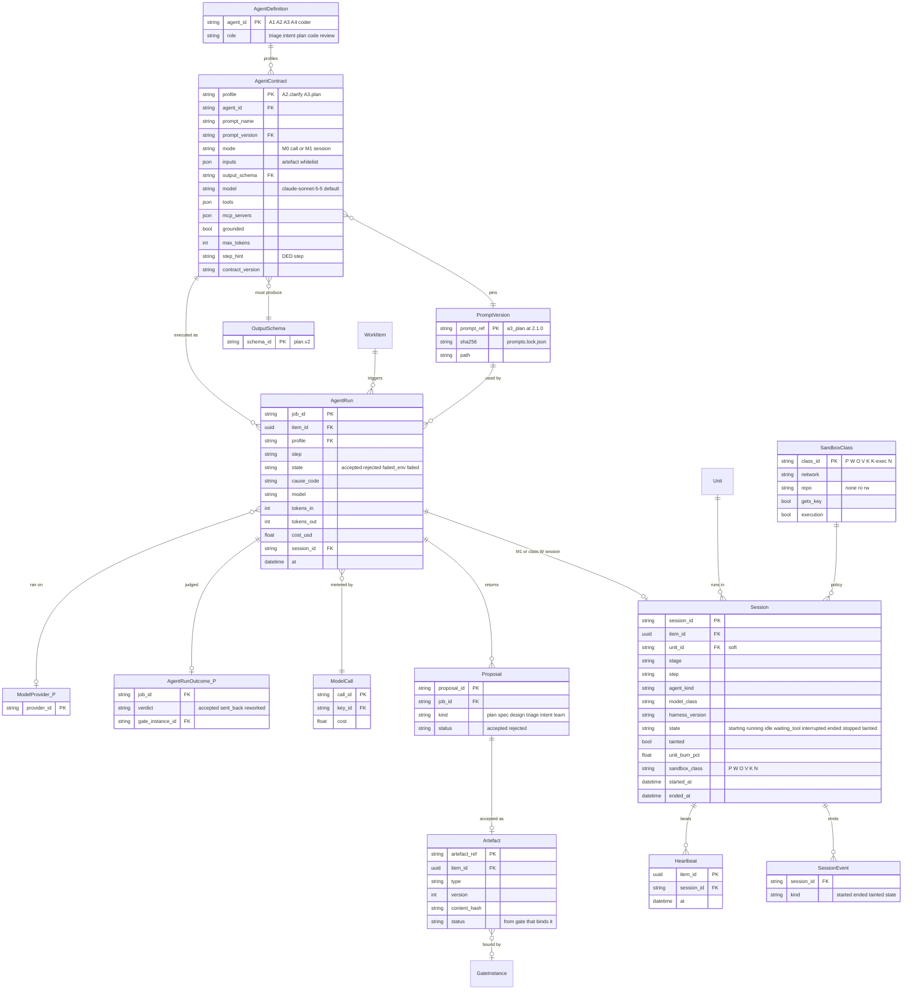

| Entity | Status | Evidence / what is missing |
|---|---|---|
| AgentDefinition | PARTIAL | agent ids are string keys in `CONTRACTS`; names table `AGENT_NAMES` in `core/frontdoor_observe/liveness.py:25` (`A1..A6` incl. A4 coding, A5 review, A6 test that have no contract) |
| AgentContract | BUILT | `planner/agents.py:14` frozen dataclass, validated in `__post_init__` (A1 may not have tools or retrieval); in code, not data |
| PromptVersion | BUILT | `runtime/src/asf_runtime/prompts/` and `prompts.lock.json` (sha256 per version) |
| OutputSchema | BUILT | `contracts/schemas/*.v1/v2.schema.json`, `planner/schemas/` |
| AgentRun | PARTIAL | no run table with prompt/model/cost. `ObserveJob` (`observe_job`) keeps `job_id agent step state cause_code at` only; cost is in the gateway budget group; tokens in gateway events (`gateway_event.schema.json`) |
| Session | PARTIAL | read model `SessionActivityView` (`frontdoor_observe/models.py:71`); no `unit_id`; sandbox class not stored; session start/stop events `session.*` (`projector.py:20`) |
| SessionEvent, Heartbeat | BUILT | record events and `ActivityHeartbeat` (`models.py:112`, non-chain) |
| Proposal | PARTIAL | record events `proposal.accepted` / `proposal.rejected`; contract `proposal.v1.schema.json`; no table |
| Artefact | PARTIAL | derived from `proposal.accepted` events (`artefacts.schema.json`); body store outside core; `StageResult.artefact_ref` (`workflow/wf/types.py`) |
| SandboxClass | BUILT | `sandbox/classes.py:26,38` |
| ModelCall | PARTIAL | gateway `VKey` + `Group` (`gateway/core.py:185,213`); metering event `meter.call.v1`; no persisted call row in core |
| AgentRunOutcome | PROPOSED | the outcome link (accepted / sent back / reworked) is derivable from gate decisions and back-edges but is not materialised; see section 5 |
| ModelProvider | PROPOSED here, see 3.8 | |

### 3.6 Code and Integrations

Evidence: `codehost/asf_codehost/port.py` (`CodeHostPort`: `list_repos read_at_sha apply_patch pr_status`; D11 no merge), `github.py:91` `GitHubCodeHost`, `realgh.py:436` `RealHost` (GitHub App, `AppKeyFile:316`, `ServedRepos:145`, `RealTokenBroker:355`), `fake_github/state.py`, `branches.py:24` `FactoryBranch`, `runtime.py:50` `LeaseTable`, `inbox.py:44` + `core/record/models.py:142` `CodehostInbox` (`cha_inbox`), `gatecheck.py`, `gatecheck_service.py`, `gaterelay.py:126` (`g5_consumed`), `markers.py:65` (`deploy_marker`), `laundering.py:86` (`fp`), `pushgateway.py:148` `PushGateway`, `runtime/src/asf_runtime/broker/broker.py:131` `PushBroker`, `contracts/schemas/codehost_port.schema.json`, `evidence_pack_manifest.schema.json`, `verification_report.schema.json`.

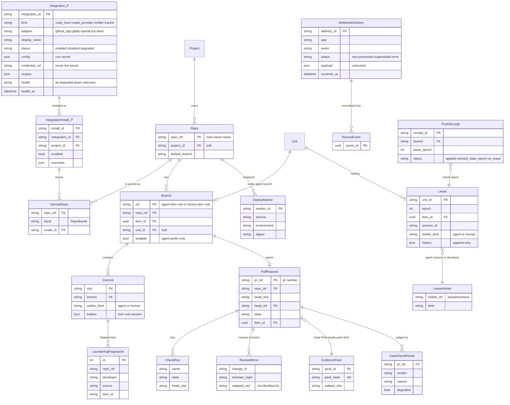

| Entity | Status | Evidence / what is missing |
|---|---|---|
| Integration, IntegrationInstall | PROPOSED | there is no registry. GitHub App config is spread across `realgh.py` (`AppKeyFile`, `ServedRepos`, `RepoBands`) and env; Teams is a separate service `teamsbot/`; gateway providers are code classes. See section 4 |
| Repo | PARTIAL | see 3.2; the code host knows repos by `repoRef {host, owner, name}` (`codehost_port.schema.json`) |
| ServedRepo | PARTIAL | `realgh.py:145` in-process config |
| Branch | BUILT | name grammar only (`branches.py:20`): `agent/<item>/<unit>` writable, `factory/...` read-only; no table |
| Commit | PARTIAL | read from the host; trailers carry item/unit/session (`apply_patch` request) |
| Lease | BUILT | `codehost/asf_codehost/runtime.py:50` `LeaseTable` (file backed, with `history`); epoch also copied into `AdmissionGrant.lease_epoch` and `StageRequest` |
| PullRequest | PARTIAL | `pr_status` response; PR facts `pr_facts`; stored as `Unit.pr_ref "pr:<n>"` in engine types; no entity |
| CheckRun, ReviewMirror | PARTIAL | `review_mirror.py:26`, `pr_status.checks`; `ReviewMirror` uses `identity_link` |
| GateCheckResult | PARTIAL | `gatecheck.py` pure function over `REQUIRED` inputs (`:47`); `DegradedTracker:326`; result is a PR status check, not stored |
| EvidencePack | BUILT | see 3.4 |
| WebhookDelivery | BUILT | `CodehostInbox` `core/record/models.py:142` and `codehost/asf_codehost/inbox.py:44` (duplicate store, see section 8) |
| DeployMarker | BUILT | `core/record/models.py:161`, `codehost/asf_codehost/markers.py:65` |
| PushReceipt | BUILT | `runtime/src/asf_runtime/broker/broker.py:123` `Receipt` |
| LaunderingFingerprint | BUILT | `codehost/asf_codehost/laundering.py:86` |
| CVW (Conformance Verification Worker) | BUILT (service, not an entity) | `codehost/asf_codehost/cvw_main.py`; signs oracle locks and verification reports |

### 3.7 Knowledge

Evidence: `knowledge/src/asf_knowledge/` (`census.py`, `claims.py`, `codegraph.py`, `understanding.py`, `pack.py`, `readiness.py`, `projects.py`, `onboarding.py:64` sqlite `jobs ledgers projects`, `agentsmd.py`, `kncheck.py`, `secret_assess.py`, `sandbox_port.py:41` `SandboxPort`), contracts `census_record.schema.json`, `project_records.schema.json#/$defs/agents_md,ledger_row`.

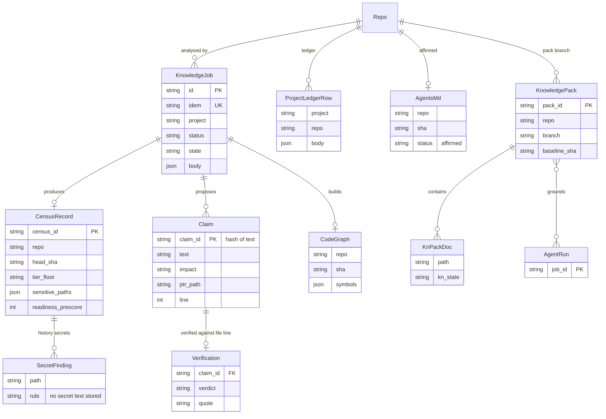

| Entity | Status | Evidence |
|---|---|---|
| KnowledgeJob | BUILT | `knowledge/.../onboarding.py:64` table `jobs` |
| CensusRecord | PARTIAL | schema BUILT, stored as JSON body in `ledgers`; summary copied into the S0 doc |
| Claim, Verification | BUILT (in process) | `claims.py:23,84`; `core/assistant/evidence.py:183` `verify_claim`; results flow into cards |
| CodeGraph | BUILT (derived, not stored) | `codegraph.py`, `understanding.py` |
| ProjectLedgerRow | BUILT | `ledgers(project, repo, body)`; contract `ledger_row` |
| AgentsMd | BUILT | `agentsmd.py`; contract `agents_md` |
| KnowledgePack, KnPackDoc | BUILT | `pack.py`, `kncheck.py`, `core/projects/s0_pack.py` (a PR branch in the repo) |
| SecretFinding | BUILT | `secret_assess.py`, `secrets.py` (hashes and rule names only) |

### 3.8 Model Providers

Evidence: `runtime/config/routes.json` (C13 route table: data class D0..D3 to approved `(provider, model)` per environment local/staging/prod, `max_tokens_cap`, `prices_usd_per_mtok`; D3 route is empty by rule), `runtime/src/asf_runtime/gateway/providers.py` (`Provider` protocol `:33`; `FakeProvider:80`, `AnthropicProvider:166`, `CappedProvider:263`, `BedrockProvider:307` "AWS-ONLY", `OpenAICompatProvider:335`), `gateway/core.py` (`Group:185` budget group with `kind` unit/item/assistant_pool/assistant_user_day/assistant_session/custom and parent hierarchy, `VKey:213`, `ControlPlane:232`, error taxonomy `BudgetExhausted`, `DlpBlocked`, `FleetFrozen`...), `runtime/config/litellm.config.yaml` (production-shaped LiteLLM mapping), `contracts/schemas/gateway_event.schema.json`, `budget_envelope.schema.json`.

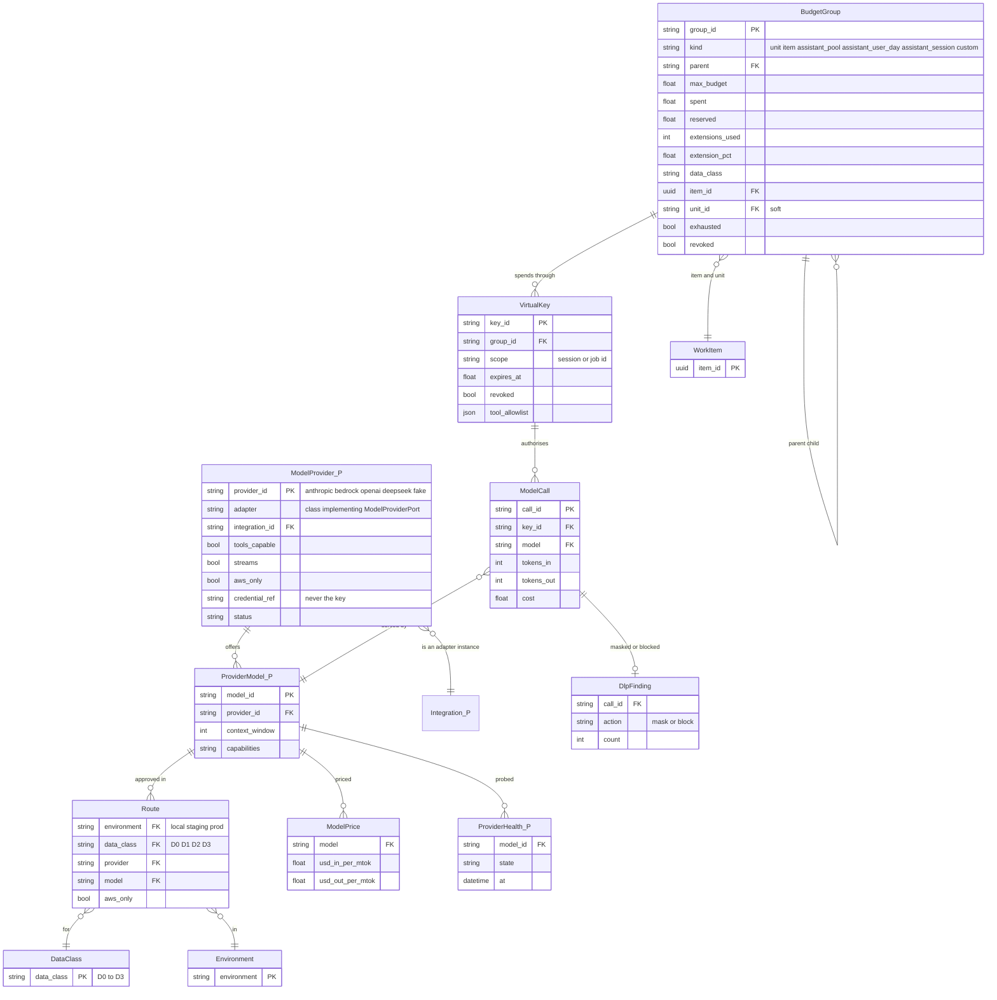

| Entity | Status | Evidence / what is missing |
|---|---|---|
| ModelProvider | PARTIAL (code) / PROPOSED (registry) | provider classes exist (`providers.py`), selected by name from `routes.json`; there is no registry entity (config, credentials ref, health, per-project enablement) and no DB. Codex/OpenAI and DeepSeek would ride `OpenAICompatProvider` (`providers.py:335`, "Bedrock/OpenAI-compat: no streaming yet" `:62`) |
| ProviderModel | PROPOSED | models appear as strings in `routes.json` and in `AgentContract.model` |
| Route | BUILT (config) | `runtime/config/routes.json`, validated by `validate_routes` (`gateway/core.py:245`); "published by the registry (C18) in prod, static in local-prod" per its `_comment` (C18 not built) |
| DataClass | BUILT | D0..D3 used by roles (`data_class_default`), groups, routes |
| ModelPrice | BUILT (config) | `routes.json#prices_usd_per_mtok` |
| BudgetGroup | BUILT | `gateway/core.py:185` (in memory in `ControlPlane`; Postgres/Redis in prod per its docstring); per-Unit envelope contract `budget_envelope.schema.json`; `AdmissionGrant.envelope_cents` is the core-side copy |
| VirtualKey | BUILT | `gateway/core.py:213` (30 s revocation, 60 s freeze, GW-1) |
| ModelCall | PARTIAL | metering event only |
| DlpFinding | PARTIAL | `mask_secrets`, `StreamMask` (`core.py:128,142`); event only |
| ProviderHealth | PROPOSED | `HealthSnapshot` (observe) has tiles by `tile_id`, none per provider |

### 3.9 Conversation

Evidence: `core/frontdoor_work/models.py:20` `ConsoleTurn` (item console), `core/projects/models.py:50` `AssistantTurn` (onboarding), `core/assistant/{thread,intake,converse,ask,onboard,drafts}.py`, contracts `request_thread.schema.json` (`turn thread assumption proposal question button`), `onboarding.schema.json` (`assistant_turn`, `converse_*`), `project_records.schema.json` (`ask_request ask_answer`), `console/request-thread-contract.md`, `console/conversational-onboarding-contract.md`. FD-D18 "Ask the factory": read + cited, actions only through buttons.

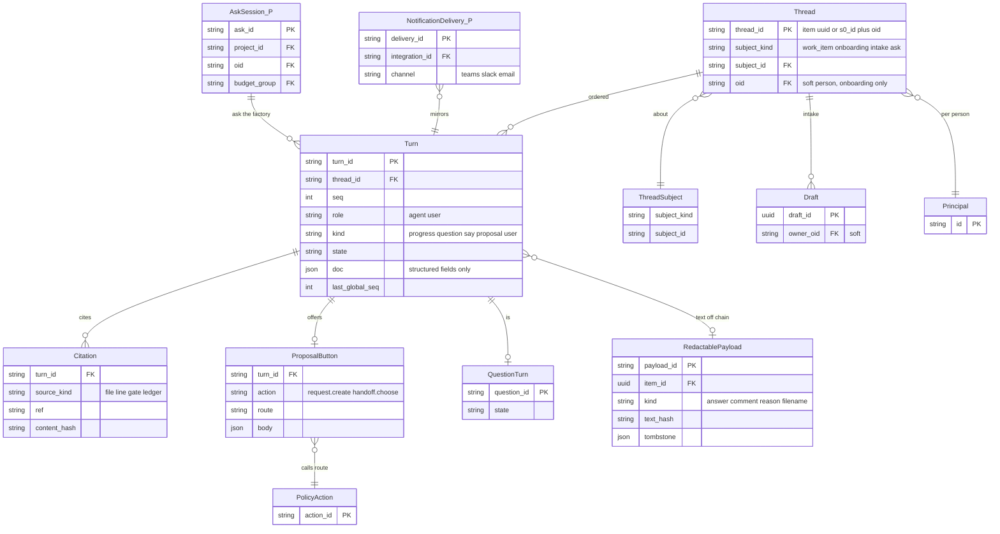

| Entity | Status | Evidence / what is missing |
|---|---|---|
| Thread | PARTIAL | no thread table. Item thread = fold of record events (`core/assistant/thread.py`); onboarding thread = rows keyed `(s0_id, oid)`; intake = `Draft` + `POST /v1/work-items:converse`. Three keys for one concept |
| Turn | BUILT (two tables, one wire shape) | `ConsoleTurn` (`frontdoor_work/models.py:20`) and `AssistantTurn` (`projects/models.py:50`); both conform to the thread-turn wire shape |
| Citation | PARTIAL | inside `turn.sources`; validated in `core/assistant/ask.py:127` |
| ProposalButton | PARTIAL | `request_thread.schema.json#/$defs/proposal` and `button` |
| RedactablePayload | BUILT | `frontdoor_work/models.py:118` |
| Draft | BUILT | `frontdoor_work/models.py:85` |
| AskSession | PROPOSED | the Ask agent is stateless per call with per-user rate limits (`ask.py:216 _limits`) and an `assistant_user_day` budget group; no stored session |
| NotificationDelivery | PROPOSED | Teams cards are sent through the outbox to `teamsbot/`; card twin tables live in the bot's own schema (`core/cards/registry.py:72`); Teams is on hold |

### 3.10 Floor and Observability

Evidence: `core/frontdoor_observe/models.py` (all tables), `positions.py` (fold of events into positions), `floor.py` (read models V0Frame/V0Row/V0Cell, `fleet`, `project`, `cell_items`, `flow`, `agents`), `liveness.py` (status `working waiting held stuck done declined`, thresholds per step kind), `web/packages/vocab/src/floorplan.ts` (stations, gates, zones, lanes), `contracts/schemas/{floor,floor_views,floor_v0_frame,activity,kill,capacity}.schema.json`, `security/src/factory_security/killswitch/core.py` (scopes session, item, project, role, model, fleet).

```mermaid
erDiagram
  WorkItem ||--|| ItemPosition : "folds to"
  ItemPosition }o--|| FloorNode : "placed on"
  Stage ||--o| FloorNode : "station"
  Gate ||--o| FloorNode : "gate"
  FloorZone ||--o| FloorNode : "side room"
  Lane ||--|| FloorLane : "drawn as"
  FloorLane ||--o{ FloorNode : "route"
  Session ||--o| ItemPosition : "bot at station"
  Session ||--o{ Heartbeat : "liveness"
  ItemPosition ||--o{ FlowWindow : "transitions"
  Control ||--o{ Hold : "creates"
  Control }o--|| OpsAction : "created by"
  OpsAction ||--o| LedgerEntry : "ledgered"
  OpsPreview ||--o| OpsAction : "binds nonce"
  KillSwitch ||--o{ KillEvent : "events"
  KillSwitch ||--o{ KillReleaseApproval : "two humans"
  Banner }o--|| OpsAction : "published by"
  HealthTile ||--o{ HealthSnapshot : "30 s"
  Project ||--o| FloorProject : "cell group"

  ItemPosition {
    uuid item_id PK
    string project_id FK "soft"
    string lane
    string stage
    string step_state
    bool terminal
    string classification "internal confidential"
    string scope_key
    json doc "content free"
    int last_global_seq
  }
  FloorNode {
    string node_id PK "S1 G0G1 S6 SCHED HOLD QUAR DESK BIN DONE"
    string kind "station gate zone"
    int x
    int y
  }
  FloorLane {
    string page_lane PK "L0 L2 L5 L6 L7 L8"
    string name
    string color
    json route
  }
  FlowWindow {
    string project_id FK
    datetime hour
    string lane
    string from_stage
    string to_stage
    string kind "F B R"
    int n
  }
  Heartbeat {
    uuid item_id PK
    string session_id
    datetime at
  }
  Control {
    uuid control_id PK
    string kind "hold clamp release_halt maintenance rollout"
    string scope_kind "fleet team project lane release budget"
    string scope_ref
    string origin_kind "operator security kill automation"
    string state "active lifted expired"
    datetime expires_at
    uuid created_by_action FK
  }
  OpsAction {
    uuid action_id PK
    string verb
    string action_class "O-T O-N O-L"
    string tier "L or R"
    string actor_oid FK "soft"
    string ledger_state "none pending ledgered"
    uuid ledger_entry_id FK
    bool backfilled
  }
  OpsPreview {
    uuid preview_id PK
    string verb
    string blast_radius_hash
    string nonce
    datetime consumed_at
  }
  KillSwitch {
    string kill_id PK
    string scope "session item project role model fleet"
    string scope_ref
    string state
  }
  KillEvent {
    int seq PK
    string kill_id FK
    string event_type
  }
  KillReleaseApproval {
    string kill_id FK
    string approver_oid
  }
  Banner {
    uuid banner_id PK
    string target "banner channel statuspage"
    string severity
    string source
    datetime expires_at
  }
  HealthTile {
    string tile_id PK
    string domain
  }
  HealthSnapshot {
    string tile_id FK
    string state "ok degraded down unknown"
    float sli_value
    datetime as_of
  }
  FloorProject {
    string opaque_key "hashed project id"
    string team_id
  }
  FloorZone {
    string zone_id PK "BIN HOLD QUAR DESK SCHED DONE"
  }
  OpsFlag {
    string key PK
    string owner
    date expires_on
    bool value
  }
```

| Entity | Status | Evidence |
|---|---|---|
| ItemPosition | BUILT | `observe_item_position`, `models.py:33`; fold `positions.py:285 fold`, rebuildable |
| FloorNode, FloorLane, FloorZone | BUILT (constants, not data) | `web/packages/vocab/src/floorplan.ts` `FLOOR_ST FLOOR_GT FLOOR_ZN FLOOR_LANES FLOOR_ANCHOR`, mapped by `placeItem` / `stageToNode` / `gateToNode` |
| FlowWindow | BUILT | `models.py:53` (90 days, hourly) |
| Heartbeat | BUILT | `models.py:112` (non-chain; drives `stale`/`stuck`) |
| Control (hold, clamp, halt, maintenance) | BUILT | `models.py:198` |
| OpsAction, OpsPreview, StepUpUse | BUILT | `models.py:165,256,274` (FD-D8 execute then ledger, backfill after Notary outage) |
| KillSwitch, KillEvent | BUILT | `security/src/factory_security/killswitch/core.py:163` tables `kills`, `kill_events`; core mirror `core/api/kill.py` |
| Banner | BUILT | `models.py:237` |
| HealthTile, HealthSnapshot | BUILT (snapshot) | `models.py:284`; row older than 2 min reads `unknown` |
| OpsFlag, ConfigRevision, GateFeasibility | BUILT | `models.py:222,317,299` |
| FloorProject | BUILT | `floor.py:79 opaque_key`, `ProjectMeta` |

### 3.11 Configuration

Evidence: `catalogue/catalogue-v*.yaml` (+ `extensions/*.lifecycle.yaml`, `vocabulary/`), schema `contracts/schemas/catalogue.schema.json`, loader `workflow/wf/catalogue_model.py:43,146` (`Catalogue`, `CatalogueRegistry`), `core/frontdoor_observe/catalogue.py` + `catalogue_index-v*.json`, `identity/asf_identity/policy/*`, `core/projects/onboarding/s0.json`, `core/assistant/config.json`, `core/frontdoor_observe/models.py:317` `ConfigRevision`, `ledger_entry_type config_publish`, `workflow/wf/lane_policy.py` (lane re-binding policy, S1 triage).

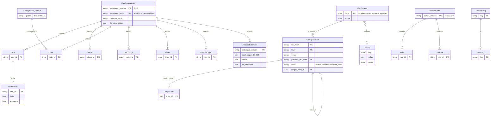

| Entity | Status | Evidence |
|---|---|---|
| CatalogueVersion, Lane, Stage, Gate, BackEdge, Timer, RequestType, LifecycleExtension | BUILT (files) | `catalogue/` (immutable per version, hash pinned); interpreters read by hash (`ItemInput.catalogue_hash`) |
| LaneProfile | PARTIAL | profile fields spread across catalogue lane entries, `lane_policy.py`, `s0.json` `lanes_by_level` |
| ConfigLayer, ConfigRevision | PARTIAL | `ConfigRevision` BUILT (`models.py:317`) but "interim until C02 lands"; layers are files |
| Setting | PARTIAL | settings are Django settings, JSON configs (`s0.json`, `assistant/config.json`) and project doc; no uniform Setting entity |
| PolicyBundle | BUILT (files) | `identity/asf_identity/policy/` with M3 bundle proposals in `policy/proposals/` |
| GatingProfile default (SOLO/TEAM) | PARTIAL | `gating` map per project (3.2); profiles by name in memory notes and `s0.json`; no catalogued profile entity |
| FeatureFlag / OpsFlag | BUILT | `models.py:222` |

### 3.12 Audit

Evidence: `core/frontdoor_observe/models.py:122,143` (`AuditEntrySearch`, `PermissionHistory`, both projections of `ledger_entry`), `core/frontdoor_observe/audit.py`, `security/src/factory_security/audit/` (`access_evidence.py`, `erasure.py`, `population.py`, `resolution.py`, `retention.py`), `export/`, `contracts/schemas/audit.schema.json`, `audit_taxonomy.schema.json`, `contracts/audit_taxonomy.json`, `sign_log_record.schema.json`, `decision_log_entry.schema.json`, identity `pdp_decisions` (retention classes).

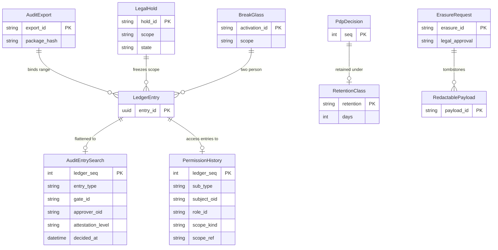

| Entity | Status | Evidence |
|---|---|---|
| AuditEntrySearch, PermissionHistory | BUILT | read models, `observe_audit_entry`, `observe_permission_history` |
| AuditExport | BUILT | `security/.../export/package.py`, ledger entry type `audit.export` |
| RetentionClass | BUILT | `identity/asf_identity/journal.py:49` columns `retention retain_until`; `audit/retention.py` |
| ErasureRequest | BUILT | `audit/erasure.py`, ledger type `erasure.execute` |
| LegalHold, BreakGlass | BUILT | Notary sqlite tables (`notary/state.py:22,24`) |

---

## 3.13 Cross-context aggregate diagram

Key aggregates only, each owned by exactly one context (in the label). Arrows are the single canonical reference each aggregate holds on another. `_P` = PROPOSED.

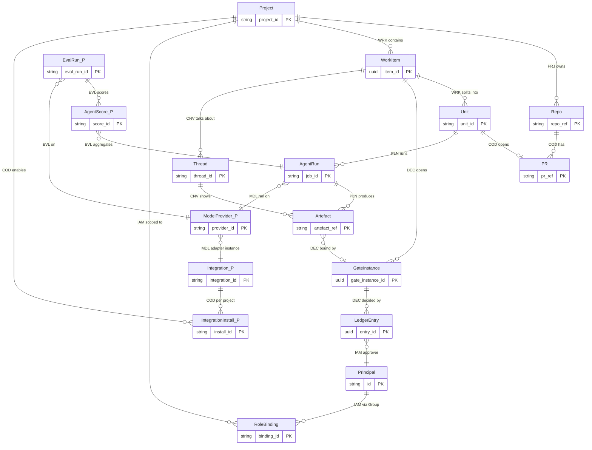

Reading rules for implementers: (a) every cross-context reference is by id through a port or a read model, never by joining another context's tables; (b) `Project` is the root: every item, repo, binding, integration install and eval run is scoped to a `project_id` (or explicitly global); (c) `WorkItem.owner_of_record`, `LedgerEntry.approver` and `Thread` participants are all `Principal` ids (the pseudonymous `oid`).

---

## 4. Adapters and ports model

Principle (AR6, C24; `NORTH-STAR`): the domain talks to the outside only through ports; GitHub, Teams, model vendors are adapters. Some ports already exist as Python `Protocol`s, some as JSON contracts, some not at all. The diagram uses status suffixes: `_B` built, `_X` partial, `_P` proposed (class names must be identifiers).

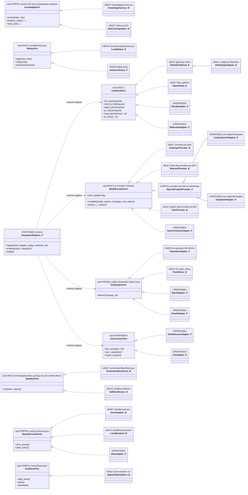

Engine-side ports that already exist in `workflow/wf/ports.py` (all `Protocol`, all with deterministic fakes in the same file): `PlanningPort`, `AdmissionPort`, `ApprovalsPort`, `RecordPort`, `HandoffPort`, `KillPort`, `CodingPort` (`wf/coding/ports.py:10`), `LivePort`, `LeasePort`, `TranscriptPort`, `DeliveryPort`, `BreakerPort`, `CloseOutPort`. Code-host side: `LeaseReader LockReader PatchStore` (`pushgateway.py:64-72`), `LedgerReader EntryVerifier RecordFacts IdentityLinker FactoryProbe PackSource` (`gatecheck_service.py:27-47`), `MarkerSink` (`markers.py:18`), `ManifestSource AttestationVerifier` (`gaterelay.py:170-174`). Runtime: `LeaseStore`, a second `CodeHostPort` (`runtime/.../broker/broker.py:59,77`). These are internal ports (domain to engine); the diagram above shows the external ones that integrations plug into.

### 4.1 Integration and ModelProvider registry entities (all PROPOSED)

Today these concepts are scattered: GitHub App id/installation/key path are env and `RealStack` wiring (`realgh.py:393`), served repos are in-process (`ServedRepos`), provider choice is `routes.json` + env key, health is not tracked per integration. The registry makes them data, per the memory rule "configurable, not hardcoded".

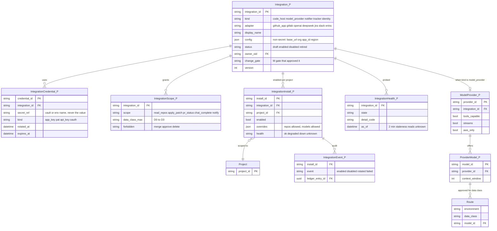

Rules the registry must keep (all already true elsewhere, so they are constraints, not new policy): credentials are references only (secret scan on every write, as `AssistantTurn` does); `IntegrationScope.forbidden` carries the code-host D11 list (`port.py:FORBIDDEN_VERBS`: merge, enqueue, approve, auto_merge, force, delete, dismiss, admin); enabling an integration, widening its scope, or adding a model route to data class D2 or lower is a gated config change (ledger entry `config_publish`); D3 data never has a model route (`routes.json`); health follows the `HealthSnapshot` rule (older than 2 minutes means `unknown`, never green).

**Built in M10.4 (TypeScript, `packages/integrations`; where the build reads this section).** The registry is two factory-layer config keys, `integrations.registry` (Integration rows with `credentials` and `scopes` embedded) and `integrations.installs` (IntegrationInstall rows), so every change is already an M1 gate and a `config_publish`. A `ModelProvider` is an Integration of kind `model_provider` (`provider_id` = `integration_id`, the `tools_capable`/`streams`/`aws_only` facts on the row); `ProviderModel` and `Route` stay `gateway.models` and `gateway.routes`. `Integration.change_gate` is not stored (it would be circular: the gate is decided on the revision's hash); the audit is the IntegrationEvent, derived from the lineage, each naming the ledger entry of the M1 decision. `IntegrationHealth` is one row per (integration, reporter) in `integrations.integration_health`; `IntegrationInstall.health` is not stored either (a tile is computed from the reports). Choices where this section is silent: an absent install means the fleet-wide default (an install row can only narrow: disable, repos or models allowed); the adapter names are `github_app`, `fake_github`, `anthropic`, `openai_compat` (Codex and DeepSeek are rows of it), `fake`; a scope's `forbidden` must list the whole D11 list; a model provider never carries D3.

---

## 5. Agent evals and scoring model

### 5.1 What exists (checked in the repo)

| Piece | Status | Evidence |
|---|---|---|
| Golden task definition | BUILT | `contracts/schemas/golden_task.schema.json`: `kind` in `regression, holdout, pooled, canary, seeded_defect`; `stack` in `python-django, react-js, go, ansible`; `hidden_tests_ref` points into the eval store, never inlined |
| Eval store (golden, holdout, baselines OUTSIDE the repo) | BUILT | `verification/src/fv/evals/store.py` format `asf-eval-store/v1`: signed manifest (ES256), pinned public key in repo (`eval_store.pub.json`), refuses a store inside the repo tree, `planning/tasks/`, `planning/baselines/<provider>.json`, `holdouts/` reserved. Rationale D36: the factory's own agents must never see answers |
| Holdout isolation test | BUILT | `verification/tests/test_vq9_holdout_isolation.py` |
| Planning eval harness | BUILT | `verification/src/fv/evals/planning_eval.py`: `grade`, `TrialResult`, `AgentRunner` protocol, `SuiteResult` (provider, n, per-task pass vectors, `profile_of`, `security_fail`, `cost_usd`, `errored`), `run_suite`, `per_task_pass_k`, `compare` (bootstrap, level 0.90), `gate`, `absolute_floor`, baselines per provider |
| Runner over the real planner + gateway | BUILT | `verification/src/fv/evals/planning_runtime.py` `RuntimeAgentRunner`; CI target `make eval-planning`, test `runtime/tests/test_eval_gate.py` (fake provider, deterministic; blocks on injected regression) |
| Scope selection (which tasks to run for a change) | BUILT | `verification/src/fv/evals/scope.py` |
| Scores surfaced in the UI | PARTIAL | `verification/src/fv/evals/summary.py` -> `GET /v1/evals/summary`, rows `task_id profile suite provider trials passes pass_rate pass_k k status` for Operate > Quality (A3 §5.7); allow-listed fields only (never prompts, outputs or per-task cost) |
| Never loaded into local-prod | BUILT | the store lives under `$FACTORY_EVAL_STORE` outside the repo; `open_store` fails closed; `summary.py` returns no suites when absent |
| Regression eval trigger after incident (B17), planner profile pin | PARTIAL | `FollowUpTimer` B17; `prompts.lock.json`; `AgentContract.contract_version` |

What does not exist: a persisted `EvalRun` history (baselines are overwritten files; `summary.py` reads file mtime as the time), scores keyed by prompt version and model, a link from a score to production `AgentRun`s or to their gate outcomes, and any UI beyond the Operate > Quality list.

### 5.2 Target model (PROPOSED unless marked)

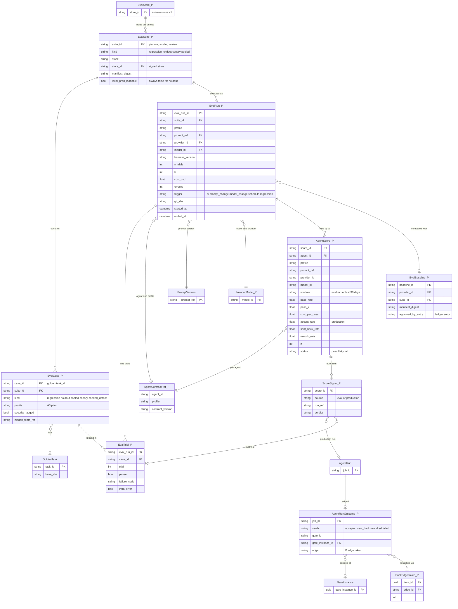

How outcomes are derived without new authority: an `AgentRun` is `accepted` when its artefact is bound by a gate decision `approve`, `sent_back` on `request_changes` or `reject`, and `reworked` when a back-edge (B-edge) took the item to the stage again. Those facts are already on the hash chain (`ledger_entry`, back-edge events); the score is a derived read model, same pattern as `ItemPositionView`. Scoring never approves, selects or promotes anything: swapping a provider or prompt for an agent profile remains a gated change (M1 or M3), with the eval comparison attached as evidence (as `evidence_sufficiency` is for G4).

### 5.3 What the factory UI would show (PROPOSED views over the above)

| View | Content | Source |
|---|---|---|
| Quality board (extends Operate > Quality) | per agent profile: pass rate, pass^k, flaky/fail list by task id, cost per pass, last run time, baseline delta with confidence | `EvalRun`, `AgentScore`, `fv/evals/summary.py` rows |
| Provider comparison | one row per `(profile, provider, model)`: same suite, same k, side by side; "adapter candidate" vs "approved route" | `EvalRun` per provider (baselines already per provider) |
| Prompt history | per `prompt_ref`: score over versions, with `prompts.lock.json` hash, regressions marked | `AgentScore` by `prompt_ref` |
| Production acceptance | per agent: accepted / sent back / reworked rates over 30 days, linked to the floor station the agent works at | `AgentRunOutcome` |
| Floor overlay | the bot at a station shows its profile score chip; a failing score raises an ops banner (`Banner.source=integration`) | `FloorNode` x `AgentScore` |
| Holdout hygiene | store id, manifest digest, signature status, "not loaded in this environment" | `EvalStore` (open_store result) |

---

## 6. Lifecycle state models

### 6.1 WorkItem

States are the union of the engine phase (`workflow/wf/interpreter.py` phases: `new run_stage gates clarifying scheduling children developer handoff held quarantined terminal`), terminal states from the catalogue (`catalogue_model.py:22`: `Done Abandoned Deferred Parked Superseded HandedOverClosed Declined`), the engine hold causes and the floor's `placeItem` states (`floorplan.ts`: done, abandoned, withdrawn, declined, cancelled, closed, quarantined, held, escalated, draft). Stage ids: `S0..S9` with `S8a` observe merge and `S8b` release. Back-edges B1..B28 return to earlier stages.

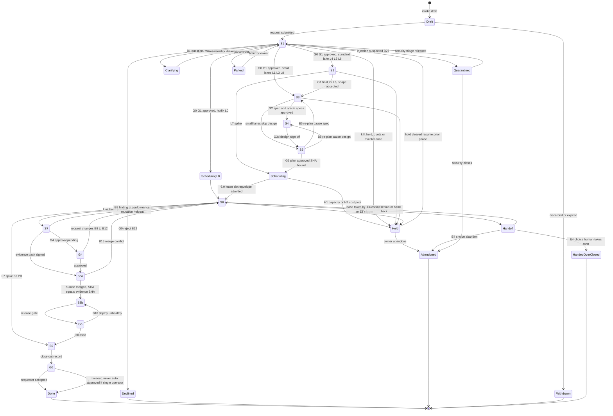

Notes: `Held` and `Waiting` are overlays, not stages: an item keeps its stage and gets a hold (`ItemState.holds`, a `Control`) or a named wait (`path.status = waiting|held|stuck|working|done|declined`, `liveness.py`). The engine resumes the prior phase when the last hold clears (`prior_phase`). Rework budget: all back-edges count to one per-item total (B28 leads to E4). `Superseded`, `Deferred` are catalogue terminals not drawn above for width.

### 6.2 GateInstance

Source: `core/api/services.py` (open at `:~140`, `_end_gate :157`, decide `:571`), `core/api/gate_lifecycle.py`.

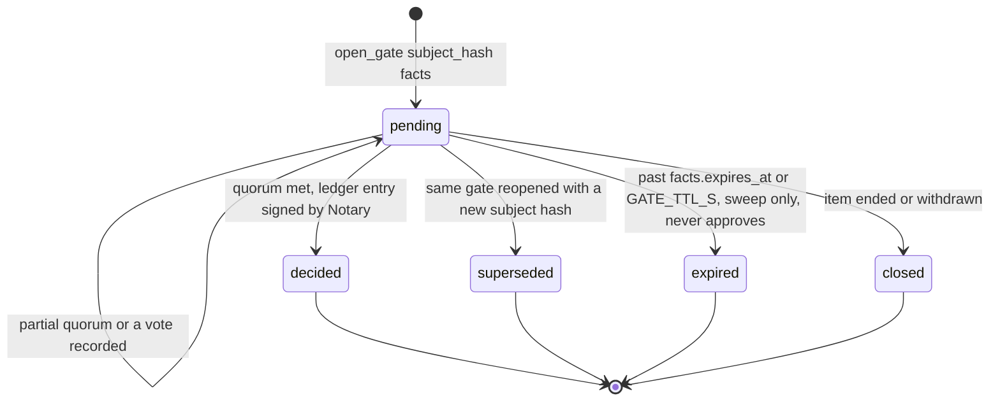

A ledger `decision` value is one of `approve reject request_changes supersede expire withdraw` (`ledger_entry.schema.json`). Step-up nonce and evidence-viewed are server enforced; a decided instance is never touched by the sweeps.

### 6.3 OnboardingRecord (S0)

Source: `core/projects/s0.py:41-43` (`OPEN_STATES = app running card starter`, `END_STATES = done rejected superseded withdrawn`, `WITHDRAWABLE = open + blocked parked rejected`), `core/projects/onboarding/s0.json` (levels census, light, full; steps 0.1 to 0.5; cards C1 C2 C3 C4 C5 SECR BATCH X2). The model's status comment (`core/projects/models.py:37`) omits `withdrawn` and `starter`, see gap 9.

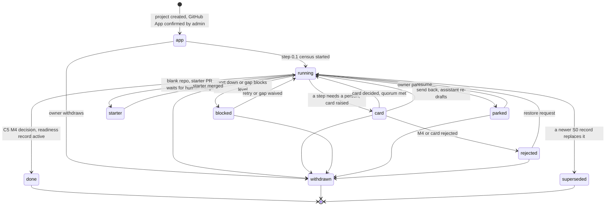

The ReadinessRecord has its own cycle: `proposed -> active` (only an M4 decision) `-> stale | suspended | expired | superseded`; a level change raises a new version (`projects_prr_version_once`).

### 6.4 Unit and Session

A Unit has no table (gap 5); this is the state it carries across `AdmissionGrant`, the lease and the PR. Session states are `common.schema.json#/$defs/sessionState`.

```mermaid
stateDiagram-v2
  [*] --> Planned : S5 plan lists Units in DAG order
  Planned --> Admitted : 6.0 lease epoch, approver slot, envelope reserved
  Admitted --> Building : session starting then running
  Building --> Building : idle waiting_tool interrupted
  Building --> Pushed : Push Broker applied patch with matching epoch
  Pushed --> Verifying : S7 evidence pack for head SHA
  Verifying --> Building : back-edge B9 finding
  Verifying --> InReview : G4 pending
  InReview --> Merged : human merge, SHA equals pack SHA
  InReview --> Building : changes requested
  Merged --> Released : G5
  Released --> [*]
  Building --> HumanHeld : developer takes lease, epoch bumped, agent rows dropped
  HumanHeld --> Building : handback, new epoch
  Building --> Tainted : session tainted by policy
  Tainted --> Quarantined : Q1 quarantine
  Building --> Stopped : kill, budget ET1 ET2, or operator stop
  Admitted --> Released_grant : handoff, item ends, or G4 decided
```

Session (agent runtime) alone: `starting -> running -> {idle, waiting_tool, interrupted} -> ended | stopped | tainted`.

---

## 7. Floor footprint

The floor is a **read model over domain entities**, never an authority. `floor.html` stays the visual reference; the product floor is live only (memory: floor is live-only). Mapping:

| Floor thing | Domain entity | Mechanism (BUILT unless noted) |
|---|---|---|
| Station S1..S9 (S8 = S8a+S8b) | `Stage` | `stageToNode` in `web/packages/vocab/src/floorplan.ts`; stage ids from the catalogue |
| Gate G0G1 G1f G2 G3d G3 G4 G5 G6 | `Gate` + open `GateInstance` | `gateToNode(gate, lane, stage)`; G3s/G3o fold into G3; X, E, M gates have no drawn gate (inbox cards only) |
| Side rooms BIN HOLD QUAR DESK SCHED DONE | item state / `Hold` / quarantine / handoff E4 / scheduling admission | `placeItem(state, stage, openGate, step)`: `held->HOLD`, `quarantined->QUAR`, `escalated->DESK`, `S6 step 6.0->SCHED`, terminals `->DONE or BIN` |
| Lane route (L0, L1-3, L4-5, L6, L7, L8) | `Lane` (catalogue) | `laneToPage`; `FLOOR_LANES.route` is a hand-copied route list (see gap 12) |
| Item chip | `WorkItem` via `ItemPosition` | `observe_item_position` (content free: never title or request text); chip label from item key |
| Live agent bots at a station (A, D, H markers) | `Session` (`SessionActivityView`) | `floor.agents`, `session.*` events, keyless towards the floor (no item key, title, content) |
| Heartbeat and stuck | `Heartbeat` + step-kind thresholds | `liveness.status` (`working waiting held stuck done declined`); stuck sweep records `item.stuck / item.unstuck` events |
| Flow arrows and back-edges | `FlowWindow` | hourly counts `F forward, B back-edge, R re-lane` |
| Kill switch, holds, clamps, banners | `KillSwitch`, `Control`, `Banner`, `OpsAction` | scopes session item project role model fleet (kill) vs fleet team project lane release budget (controls), see gap 8 |
| Project rows, restricted projects | `Project`, `ProjectMeta` | `floor.fleet(...)` groups by project with an opaque key; confidential projects are collapsed (FD-D6) |
| Gate feasibility badge | `GateFeasibility` | `observe_gate_feasibility` |
| Agent score chip (PROPOSED) | `AgentScore` | section 5 |
| Integration health tile (PROPOSED) | `IntegrationHealth` | section 4.1 |

```mermaid
flowchart TB
  subgraph DOMAIN["Domain (authoritative)"]
    RE["RecordEvent stream"]
    LE["LedgerEntry"]
    CAT["Catalogue: lanes, stages, gates"]
    CTL["Control, KillSwitch"]
    SES["Session events"]
  end
  subgraph READ["Floor read models (rebuildable from the record)"]
    POS["ItemPosition"]
    FLW["FlowWindow"]
    SAV["SessionActivity"]
    HB["Heartbeat (non-chain)"]
    GF["GateFeasibility"]
    HS["HealthSnapshot"]
  end
  subgraph VOCAB["Floor plan constants (vocab package)"]
    NODES["FloorNode: stations, gates, zones"]
    LANES["FloorLane: routes and colours"]
    PLACE["placeItem, stageToNode, gateToNode"]
  end
  subgraph VIEW["Floor view (portal)"]
    CHIPS["Item chips on the belt"]
    BOTS["Agent bots in pods"]
    GATES["Gate marks and queues"]
    ROOMS["Hold, Quarantine, Desk, Scheduler, Bin"]
    OPS["Kill, hold, banner controls"]
  end
  RE --> POS
  RE --> FLW
  SES --> SAV
  SES --> HB
  LE --> GF
  CAT --> PLACE
  CAT -.->|"should generate"| LANES
  POS --> PLACE
  PLACE --> CHIPS
  PLACE --> GATES
  PLACE --> ROOMS
  NODES --> CHIPS
  LANES --> CHIPS
  SAV --> BOTS
  HB --> BOTS
  GF --> GATES
  CTL --> ROOMS
  CTL --> OPS
  HS --> OPS
  OPS -->|"PDP then OpsAction then ledger"| CTL
```

Interaction rule: every action on the floor (click an item, decide a gate, pause a lane, stop a session) is a button that calls a normal route; the PDP decides, the floor holds no authority. This matches the Conversation rule (actions only through buttons).

---

## 8. Gaps and tensions found (ranked by damage to modularity)

Rank 1 is the most harmful. Line numbers are from the repo at the time of reading.

| # | Gap | Evidence | Why it hurts | Fix direction |
|---|---|---|---|---|
| 1 | **No Project/Repo/Unit/Team aggregates; ids are loose strings.** `project_id` is `CharField(255)` on every table with no FK (`core/record/models.py:67`, `core/lifecycle/models.py:20,37,55`, `core/frontdoor_observe/models.py:23`); the project itself is a JSON `doc` (`core/projects/models.py:5`); `Repo` has no table; `Unit` has no table (id only in `AdmissionGrant.unit_id` `lifecycle/models.py:52`, branch name `codehost/.../branches.py:20`, `StageRequest.unit_id` `workflow/wf/types.py`); `Team` is a string (`observe/models.py:24`); `Binding.scope_kind` lists `repo`, `team`, `org`, `environment` (`identity/asf_identity/rbac.py:101`) with no entity behind them | files above | scopes, floor rows, integrations, evals and the wizard all need a typed Project/Repo/Unit; today each reconstructs it | normalise Project, Repo, Unit, Team as typed read models first (step 1) |
| 2 | **Project configuration split across five stores.** (a) `ProjectRecord.doc` `core/projects/models.py:5` (name, repo, stack, level, `role_map`, `gating`, `two_person`, `kill_delegations`, `core/projects/settings.py:75,122`); (b) `ProjectMeta` `observe/models.py:22` ("interim"); (c) knowledge `projects` and `ledgers` `knowledge/.../onboarding.py:65-66`; (d) the readiness doc `ReadinessRecord.doc` `projects/models.py:17` repeats `role_map` and `gating_profile` (`onboarding.schema.json#/$defs/prr`); (e) identity bindings `rbac.py:97` and `service_grants.yaml` | as listed | a role-map edit must keep (a) (d) and (e) in sync; today `core/projects/settings.py:6` does it by emitting `role_map_change` access events by hand | one `ProjectSettings` typed record; role map expressed as `RoleBinding` rows with PRR a signed snapshot, not a second copy |
| 3 | **Project role map is not the RBAC model.** `role_map` has ten keys (`admin requesters intent design g4 g5 x sec m4 kill`, `project_records.schema.json#/$defs/role_map`) mapping to people, while identity roles are group+binding+scope with 20+ roles (`policy/roles.yaml`). The translation lives in code, not data | `core/projects/s0.py:722`, `settings.py:75`; `s0.json card_role` | "who can do what" in the front end has two vocabularies; wizards cannot show effective access without both | declare `ProjectRoleSlot -> Role` mapping as config; generate bindings |
| 4 | **Assumption has four shapes.** (1) thread DTO `{id,text,source engine\|intent\|plan,state open\|overridden}` (`request_thread.schema.json#/$defs/assumption`); (2) event `item.assumption_raised {assumption_id, text_hash}` and `item.assumption_accepted` (`core/frontdoor_work/projector.py:260,269`, doc key `assumptions_accepted` `:212`); (3) agent output `assumptions` arrays in `spec.v1.schema.json:129`, `design.v1.schema.json:224`, `plan.v2.schema.json:220`; (4) derived from intent `open_questions` (`core/assistant/thread.py:7`). Same for Question (event, `ConsoleTurn`, `questions.v1`, `question.schema.json`) | as listed | thread, planner and engine each need adapters between shapes; an assumption cannot be traced from agent output to override | one `Assumption` entity (id, item, origin run, text_hash, state, overridden_by) fed by all four |
| 5 | **Handoff id vs E4 gate-instance id.** The engine mints `handoff_id = uuid5(HO_NS, item:ho:n)` (`workflow/wf/workflow.py:317-318`); core's choose route treats `handoff_id` as the E4 gate instance (`core/lifecycle/handoff.py:255,270`); the projector keeps both (`handoff_e4 = e4_gate_instance_id`, `core/frontdoor_work/projector.py:384`). The pack is yet another key `handoff-pack:<n>:<code>` (`handoff.py:111`) | as listed | one concept, three ids, joined by event payload convention; already caused a live defect (comment at `handoff.py:101`) | `Handoff` entity with one id; `e4_gate_instance_id` and `pack_id` as attributes |
| 6 | **Entities that exist only as events or JSON with no schema or table:** Proposal, Artefact (`proposal.accepted` events; `artefacts.schema.json` is a response shape), Question, HandoffPack, GateVote/quorum (computed), PullRequest, Unit, AgentRun (partial in `ObserveJob`), ModelCall (event), Repo, Census (`ledgers.body` text JSON), OnboardingStep/Card (`doc` blob), Gap (`doc`), OracleLock (file in a repo) | see section 3 tables | cannot query, join, evolve or give a stable UI link; schema drift hides inside `doc` | promote the high-traffic ones to typed read models in section 9 order; keep events authoritative |
| 7 | **Two `CodeHostPort` protocols with the same name.** Domain port `codehost/asf_codehost/port.py` (`list_repos read_at_sha apply_patch pr_status`) and the broker's own `CodeHostPort` in `runtime/src/asf_runtime/broker/broker.py:77` plus `InMemoryCodeHost:81`. Webhook inbox is also duplicated: Django `CodehostInbox` (`core/record/models.py:142`) and sqlite `cha_inbox` (`codehost/asf_codehost/inbox.py:44`) | as listed | an adapter for GitLab would have to be written against two shapes | one port module in a shared package; one inbox |
| 8 | **Three vocabularies for scope and two for the kill switch.** Kill scopes `session item project role model fleet` (`security/.../killswitch/core.py:~29`) vs `Control.scope_kind` `fleet team project lane release budget` (`observe/models.py:200`) vs `Binding.scope_kind` `enterprise org team project repo service_env environment` (`rbac.py:101`) vs `ProjectMeta.team_id`. Kill state is in sqlite (`kills`, `kill_events`), core mirrors it in `Control`/`OpsAction`/`KillReleaseApproval` | as listed | a floor control, a role binding and a kill each name a scope differently | one `Scope(kind, ref)` value type used by Binding, Control, Kill, Budget |
| 9 | **Status enums live in comments, and drift.** `OnboardingRecord.status` comment (`core/projects/models.py:37`) lists 8 values, code uses `starter` and `withdrawn` too (`core/projects/s0.py:41-42`); `GateInstance.status` default `pending` with the other values only in `api/services.py` (`decided superseded expired closed`); ledger decision enum includes `supersede expire withdraw`, gate status says `superseded expired closed` | as listed | the UI vocab, tests and projections each re-list them | enums as contract (`$defs`) and generated TS/Python (the `contracts/gen_artifacts.py` pattern exists) |
| 10 | **Identity is a separate store with `oid` strings everywhere.** `records(kind, rec_id, doc)` for principals (`identity/asf_identity/journal.py:46`); core uses `actor_oid`, `principal_oid`, `approver_oid`, `owner_oid` as plain strings (`record/models.py:76,129`; `frontdoor_work/models.py:73,86`; `observe/models.py:143`). Principal docs are untyped JSON in the journal | as listed | fine as a service boundary, but there is no Principal read model in core, so name resolution, picker and wizard each call identity | `Principal` read model in core (handle, display, kind, status) fed by `access` events |
| 11 | **No Integration or Provider registry; adapters selected by env and code.** GitHub App wiring in `realgh.py:393 RealStack`; gateway routes in static `routes.json` ("C18 registry" referenced, not built); teams outbox destination hard-coded (`core/record/sinks.py:311`); outbox `destination` has two values in code (`teams`, `temporal_start`) with no registry | as listed | adding Codex, DeepSeek, GitLab or Slack means code edits, not data | section 4.1 |
| 12 | **Floor plan constants duplicate catalogue facts.** `FLOOR_LANES[*].route` lists station and gate sequences per lane and `FLOOR_ST` station names are hand-copied from the user's `floor.html` (`web/packages/vocab/src/floorplan.ts`), while the catalogue already defines `lanes` with stage subsets and gate positions (`catalogue/catalogue-v0.1.0.yaml` header). `core/frontdoor_observe/catalogue_index-v0.4.1.json` is a third derived copy | as listed | a catalogue bump can silently disagree with the drawn route | generate `FloorLane.route` from the catalogue; keep geometry as the only hand data |
| 13 | **Evals have no persisted run history.** Baselines are per-provider overwritten files; the Quality list uses file mtime as `at` (`verification/src/fv/evals/summary.py:42`); two task loaders (`fv/evals/golden.py` for `golden_task.schema.json` and `planning_eval.load_tasks`) | as listed | no trend, no per-prompt or per-model score, no link to production outcomes | section 5.2 `EvalRun` first |
| 14 | **Lease epoch has three copies.** Code-host `LeaseTable` (`codehost/asf_codehost/runtime.py:50`, file), `AdmissionGrant.lease_epoch` (`core/lifecycle/models.py:55`), `ItemState.lease_epoch` (engine) and `StageRequest` | as listed | tolerable now (epoch only increases, stale writes refused) but a Unit entity should own it | `Unit.lease_epoch` as the single reader's view |
| 15 | **"Session" means four things.** agent runtime session (`SessionActivityView`), sandbox session (`sandbox_session.schema.json`), gateway key scope `VKey.scope = session or job id`, browser session (`bff.session`) | as listed | naming only, but it confuses UI and docs | rename: `AgentSession`, `SandboxRun`, `KeyScope`, `LoginSession` |
| 16 | **Card and inbox twins.** `InboxEntry` (`fd_inbox_entry`, `card_instance_id` unique) mirrors Teams `card_twins` in the bot's own schema (`core/cards/registry.py:72-86`) | as listed | two stores must agree; Teams is on hold so the cost is deferred, not removed | portal inbox is authoritative; the Teams twin becomes a `NotificationDelivery` |
| 17 | **Agent id table incomplete.** `AGENT_NAMES` names `A1..A6`, `coder` (`liveness.py:25`); `CONTRACTS` only `A1 A2 A3` and profiles (`planner/agents.py`) | as listed | an A4/A5/A6 score or contract has no home | `AgentDefinition` typed registry |

Not found (checked, absent): any `Integration`, `ModelProvider` registry table; any persisted `EvalRun`; any `Team`/`Org` table; any `Unit` or `Repo` table; any per-project `ServiceEnv` entity.

---

## 9. Recommended target model and build order

Guiding rules: events and the ledger stay authoritative (do not give new entities independent write paths unless they are config); new typed entities start as **rebuildable read models** or **config rows**; one context at a time; every step is small, keeps existing contracts, and lands with a rebuild-from-record test (the pattern used by `rebuild_frontdoor_work`, `rebuild_models`).

Target shape: Project is the root; Repo and Unit are first class; Scope is one value type; Principal has a read model in core; Integration and ModelProvider are registries in front of existing ports; evals have run history and a derived score.

Build order (each step unlocks the front-end item in brackets):

| Step | Normalise | Small deliverables | Unlocks |
|---|---|---|---|
| 1 | **Project, Repo, Team read models** (gap 1, 2) | typed `Project(project_id, name, team_id, classification, stack, level, owner, version)` and `Repo(repo_ref, project_id, host, default_branch, stack, onboarding_level)` as projections of the existing `project:<id>` events; `ProjectMeta` folded into it; FK from `work_item_projection.project_id` | onboarding wizard (reads one Project), floor project rows, per-project integration enablement |
| 2 | **Scope value type and enum contracts** (gap 8, 9) | `Scope{kind,ref}` in `common.schema.json`; enums for statuses (`OnboardingStatus`, `GateStatus`, `SessionState`) generated into Python and `@asf/vocab` | access screens (one vocabulary), kill and control UI |
| 3 | **Unit entity (read model)** (gap 1, 14) | `Unit(unit_id, item_id, repo_ref, branch, lease_epoch, head_sha, pr_ref, state)` folded from `lease.*`, `session.*`, `pr.*` events and `AdmissionGrant` | PR and Unit views, floor pods, eval/outcome links, G4 conflict facts |
| 4 | **Principal read model + ProjectRoleSlot mapping as config** (gap 3, 10) | core `Principal` view (handle, display, kind, status); declarative `role_map slot -> role + scope` and generated bindings; effective-access explain screen reads it | user access (who can do what), onboarding role step |
| 5 | **Handoff and Assumption entities** (gap 4, 5) | one `Handoff` id; one `Assumption` shape fed by all four sources | request thread, E4 desk, planner traceability |
| 6 | **Integration registry + IntegrationInstall + health** (gap 7, 11) | tables per 4.1; first adapter instance = existing GitHub App as data; one `CodeHostPort` module; one webhook inbox; health tiles per integration | "integrations as adapters" UI; GitLab/Slack/Jira later as new adapter classes |
| 7 | **ModelProvider registry in front of `routes.json`** (gap 11) | `ModelProvider`, `ProviderModel`, `Route` as config rows published through `config_publish`; `OpenAICompatProvider` gets streaming; Codex and DeepSeek become registry rows plus thin adapters; D3 stays empty by rule | model-provider adapters; budget and route screens |
| 8 | **AgentDefinition + AgentRun + AgentRunOutcome** (gap 6, 17) | `AgentRun(job_id, item_id, profile, prompt_ref, provider, model, tokens, cost, state)` from `proposal.*`, `job.failed`, gateway meter events; outcome from gate decisions and back-edges | evals on production, acceptance rates, cost per agent |
| 9 | **EvalSuite / EvalRun / AgentScore** (gap 13) | persist each run (extends `SuiteResult.to_json`); score read model per `(profile, prompt_ref, provider, model)`; keep the signed out-of-repo store; extend `GET /v1/evals/summary` | Quality board, provider comparison, prompt history, floor score chips |
| 10 | **Catalogue-generated floor and LaneProfile** (gap 12) | generate `FloorLane.route` and gate list from the catalogue index; one `LaneProfile` object | floor stays correct across catalogue bumps |
| 11 | **Notification port** (gap 16) | `NotificationDelivery` entity; Teams adapter resumes behind it when un-held; Slack/email as adapters | multi-channel nudges without touching the inbox |

Dependencies: 1 before 3, 4, 6; 2 before 4 and 6; 3 before 8; 6 and 7 are independent of each other once 1 and 2 are done; 8 before 9. Steps 1 to 4 need no new external dependency and no migration of events. Nothing here touches the gate kernel, the Notary or the hash chain.

Open questions for the user (decisions that change the model, not blockers):
1. Is `Team` an organisational entity the factory owns, or a label imported from Entra? (changes step 1 and the binding scope)
2. Should the project role map stay the user-facing form (ten slots) with bindings generated, or should the wizard edit bindings directly?
3. Are evals per project or per factory? Today the eval store is factory wide and golden tasks carry an optional `project`.
4. Should one `Integration` entity cover both model providers and code hosts (as drawn), or two registries with a shared health shape?

---

## Appendix A. Entity census (by status)

Counts below are over the context tables in section 3 (the cross-context diagram repeats, it adds none). "BUILT (config)" counts as BUILT.

| Context | BUILT | PARTIAL | PROPOSED |
|---|---|---|---|
| 3.1 Identity and Access | 14 | 2 | 2 |
| 3.2 Projects and Onboarding | 4 | 11 | 2 |
| 3.3 Work | 13 | 7 | 0 |
| 3.4 Decisions and Ledger | 13 | 1 | 0 |
| 3.5 Planning and Agents | 6 | 6 | 2 |
| 3.6 Code and Integrations | 8 | 7 | 2 |
| 3.7 Knowledge | 9 | 1 | 0 |
| 3.8 Model Providers | 5 | 3 | 2 |
| 3.9 Conversation | 3 | 3 | 2 |
| 3.10 Floor and Observability | 19 | 0 | 0 |
| 3.11 Configuration | 10 | 5 | 0 |
| 3.12 Audit | 7 | 0 | 0 |
| **Total (context tables, with repeats across contexts)** | **111** | **46** | **12** |
| Additional PROPOSED in 4.1 (registry detail) and 5.2 (evals) | 0 | 0 | about 16 (`IntegrationCredential IntegrationScope IntegrationHealth IntegrationEvent ProviderHealth EvalSuite EvalCase EvalRun EvalTrial EvalBaseline AgentScore ScoreSignal AgentRunOutcome BackEdgeTaken AgentContractRef EvalStore`) |

Some entities appear in two contexts (for example `Repo`, `EvidencePack`, `Draft`, `LedgerEntry`); the owner is the context named in the section 2 ownership list.
