# Onboarding (S0) roadmap: guide, standard and build plan

Editor's synthesis of the onboarding roadmap council, 2026-11-06. **Plan only: nothing was built or changed.** Every schema, rule table and route below is a SPECIFICATION.

**Inputs:** frame.md and the six positions. Round-2 answers override round 1 wherever they differ.
- [CS] current-state.md, [STD] standard.md, [SEC] security.md, [PROC] process.md (including "Revised roadmap")
- [SKP] skeptic.md, [FID] fidelity.md
- Also council-board.md (CB) and flow-corrected.md (FLOW)

**Citation keys:**
- `FLOW:n` = /home/reshif/aisdlc-council/flow/flow-corrected.md
- `CB:n` = /home/reshif/aisdlc-council/council-board.md
- `DED:n` = DomainExpertDocument-v1.2.md
- `ARCH:n` = ArchitectureDocument-v1.0.md
- Bare code paths are relative to /home/reshif/ai-software-factory, main @ `0653de7`. `a3/<branch>:` marks an unmerged branch.

**Name clashes, fixed in this document:**
- "R3" means the flow's **R3 circuit breaker** (ET14, FLOW:251). Roadmap phases are written **phase R3**.
- The DED's readiness levels "L1..L4" (DED:1722) are written **RL1..RL4**, so they don't read as lanes L1–L8.
- Light floors are numbered **LF1..LF8** (standard R2-9 called them L1..L8, which collides with the lane names).
- "M4" always means the **onboarding sign-off gate**, never the DED:231 member decision.

---

## 1. Summary

1. **What "onboarded" means.** The repo has an **active Project Readiness Record (PRR)** that a human signed at **M4**. The PRR is hash-bound and holds the level (Census, Light or Full, judged per area), the tier (T0–T2), the four readiness pillars, the autonomy cap and the lanes that are open.
   - No active PRR: items for the repo are **held (N8)**.
   - PRR level too low for the lane: items go to **human-led L8** through a deterministic rule at 1.4.
2. **The minimum safe path to the first onboarding:**
   - **phase R0:** cheap fixes to code we own, plus **4 spikes** (SP-FID-1, SP-FID-2, SK-1, SEC-OB-2). No engine change, no downloads.
   - **phase R1a:** read-only Census of the public testbed. GitHub sees GETs only, and the gaps live in the PRR. It needs DEC-5 and an M3+Security review of codehost CR #5.
   - **phase R1b:** a reduced 0.4, one SOLO 0.5+M4 card (gate subject = the S0 record UUID), and the **eligibility producer**, so agents are kept off unready repos by code.

   That is a Census onboarding. It opens no agent-written code.
3. **Agent code (Light, lanes L1–L3) requires:**
   - the **8 Light safety floors**;
   - fixes for three blockers no wave-1 position found [FID 2.2]:
     - the Push Gateway refuses AGENTS.md, CODEOWNERS and `.factory/**`;
     - gate-check can never pass an S0 or human PR;
     - in SOLO, no PR the user pushes to can ever merge [SKP A1]. The same holds for **human-led L8**, which has no merge path until DEC-10 gives it one.

   Light is split: **phase R2a** signs Light; **phase R2b** (the first remediation PR) waits for identity-3 and workflow-o1, and identity work is dropped.
4. **The factory's own repo.** The council's proposed first target is **Census + M4 + human-led L8**. Tier T2, the GitHub plan, the probe and the single-repo allow-list all hold it there. This reshapes the user's dogfood goal, so it is **DEC-26**. Under it, no factory-authored change reaches the factory repo before phase R7 unless the user records an exception.
5. **Decisions (§12): 30 in total (DEC-27..30 already decided by the user, §12.6), numbered DEC-n** so they don't clash with the user's own D-ids (D11, D23, D37…).
   - **Decide now, for R0–R1b (§12.0): 10 items.** Seven to decide (DEC-1, DEC-4, DEC-5, DEC-6, DEC-7, DEC-8, DEC-9) and three to confirm (DEC-2, DEC-3, DEC-14).
   - The other 16 are raised at the start of the phase that needs them (§12.3–§12.5).

---

## 1A. Walkthrough: what happens when you onboard a new project

This is the **target behaviour** once phases R0–R2a are built. Details are in §6 (steps and cards), §4 (trust), §5 (security), §7 (issues) and §8 (after onboarding).

```mermaid
flowchart TB
  classDef you fill:#e8f5e9,stroke:#2e7d32,color:#000;
  classDef fac fill:#e3f2fd,stroke:#1565c0,color:#000;
  classDef card fill:#fff3cd,stroke:#d4a017,color:#000,font-weight:bold;
  classDef bad fill:#fde2e2,stroke:#c0392b,color:#000;
  classDef term fill:#eeeeee,stroke:#424242,color:#000;

  START(["You: 'Onboard repo X'<br/>in the portal, pick target level<br/>Census / Light / Full"]):::you
  APP["You: install the factory GitHub App<br/>on that repo only"]:::you
  START --> APP --> ACC

  ACC{"Factory: access OK?<br/>App installed, read-only token works"}:::fac
  ACC -- "no" --> WAITAPP["Waits: 'App not installed'<br/>requests for this repo are held"]:::term
  ACC -- "yes" --> COPY

  subgraph S01["0.1 CENSUS (always)"]
    COPY["Factory: credential-free copy<br/>of the repo into its own store<br/>(GitHub sees reads only)"]:::fac
    SCAN["Factory: secret scan of FULL git history<br/>stack, build/test commands, owners,<br/>CODEOWNERS, risk tier T0–T2,<br/>which agent-instruction files exist"]:::fac
    PROBE["Factory: build + test probe<br/>in the locked sandbox<br/>(no creds, no internet)"]:::fac
    GAPS["Factory: gap list<br/>each gap = blocking or fix-later"]:::fac
    C1["CARD 1 (you): confirm owners and tier<br/>say 'no prod, no real data' if T0<br/>decide each gap: fix now / later / accept"]:::card
    COPY --> SCAN --> PROBE --> GAPS --> C1
  end

  SECRET{"Secret found<br/>in history?"}:::bad
  SCAN -.-> SECRET
  SECRET -- "yes" --> SC["SECURITY CARD (you):<br/>value never shown, never in an issue<br/>you rotate the key, then mark 'rotated'<br/>until then: Light/Full blocked"]:::bad

  C1 --> LVL{"Target level?"}:::fac

  subgraph S02["0.2 LIGHT (if asked): unlocks agent work L1–L3"]
    L1["Factory: shallow code map<br/>≤50 key claims about the repo, each with evidence<br/>draft AGENTS.md as a DIFF of the existing one<br/>~15 intent questions, operations.md draft"]:::fac
    C2["CARD 2 (you): affirm / correct each claim<br/>answer intent questions<br/>approve the AGENTS.md text (step-up login)"]:::card
    L1 --> C2
  end

  subgraph S03["0.3 FULL (if asked): unlocks L4–L6"]
    F1["Factory: full code map, system map,<br/>spec seeds, exam on the repo"]:::fac
    C3["CARD 3 (you): longer intent interview,<br/>grade the exam, affirm specs"]:::card
    F1 --> C3
  end

  LVL -- "Census" --> R04
  LVL -- "Light / Full" --> L1
  C2 -- "Light" --> R04
  C2 -- "Full" --> F1
  C3 --> R04

  subgraph S04["0.4 CONTROLS (always)"]
    R04["Factory: reads repo settings<br/>branch rules on main, required checks,<br/>App permissions, protected paths"]:::fac
    C4["CARD 4 (you): attest what factory can't read<br/>no bypass on protect-main, App scope,<br/>secret scanning on<br/>confirm WHO CAN DO WHAT (role map,<br/>proposed from CODEOWNERS + collaborators)<br/>YOU fix settings on GitHub; factory re-checks"]:::card
    R04 --> C4
  end

  subgraph S05["0.5 SIGN-OFF + M4 (always)"]
    PKG["Factory: Readiness Record<br/>level, tier, caps, open lanes, gaps<br/>hash-bound"]:::fac
    C5["CARD 5 (you): sign-off + M4<br/>one card, two ledgered decisions<br/>never auto-approved"]:::card
    PKG --> C5
  end
  C4 --> PKG

  C5 -- "send back" --> PKG
  C5 -- "approve" --> READY(["PROJECT READY<br/>requests flow into S1 for the open lanes"]):::term

  PR["Factory: opens ONE onboarding PR<br/>(AGENTS.md, CLAUDE.md -> @AGENTS.md, knowledge pack,<br/>CODEOWNERS)<br/>you never push to it: edits go via cards<br/>YOU approve + merge on GitHub"]:::fac
  C2 -.-> PR

  ISS["Fix-later gaps → GitHub Issues<br/>you approve the batch once<br/>factory closes one only after verifying the fix<br/>public repo: no security issues"]:::fac
  READY -.-> ISS

  subgraph AFTER["AFTER ONBOARDING"]
    DRIFT["Factory polls (no webhooks):<br/>AGENTS.md changed → 'unaffirmed', re-approve card<br/>protect-main loosened → record suspended,<br/>new work goes human-led until fixed"]:::fac
    ROUTE["New request for this repo:<br/>no record → waits (N8)<br/>level too low for lane → human-led L8<br/>level OK → normal lifecycle"]:::fac
  end
  READY --> ROUTE
  READY -.-> DRIFT
```



**Legend:** green = you · blue = the factory · yellow = a card in your portal inbox · red = security · grey = a waiting or end state.

### In plain words

**You do 2 things to start:**
1. **In the portal:** ask to onboard the repo and pick a level.
   - **Census:** the factory understands the repo; people do the work.
   - **Light:** agents may do small work (L1–L3).
   - **Full:** agents may do features (L4–L6).
2. **On GitHub:** install the factory App on that one repo.

**The factory then works mostly on its own:**
- It copies the repo into its own store. It only reads from GitHub and never writes during Census.
- It scans the **full history for secrets**, works out the stack and commands, finds the owners, and sets a risk tier.
- It runs the build and tests in the **locked sandbox**, which has no credentials and no internet.
- It produces a **gap list**, each gap marked "blocks this level" or "fix later".

**Then you get cards in your inbox:**
- **Census: 3 cards.**
  - **Card 1:** confirm owners and tier, and decide each gap.
  - **Card 4:** confirm the settings the factory can't read, and fix them on GitHub yourself, since the factory never changes repo settings. Also confirm **who can do what** on this project (the role map, §1B): the factory proposes it from CODEOWNERS and the collaborators, and you adjust it.
  - **Card 5:** sign off (M4).
- **Light adds card 2:** check the factory's claims about your repo, answer about 15 intent questions, and approve the AGENTS.md text with the step-up login.
- **Full adds card 3:** a longer interview, plus grading the exam and the spec seeds.

**What comes out:**
- **A readiness record:** level, tier, which lanes are open, and the gaps.
- **One onboarding PR** with AGENTS.md, the knowledge pack and CODEOWNERS. The factory writes it; you approve and merge it on GitHub. You never push to it yourself, because GitHub won't let you approve a PR you pushed to.
- **Fix-later gaps become GitHub issues** after you approve them as a batch.

**If something is wrong:**
- **A secret in the history:** a separate security card. The value is never shown and never goes in an issue. You rotate the key, and until then the repo can't go beyond Census.
- **A missing setting:** you fix it on GitHub and press re-check.
- **You don't answer:** the onboarding parks after 5 business days.

**After onboarding:**
- **Requests for the repo are routed by its record.** With no record they wait. If the level is too low for the lane, the work goes to a person (L8). Otherwise it follows the normal lifecycle.
- **The factory keeps checking the repo.** If AGENTS.md changes, the factory keeps using the version you approved and sends you a re-approve card. If someone loosens protect-main, agent work is suspended until it's fixed.

**Agents always ignore the repo's own agent config files.** They use only the AGENTS.md text you approved.

**What exists today vs. this target:** Census analysis runs on main. Still missing: the sign-off card, GitHub access for the knowledge service, the onboarding PR path and the issues. Those come in phases R0–R3 (§10), once the decisions in §12.0 are made.


## 1B. Per-project roles (user decision 2026-11-06; supersedes the factory-wide single-operator switch)

**Why:** one factory-wide single-operator mode made the system rigid. Roles are now set **per project at onboarding**, giving each project a clear, agreed answer to "who can do what".

**What onboarding adds (lands in 0.1 and card 4, signed at M4):**
1. **Proposed from GitHub:** CODEOWNERS (path owners, which become the G4 reviewers) and repo collaborators with their GitHub permission. Read-only; RECORDED if unreadable (SP-FID-2).
2. **Asked on the card:** who may request work · who approves intent/spec (G0/G1/G2) · design and plan (G3d/G3/G3s) · merge (G4 = code owners on GitHub) · release (G5, step-up kept) · acceptance (G6) · exception gates (X1/X2/E2) · onboarding sign-off (M4) · **project admin** · **kill-switch holders**.
3. **Stored in the Project Readiness Record** as a `role_map`, hash-bound and signed at M4. Any later change is a ledgered decision by the project admin and re-binds the record.

**Rules:**
- **Single-operator is automatic, per role.** If a role has one person, that person decides alone and the decision is stamped `sod_waiver`. The global `FACTORY_OPERATING_PROFILE` remains only as the default for projects without a role map.
- **Two-person rules** (X1, X2, E2, kill release, M4) are a **per-project setting** chosen at onboarding. They default to ON when 2+ people hold the role. **A T2 project cannot turn them off.**
- **Kill switch.** A project kill can be requested only by the project admin or a **delegated holder**. Delegation is granted by the project admin, lasts **until revoked**, and is ledgered. Release follows the project's two-person setting. **Fleet (whole-factory) kill is factory-admin only**: it is not on project floors.
- **Floor.** One floor per project (project picker). The kill button shows only to holders of that project's kill permission (the PDP decides, not the UI).

**Build placement:** after the current core flow work merges. It touches identity (the RBAC hold is lifted for this piece only). It adds to phase R1b (role map on card 4, the M4 binding) and needs new decisions on the PDP policy shape. Those decisions will be raised at R1b.

**New decision ids:** DEC-27 role map at onboarding (decided: adopt) · DEC-28 two-person rules per project, default on, T2 locked (decided) · DEC-29 kill delegation until revoked (decided).


## 1C. Per-project gating profile (user decision 2026-11-06)

**Why:** a fixed set of human gates in every project means too many clicks, especially for one operator. Which human gates a project has is **chosen at onboarding** (card 4), like the role map (§1B), above a fixed safety floor.

| Always required (no project can turn it off) | Chosen per project at onboarding (defaults in brackets) |
|---|---|
| **G4** merge: human review and merge on GitHub; the factory never merges (D11) | **G0+G1** triage + intent card [on] |
| **X1 / X2 / X3** action gates (destructive, protected path, new dependency) | **G2** spec + oracle specs [on for L4–L6, off for L1–L3] |
| **E-gates** (E1–E6: exceptions, extensions, test-change requests) | **G3d** design / threat review at 4.6 [on for L4–L6] |
| **Q1** security triage after quarantine | **G3 / G3s** plan approval [on for L4–L6] |
| **M4** onboarding sign-off | **5.7 scheduling** [**automatic**: lease + slot + envelope, FIFO by priority] |
| Verification 7.1–7.6 in every lane (automatic, not a human gate) | **G5** release [on if the project deploys; off otherwise] |
| | **G6** requester acceptance [on; off when requester = operator] |

**Rules:**
- **Off means absent, never auto-approved.** Turning a gate off removes it from that project's lane profiles. A gate that exists always needs a human decision (INV-NO-AUTO-APPROVE unchanged).
- **Tier floor.** A **T2** project cannot turn off G2, G3d or G3 for L4–L6, or G5 where it deploys. T0/T1 may.
- **Stored in the PRR** as `gating_profile`, hash-bound and signed at M4. Changes are a ledgered decision by the project admin and re-bind the record. Items pin the profile they started with; a change applies to new items only.
- **Engine.** The lane profile bound at G0 (FIX 7) takes its gate set from the project's `gating_profile`. Card consolidation (§6.3) works over whichever gates remain.
- **Done now (live-fix-1):** 5.7 scheduling is **automatic by default**; human scheduling is an opt-in profile flag.

**Amends flow.md:** 5.7 changes from H to D by default, and the human gates G0–G3, G5 and G6 become per-project. The safety floor above is unchanged. New decision: **DEC-30** (decided: adopt, with the defaults above; the T2 floor as stated).

---

## 2. What onboarding guarantees

### 2.1 Levels and the lanes they unlock (DED:448, R-OPK-3, DED:1601-1611)

| Level | Repo must contain | Lanes unlocked | Autonomy | Human time (DED estimate) |
|---|---|---|---|---|
| **Census** | Nothing. Census only records and confirms (R-STD-3) | S1–S5 planning plus **L8 human-led**. Agent remediation chores are DEC-16 (DED:1605 vs DED:448) | A0 (DED:2406) | ~15 min (DED:443) |
| **Light** | The 8 Light floors (§3.2) | Adds agent-led **L1–L3**, and L2 remediation | Capped (§2.3) | ~0.5 person-day (DED:1606) |
| **Full** | Light floors plus the Full floors | Adds **L4–L6**. L5 also needs `operations.md` with staging separation. **Every T2 repo needs Full for any agent-led lane** (R-OPK-3) | Capped (§2.3) | ~1–1.5 person-days (DED:1607) |

- **Per area (proposed; user decision DEC-25, amends DED:448).** Levels and floors are judged per area (a monorepo part, ARCH `areas[]`), not per repo [STD R2-1, R-STD-17]. The testbed signs one repo-wide area. The factory repo's Python parts can reach Light while its TS part cannot install.
- **Signed level ≤ requested level.** For example, a Light request can be signed at Census. This is a flow addition that needs the user (DEC-9).
- **Not stated anywhere:** whether L0 (hotfix) and L7 (spike) are allowed at each level. DED:448 is silent and the council did not rule. This is an open item (§13.3).

### 2.2 Tier T0–T2 (inherent risk, never posture) [SEC 1.3, 3.1; DED:1728-1738, 2381-2396]

- **What the tier measures.** The tier is what the system *is*: its data, exposure, blast radius, regulation and criticality. A messy repo is not T2 for being messy.
- **How the floor is set.** The deterministic detectors set the floor (`floor.py`, `detectors.py:71-135`). After that, A9 and the owner may only **raise** it.
- **Current gap.** Today an unattested `regulatory`/`criticality` silently defaults to T0 (`census.py:33, 46`). The council proposes that **T0 needs a positive owner attestation**, "no prod, no real data, no dependants", and that an unattested repo blocks M4 (R-SEC-T3; DEC-4).

| Criterion | T1 floor if any | T2 floor if any |
|---|---|---|
| data_class | PII-like fields (`dc.pii`) | sensitive PII or customer data (`dc.sensitive_pii`), or owner says D2 |
| exposure | routing/ingress config (`ex.routing`) | internet-facing, CORS-open or public ingress (`ex.open`), or owner says external users |
| blast_radius | migrations, IaC (`br.migration`, `br.iac`) | prod inventory, shared DB, apply-on-merge (`aom.*`), or a platform other teams use (owner) |
| regulatory | — | none defined. Any "yes" means **stop**: M4 cannot sign, escalate (T3 dormant) |
| criticality | internal users depend on it (owner) | business-critical SLA or on-call (owner, cross-checked with SLO/on-call files) |

- **Who signs.** In SOLO the user signs every tier. The PRR still records which team-mode role would sign: T0 the TL, T1 the EM, T2 the FGB with Security concurring (DED:2383-2386).
- **Dogfood repo.** **DED:389 is the M16 portal-security row, not a tier decision for the repo** [CS R2.2, SEC R2-4, SKP]. The factory repo's tier is the user's call (DEC-23). Security recommends T2 because that repo mints tokens and guards protected paths for every other repo.

### 2.3 Autonomy cap

**Effective autonomy = min(tier cap, level cap, readiness cap, posture cap, probation cap, earned)** [SEC 2.1, R2-5; FID FB-8].

| Cap | Values | Source |
|---|---|---|
| Tier | T0/T1 → A3, T2 → A2 | DED:2383-2386 |
| Level | Census → A0 | DED:2406 |
| Readiness | RL1 → A0, RL2 → A1, RL3 → A2, RL4+ → A3. The composite is the **min** of VRL/ERL/ORL/KRL, never an average | DED:1711-1726; `readiness.py:11-48` |
| Posture | Red (any B1–B5 open) → A0 and Census lanes. Amber (an open high-severity remediable item) → A1, G4 mode C on every PR. Green → no constraint | [SEC 2.1] |
| Probation | **A1 for ≥4 weeks after M4**. It ends only through the governance earn rule | DED:1635 (ON18), DED:2620 |

**Rules for changing caps:**
- Automatic changes may only **tighten**: stale, suspended, a lower cap.
- **Loosening always needs a human** [PROC §5 rules 2-3].

### 2.4 The Project Readiness Record (SPECIFICATION; [PROC §5] with round-2 changes)

The PRR lives in the factory record (ARCH:5503-5504), not in the repo. Each version is immutable and M4 binds to its `record_hash`. On main today, `readiness_record()` is hashed but holds **no tier, level or cap** (`readiness.py:74-82`).

```yaml
# SPECIFICATION
ProjectReadinessRecord:
  schema: prr/1
  record_id: "prr:<project>:<repo_id>"; version: <int>; supersedes: <prev hash>
  status: proposed|active|stale|suspended|expired|superseded
  repo: {owner, name, repo_id, visibility, owner_type: user|org, plan, default_branch, archetype}
  baseline_sha: <40-hex>
  pins: {catalogue, criteria_set: CRITERIA_V2@ver, detector_set, governance_cap_map}
  level: {requested, signed, by_area: {<area>: census|light|full},
          steps: {"0.1": done, "0.2": done|not_requested, "0.3": …, "0.4": done, "0.5": done}}
  tier: {value, floor, raised_by: [a9|owner], t0_attested: bool, risk_category_hash}
  pillars: [{pillar: VRL|ERL|ORL|KRL, level: 0-4, criteria: [{id, class, met: true|false|unknown, evidence_ref, gap_id?}], by_area}]
  gating_profile:  # §1C, DEC-30: per-project human gates above the safety floor; signed at M4
    {gates: {G0_G1: on, G2: on|off, G3d: on|off, G3_G3s: on|off, G5: on|off, G6: on|off}, schedule: auto|human,
     tier_floor_applied: bool, by_lane?: {...}}
  role_map:   # §1B, DEC-27..29: proposed from CODEOWNERS + collaborators, confirmed on card 4, signed at M4
    {project_admin: [ids], requesters: [ids], approvers: {G0_G1_G2: [ids], G3d_G3_G3s: [ids], G4: codeowners, G5: [ids], G6: requester,
     X1_X2_E2: [ids], M4: [ids]}, kill: {holders: [ids], delegations: [{to, by, granted_at, revoked_at?}]},
     two_person: {enabled: bool, default: on_if_2plus, locked_on: tier==T2}, source: {codeowners_sha, collaborators_read_at}}
  composite: <min of pillars>
  autonomy: {tier_cap, level_cap, readiness_cap, posture_cap, probation_until, effective,
             lanes_eligible: [...], r3_zones: [<area globs with a critical unknown>]}
  writes: none|docs|agent          # SEC R2-8: a read-only Census may sign without B3; docs role not mintable when "none"
  affirmed:
    instructions: [{area, path, text_sha256, source_blob_sha?, lint_report_hash, step_up_ref, sod_waiver}]  # §4
    claims: {total_high_impact, affirmed, corrected, unknown, pct, claims_hash}
    intent: {answers_hash, attested_by}       # card answers verbatim (ON10)
    operations: {text_sha256, attested_by} | null
  controls:                       # observed at 0.4, never the factory's wishes
    effective_rules: {hash, required_checks: [{name, integration_id?}], read_at}
    attested: {bypass_has_no_factory_app, app_scope_selected, github_token_readonly, at, by}
    app_installation: {installation_id, repository_selection, permissions}
    codeowners: {path, blob_sha, errors: n|unknown}
    sensitive_paths_hash, egress_request_ref
  security_summary: {history_scan: {status: ok|error, refs_covered: all|default_only,
                     commits_scanned, truncated, open, rotated, false_positive, rules_version}}   # COUNTS ONLY
  gaps: [{gap_id, severity: blocking|tracked, blocks_level, disposition, status, issue?, remediation_item_ref?, waiver?}]
  signer: {principal, role, mode: solo|team, sod_waiver: bool}
  m4: {ledger_entry_id, decision_hash}          # outside record_hash; binds TO it
  issued_at; fresh_until: +90 d; review_by: Light +3 mo | Full +12 mo   # DED App. D §5
  freshness: {last_mechanical_check_at, last_check_sha, stale_areas}
  record_hash: sha256(canonical JSON minus m4, status, freshness)
```

**Rules:**
- Only an M4 decision makes a version `active`.
- Mechanical checks only tighten.
- Raising a level, or lifting a suspension, needs a human (a new version plus M4, or the one-click restore in DEC-21).
- The record never holds a secret value, a fingerprint or an issue body.

---

## 3. The agent-ready repo standard [STD; round 2 R2-1..R2-10]

### 3.1 How criteria work

- **One catalogue, scored by the existing four pillars.** There is no fifth score. It ships as a proposed `CRITERIA_V2`, which adds `floor` and `class_by_level` to the config-driven criteria in `readiness.py:11-28`. Today's `CRITERIA_V1` checks presence only and has no floor concept [STD F5].
- **Classes:**
  - **FLOOR:** blocks the level. It sits outside the 80% rule, and unknown counts as unmet.
  - **SCORED:** counts toward the pillar's 80% rule. A gap here becomes a remediation item, and the level may still be signed.
  - **RECORDED:** the measurement must exist, but any value passes.
  - **ADVISORY:** proposed by the wizard, never scored.
- **N/A** comes only from a written deterministic rule, never from agent judgement.
- **Rule for a FLOOR** [STD R2-1]: it must prevent harm from agent action, or keep the agent's own check meaningful. Everything else is SCORED or RECORDED. No criterion was deleted; only the floor list gates.
- **No floor may depend on a PR the human authors** while in SOLO (R-STD-16), because such a PR cannot merge (§6.6).

### 3.2 Safety floors (the only gating list)

**Census floors (CF):**

| # | Floor | Ids | Method |
|---|---|---|---|
| CF1 | App installation scoped to the repo; repo reachable; default branch known | RS-ID-1 | D |
| CF2 | Owner confirmed (SOLO: the user) | RS-ID-2 | H |
| CF3 | Tier signed, raise-only (positive attestation for T0, if DEC-4) | RS-ID-3 | D→A→H |
| CF4 | Visibility, owner type and plan recorded | RS-ID-4 | D |

Everything else at Census is RECORDED, including the probe (pass, fail or pending), protect-main and the harness inventory.

**Light floors (LF), per area. These unlock L1–L3:**

| # | Floor | Ids | Method | Why it gates |
|---|---|---|---|---|
| LF1 | No open BLOCKING security finding (B1, B2, B5). The scan is complete, or its gap is accepted | RS-SEC | D+H | Agent code must not run where secrets or dangerous workflows are open |
| LF2 | protect-main effective on the default branch: PR required, ≥1 approval, last-push approval, required `gate-check` pinned to the App, no force push or deletion. The App can push only to `agent/**` and holds no forbidden permission. The bypass list is **attested** | RS-CC-3, RS-CC-4 | D (rules read) + H | Makes D11 (the factory never merges) structural |
| LF3 | Probe: `setup` + `test` from a clean checkout, hermetic (mirror-only egress, no secrets, no prod endpoints), **one run**. Test count > 0 and the gating set passes | RS-BT-1, -2, -7, RS-TH-1, RS-EN-2 | D | Without it the agent can't check its work, and every change looks broken |
| LF4 | Repo harness and auto-run config inventoried, and the **live planted-instruction isolation test** passed for the worker image in use | RS-AI-7 | D | FIX 15: these files execute code or grant tools |
| LF5 | Instruction text affirmed (§4: card + D37 step-up, lint-clean, record artefact) | RS-AI-3, RS-AI-4 | D+H | The only repo text that can reach agents as guidance |
| LF6 | Shallow codekb produced; ≥90% of ≤50 high-impact claims affirmed or `unknown`; intent attestation (card answers); practices interview attested (ON9, R-OPK-7; SOLO: once for the operator, reused across repos) | RS-KN-4, RS-KN-5 | A+H | Guards against a confident-but-wrong baseline (R-OPK-4) |
| LF7 | `operations.md` attested and apply-on-merge known ("never deploys" is fine) | RS-OP-1, RS-OP-2 | A+H | Decides whether a merge is a deploy |
| LF8 | Egress needs declared (a mirror allow-list request) | RS-EN-1 | A+D | Undeclared needs turn every probe red |

**Full floors (FF):** the Light floors plus:

| # | Floor | Ids |
|---|---|---|
| FF1 | DED Full exit: full codekb, system-map edges, `specs/` seeds (`observed` until affirmed `intended`) | RS-KN-7 |
| FF2 | For L5 only: `staging_separation: yes` attested | RS-OP-2 |

**Team mode adds:** RS-CC-1/2 (CODEOWNERS valid and covering the protected set) as FLOOR, and RS-PUB-1/2 as FLOOR on public repos.

### 3.3 Full catalogue by level (round-2 classes)

C = Census, L = Light, F = Full. A trailing "→LFn" means the item is part of that floor.

| Pillar | Id | Criterion | C | L | F |
|---|---|---|---|---|---|
| ID | RS-ID-1..4 | App scope, owner, tier, visibility/plan | FLOOR | FLOOR | FLOOR |
| AI | RS-AI-1 | Root AGENTS.md ≤150 lines; the whole chain ≤32 KiB (Codex cut-off) | RECORDED | SCORED | SCORED |
| AI | RS-AI-2 | Template sections present (§3.4) | — | SCORED | SCORED |
| AI | RS-AI-3 | Content lint clean (L-rules, §4.5) | RECORDED | FLOOR →LF5 | FLOOR |
| AI | RS-AI-4 | Text affirmed by a human (§4) | — | FLOOR →LF5 | FLOOR |
| AI | RS-AI-5 | One source: CLAUDE.md = `@AGENTS.md` stub, other harness files absent or stubs | RECORDED | SCORED | SCORED |
| AI | RS-AI-6 | Nested AGENTS.md only at subproject roots, ≤60 lines (if present; an unaffirmed nested file stays data) | RECORDED | SCORED | SCORED |
| AI | RS-AI-7 | Harness/auto-run config inventoried, protected, never loaded; isolation test | RECORDED | FLOOR →LF4 | FLOOR |
| BT | RS-BT-1 | Task-contract targets discoverable; `test` and `check` exist | RECORDED | FLOOR →LF3 | FLOOR |
| BT | RS-BT-2 | `setup` + `test` pass headless in K-exec from clean | RECORDED | FLOOR →LF3 | FLOOR |
| BT | RS-BT-3 | Lockfile per manifest; frozen install | RECORDED | SCORED | SCORED |
| BT | RS-BT-4 | Toolchain pinned | RECORDED | SCORED | SCORED |
| BT | RS-BT-5 | Environment builds within the ≤10 min rehydration budget | RECORDED | SCORED | SCORED |
| BT | RS-BT-6 | Test wall time recorded; if `test` > 15 min, a `test-fast` ≤5 min exists | RECORDED | SCORED | SCORED |
| BT | RS-BT-7 | Default `test` is hermetic; external-service tests marked and excluded | RECORDED | FLOOR →LF3 | FLOOR |
| BT | RS-BT-8 | CI runs `check`; required check = what the sandbox ran | RECORDED | SCORED | SCORED |
| ST | RS-ST-1..3 | Formatter, linter (diff-scoped against a baseline), type checker | RECORDED | SCORED | SCORED |
| ST | RS-ST-4 | AGENTS.md conventions = non-standard practices only, tagged `(enforced:)` or `(advisory)` | — | SCORED | SCORED |
| ST | RS-ST-5 | Generated/vendored paths declared | RECORDED | SCORED | SCORED |
| ST | RS-ST-6 | pre-commit hooks | ADVISORY | ADVISORY | ADVISORY |
| TH | RS-TH-1 | Tests exist and the gating set passes | RECORDED | FLOOR →LF3 | FLOOR |
| TH | RS-TH-2 | Flake baseline (CI history or later item runs) | RECORDED | RECORDED | RECORDED |
| TH | RS-TH-3 | Quarantine manifest with issue, owner and expiry; tests never deleted | — | SCORED | SCORED |
| TH | RS-TH-4 | Skip/xfail inventory | RECORDED | RECORDED | RECORDED |
| TH | RS-TH-5 | Coverage report producible | — | SCORED | SCORED |
| TH | RS-TH-6 | Mutation testing | — | — | ADVISORY |
| CC | RS-CC-1 | CODEOWNERS parses with zero errors; owners resolve (RECORDED until SP-FID-2 proves the API is readable) | RECORDED | SCORED (team: FLOOR) | SCORED (team: FLOOR) |
| CC | RS-CC-2 | CODEOWNERS covers the protected set | RECORDED | SCORED (team: FLOOR) | SCORED (team: FLOOR) |
| CC | RS-CC-3 | Default-branch rules (as LF2); the bypass clause is H-attested | RECORDED | FLOOR →LF2 | FLOOR |
| CC | RS-CC-4 | App may only create or update `agent/**` | RECORDED | FLOOR →LF2 | FLOOR |
| CC | RS-CC-5 | Push ruleset on protected paths (N/A on public or user-owned repos) | RECORDED | SCORED | SCORED |
| CC | RS-CC-6 | Merge method recorded | RECORDED | RECORDED | RECORDED |
| CC | RS-CC-7 | Signed commits | ADVISORY | ADVISORY | ADVISORY |
| KN | RS-KN-1 | README purpose and how to run | RECORDED | SCORED | SCORED |
| KN | RS-KN-2 | `.factory/knowledge/` pack in git, front-matter valid, `kn-check` clean (git copy; see DEC-12) | — | SCORED | SCORED |
| KN | RS-KN-3 | `build-and-run.md` generated from the probe | — | SCORED | SCORED |
| KN | RS-KN-4 | ≥90% of ≤50 claims; unknowns register | — | FLOOR →LF6 | FLOOR |
| KN | RS-KN-5 | Business intent (card answers) + sensitive-path list | — | FLOOR →LF6 | FLOOR |
| KN | RS-KN-6 | Decision records seeded | — | ADVISORY | SCORED |
| KN | RS-KN-7 | Full codekb, system map, seeds | — | — | FLOOR (FF1) |
| OP | RS-OP-1 | Apply-on-merge known | RECORDED | FLOOR →LF7 | FLOOR |
| OP | RS-OP-2 | `operations.md` attested (L5 also: staging separation) | — | FLOOR →LF7 | FLOOR (+FF2) |
| OP | RS-OP-3 | Runbook pointers | — | ADVISORY | SCORED |
| EN | RS-EN-1 | Egress needs declared | — | FLOOR →LF8 | FLOOR |
| EN | RS-EN-2 | `.env.example` placeholders only; `test` needs no real secret | RECORDED | FLOOR →LF3 | FLOOR |
| EN | RS-EN-3 | Repo size, LFS, binaries | RECORDED | RECORDED | RECORDED |
| PUB | RS-PUB-1/2 | LICENSE; SECURITY.md with private reporting (human-authored) | RECORDED | SCORED (team + public: FLOOR) | same |
| PUB | RS-PUB-4 | CONTRIBUTING, PR template | ADVISORY | ADVISORY | ADVISORY |
| PUB | RS-PUB-5 | Dependabot/Renovate config | RECORDED | SCORED | SCORED |
| SEC | RS-SEC-* | Security assessment exists; no open BLOCKING finding (§5) | RECORDED | FLOOR →LF1 | FLOOR |

**The task contract** is the language-agnostic core. It uses fixed names, `setup / build / test / test-fast / lint / format-check / typecheck / check`, and maps them onto the repo's existing runner (Makefile, justfile, package.json scripts and so on). `check` is the single "am I done?" command. **The wizard wraps existing tools.** It never picks a licence or introduces a new tool or framework without a human decision (R-STD-13).

### 3.4 AGENTS.md template outline (SPECIFICATION) [STD §2.11, R2-7]

**General constraints:**
- Plain Markdown, ≤150 lines, no front-matter, no emphasis tokens.
- Factory metadata lives in `.factory/knowledge/index.yaml`, not in the file.

**What is affirmed (the LF5 floor):** a **short version of about 40 lines** with three sections only:
- **Commands:** the task-contract targets, generated from the probe;
- **Boundaries:** the sensitive-path pointer, no-go zones, "looks wrong but intentional", and what always needs a human;
- **Knowledge:** links into the pack.

**The full 10-section outline is the SCORED target:**

| # | Section | Content rule |
|---|---|---|
| 0 | `# <repo> — agent map` + ≤3 lines | One sentence on what the repo is, plus "This file is a map; details live in `.factory/knowledge/`" |
| 1 | `## Commands` | Exact task-contract invocations; "Run `check` before you propose a change" |
| 2 | `## Layout` | Top-level dirs; where tests live; generated paths: "do not edit" |
| 3 | `## Conventions` | ≤15 non-standard practices, each tagged `(enforced: <check>)` or `(advisory)` |
| 4 | `## Boundaries` | Sensitive paths, no-go zones, intentional oddities, what needs a human |
| 5 | `## Tests` | How to add a test; quarantine pointer; "never delete or skip a failing test; report it" |
| 6 | `## Changes` | Human commit, branch and PR conventions; link to CONTRIBUTING |
| 7 | `## Knowledge` | Links: product, tech, structure, build-and-run, operations, intent, specs, ADRs, codekb, system map |
| 8 | `## Gotchas` | Known errors and workarounds |
| 9 | `## Owners` | Pointer to CODEOWNERS and SECURITY.md |

**Must not contain** (lint-enforced):
- tier, autonomy, lane, gate or budget statements;
- tool, permission, MCP or egress grants;
- text addressed to "the factory" or "the AI";
- secrets;
- URLs outside the allow-list;
- `curl | sh`;
- long architecture prose.

Main's template breaks this today. It writes the tier into the file ("Tier floor … never lower it", `templates/AGENTS.md:6`) and marks it `protected: True`, tag C (`pack.py:52-55`). Both must go (R-STD-14).

**Context precedence** when the factory builds an agent's context (higher wins; a conflict is logged as a knowledge defect):
1. factory policy and constitution;
2. the intent block a human accepted at G1;
3. affirmed instruction text (only if DEC-11 is approved);
4. affirmed claims;
5. fresh pack docs;
6. inferred, stale or unmerged-draft docs (tagged);
7. all other repo text, as data only.

**Evidence base.** It is thin, and the standard claims little [STD F3, R2-7; SKP §4]:
- ETH arXiv:2602.11988: context files "do not generally improve task success rates", for both LLM-generated and developer-written files, at more than 20% extra inference cost.
- arXiv:2601.20404: −28.6% median runtime and −16.6% output tokens.
- **SP-STD-5** decides whether the injected text earns its tokens. If it does not, LF5 shrinks to "Boundaries only".

### 3.5 Left out, and why

| Item | Why it's out |
|---|---|
| Signed commits (RS-CC-7) | Breaks rebase-merge verification. Adds nothing beyond App identity plus the hash-bound ledger [STD F6] |
| pre-commit hooks (RS-ST-6) | Client-side and bypassable. The Push Broker doesn't run them. Their checks belong in `check` and CI |
| Merge queue (RS-CC-8) | SOLO, low PR volume |
| Mutation testing as a criterion (RS-TH-6) | Verification owns it at VRL ≥3. Too costly at onboarding on this box |
| CONTRIBUTING, PR template as criteria | For humans. The factory writes PR bodies from evidence, and a template is data |
| `factory-request.yml` issue form (RS-PUB-3, R-STD-25, T12) | **Removed.** D24 dropped issue forms as a door (CB:228), and the front door is on hold [STD R2-4; FID FB-4] |
| Harness stubs as a floor (RS-AI-5) | Factory workers already load no repo settings (`setting_sources=[]`, `sdk_runner.py:5,17`). The D15 thin arm the reason relied on was removed by D33 (CB:293) [FID FB-3] |
| 3× flake reruns as a floor (RS-TH-2) | Costly on a 14 GB box. One probe run is the floor; flake is recorded |
| Lockfile as a floor (RS-BT-3) | The testbed has none, and the mirror stub can't serve index access to make one |
| Lint, format and typecheck as FLOOR at Full | Withdrawn. They are not safety [STD R2-1] |
| LICENSE, SECURITY.md, CI workflow, CODEOWNERS as SOLO floors | A human must author them, and in SOLO a human-authored PR cannot merge (§6.6) |
| Scoring prose volume | ETH: overviews don't help (R-STD-31) |

---

## 4. Trust in repo content (FIX 15): the single rule

**Status.** This is the unified rule, written by standard R2-8. It is co-signed by:
- **process** (R2 row 15): card decision, D37 step-up, serve the last affirmed text on drift, never trust a repo flag, never overwrite;
- **security** (R2-8): adopts the single card-based rule and drops R-SEC-U3/B8;
- **current-state** (CS-M7 revised): data only until the user approves.

**It is a FIX 15 refinement, and the user must approve it (DEC-11).** FLOW:273 says repo files are "DATA, never instructions" [FID FB-1].

**Until DEC-11 is approved:** every repo file, AGENTS.md included, is data. It is quoted in the context brief with provenance, like any pack doc.

### 4.1 The rule

1. **Each instruction file (per repo or area) is in one of four states:**
   - `absent`;
   - `data` (present, never affirmed);
   - `affirmed@text_sha256`;
   - `drift` (the repo text differs from the affirmed text).

   New or changed repo text is **always data**.
2. **Where it is decided.** On the **0.2 Light card**, together with the claims and the intent answers. The 0.4 card shows the state read-only.
3. **What the card shows:**
   - a proposed text **drafted from the existing file**, shown as a diff. The factory never overwrites the repo file; `pack.py:52-55` must stop (R-STD-19, CS-M15);
   - the lint findings;
   - the "will be ignored" directives.

   The user may edit the text in the card. **The human never pushes to the repo.**
4. **How it is decided:**
   - The confirm uses the **D37 step-up** (re-sign-in, CB:304), bound to `text_sha256`. It writes `instructions.affirmed{repo, area, path, text_sha256, source_blob_sha?, lint_report_hash, step_up_ref, sod_waiver}`. **Which step-up exists on local-prod is a user decision (DEC-11(c)):** D37 names an Entra re-sign-in, and identity is on hold.
   - **Secret-scan before storing.** The proposed or edited text is scanned with the shared secret ruleset before it enters the record. A hit blocks the confirm, with no override: the record copy is served to every agent [SEC final (a)].
   - In SOLO, `sod_waiver` is stamped on `instructions.affirmed` exactly as on M4 (DEC-6). **Agent-proposed text is never affirmed in the same session that proposed it** [SEC final (a)].
   - A GitHub review alone **never** affirms. That withdraws standard's round-1 "review = re-affirmation" [STD R2-2; FID FB-2].
   - Agents and services cannot affirm (PDP, human-only token).
   - A blocking lint finding can be passed only with a recorded override note.
5. **The lint:**
   - It always runs, on the repo file and on the affirmed text.
   - **Repo front-matter never skips it.** Today `grounding.py:193` (`if meta and not meta.get("protected") and lint…`) skips the lint when the repo-written front-matter says `protected: true`, **and** whenever `meta` is `None`. `frontmatter.parse` returns `None` for no front-matter, YAML that fails to parse, or non-dict front-matter (`frontmatter.py:12-20`), so a repo author can force a doc in unlinted just by breaking its YAML; it is still indexed (`grounding.py:202`). `kncheck.py:110` (`lint_pack`) has the same skip. `claims.yaml` and `unknowns.yaml` text is indexed with **no lint at all** (`grounding.py:203-212`) [FID final 5].
   - **Rule:** lint every doc whose body exists, and lint claim and unknown text before indexing.
6. **How agents receive it:**
   - **If DEC-11 is approved:** as fenced **Guidance** with a provenance header `{repo, area, path, text_sha256, affirmation_ref}`. It is never Control: it cannot change lane, gate, tools, egress or budget (R-STD-33).
   - **If DEC-11 is declined:** quoted as a pack doc, labelled data.
7. **Where the affirmed text lives:**
   - It is a **hash-bound decision artefact in the factory record**. The record copy is what agents receive.
   - The git copy (AGENTS.md, `.factory/knowledge/*`) is a rendered projection. It lands through a factory PR, which the user approves without pushing, once the protected-path write path (DEC-12) and the gate-check S0 profile (DEC-13) exist. Until then, `absent` or `drift` in git is SCORED.
   - **This amends R-OPK-2** ("git is the system of record for knowledge"), the DED Light exit "pack merged" (DED:1640) and the ARCH:5450 split of truth (DEC-12) [STD R2-6; FID final 2]. Security co-signs record-first: the git copy is a projection and is never re-read as authority [SEC final (a)].
8. **Harness isolation:**
   - Factory workers load no repo harness file. `setting_sources=[]` is already built (`sdk_runner.py:17`).
   - The floor is the RS-AI-7 inventory plus a live planted-instruction test (SP-STD-1 = SP-PROC-5), passed for the worker image.
9. **No factory state in repo files.** Tier, autonomy, lane and the like never go in the repo file. Remove `{{tier}}` from the template.

### 4.2 Drift and re-affirmation

- **Detection:** a 10-min poll of the default-branch head compares the repo blob with the affirmed text.
- **On drift:**
  - the factory keeps serving the **last affirmed text**;
  - the new repo text is served only as data;
  - the area gets KRL −1;
  - a **re-affirm card** appears in the existing Inbox (one step-up click, showing the diff).

  This merges the three round-1 drift rules ("reverts to data", "excluded", "serve last affirmed") [SKP A6].
- **Agent-proposed edits** (Focused RE, doc gardening) follow the same card path. They are never guidance until affirmed.
- **Staleness:** a nightly mechanical check runs the affirmed text's commands and paths at HEAD. A failure sets `stale`.
- **Scope:** the same mechanism covers nested AGENTS.md, the CLAUDE.md stub, constitution and discovered-rules (the DED's protected X2 subset, DED:1683).

---

## 5. Security assessment [SEC; round 2 R2-1..R2-8]

### 5.1 Tier, posture and blockers are three different things

- **Tier** is inherent risk (§2.2).
- **Posture** is hygiene: secrets, workflows, dependencies, SAST, rulesets. It feeds the readiness pillars and the posture cap, and never changes the tier (R-SEC-T2).
- **Blockers** are the few conditions where letting an agent in would itself *create or amplify* harm. Everything else is remediation.

### 5.2 Blockers (revised)

| Id | Condition | Blocks | Built today? |
|---|---|---|---|
| **B1** | Any secret finding in tree or history not in state `rotated`, `false_positive` or `accepted_test_fixture` (all human-set) | Light/Full, and agent jobs in every sandbox class that holds repo content with egress or a key (P, W, O, V, K-exec). Only K is exempt. Census still completes | **Partly.** `admission_check` blocks class P only (`secrets.py:133-141`) [SEC R2-3]. The other classes are new work, needed before phase R2a |
| **B2** | Scan incomplete: errored, hit the commit cap, a ref class unscanned, or older than the onboarded head | Same as B1. Exception: at Census on the synthetic **and public** testbed, `default_only` may be an owner-accepted gap, and the M4 card shows "refs/pull/* not scanned". Light requires all refs | **No.** `secrets.py:71-72` returns `[]` on a git error (fails open); `:67` caps silently at 5000 commits |
| **B3** | protect-main not effective on the default branch (**effective = LF2's rule list**; code-owner review is a team-mode floor only), or the bypass attestation missing. Security agrees **B3 = LF2 in SOLO** [SEC final (c)] | **Any factory write capability** (pack/docs PRs included) and all agent-code lanes. A **read-only Census may sign** with `writes: none`, and then the docs role is not mintable [SEC R2-8] | Read path missing (§6.5) |
| **B4a** | The installation holds `administration` or `workflows`, or any minted token carries `administration`, `workflows` or `statuses` | M4 entirely | Token half built (`tokens.py:49, 181-182`) |
| **B4b** | The installation holds `statuses` **and** a required check is not pinned to a source App (`integration_id` absent) | M4 entirely | No. A status with a matching name could self-satisfy a gate |
| **B4c** | The installation holds `statuses` and every required check is pinned | Amber remediation | — The testbed App holds `statuses:write` (CB:357) and nothing uses it. **DEC-7: remove it** |
| **B5** | Dangerous workflow reachable by an agent PR: `pull_request_target`/`workflow_run` running PR head; secrets on `agent/**` triggers; `${{ github.event.* }}` injected into `run:` | Agent-code lanes | Met trivially while `.github/workflows` is absent (both targets today) |
| **B6** | Apply-on-merge detected without attested `operations.md` | L5 | Detector built (`detectors.py:127-135`) |
| **B7** | Build/test probe ran anywhere but K-exec | The probe result is void (VRL = 0) | Probe is `pending` (NullSandbox) |
| ~~B8~~ | Replaced by §4 (subject to DEC-11) | — | — |

**Posture cap:** see §2.3.
- **Red:** any B1–B5 open.
- **Amber:** high-severity remediable items, for example unpinned third-party actions in a workflow with secrets, no `permissions:` on a writing workflow, no lockfile, or a KEV/critical CVE in a runtime dependency.

**What is never blocking:**
- **SAST** is report-only at onboarding (R-SEC-C1). It forms a baseline, and S7 7.4 blocks only *new* findings.
- **Pre-existing CVE findings** alone never block onboarding.

**Thresholds and suppression:**
- A remediation issue needs severity ≥ high and confidence ≥ medium, or any finding in a sensitive path (R-SEC-C2).
- **False positives** are suppressed only by a factory-side, human-reviewed record (≤12 months). In-repo ignore files are reported, never obeyed (R-SEC-C3, U2).

### 5.3 Secret handling

1. **Scan scope.** The scan covers full history over all refs in the copy, plus the head tree. It records its coverage: refs, commit count, cap reached, LFS unscanned, submodules listed (R-SEC-S1, U4).
2. **Fails closed.** A non-zero exit or a parse error sets `scan_status: error`, which triggers B2 (R-SEC-S2).
3. **Ingress.** All branches and tags, plus `refs/pull/*/head` on public repos, or else `default_only` recorded (R-SEC-S3). Today the codehost bundle is main-only (`realgh.py:339`; `a3/onboarding:bundlesource.py:71`; `localprod_main.py:224`) and every git call has a 180 s timeout (`realgh.py:306`).
4. **Never echo the value.** Redact before anything is written (in the analysis container per DEC-5, or in K for Phase B tools). Fingerprints become **HMAC(factory key, value)**, computed by a call to kms-local so the key never enters the analysis container. Today `secrets.py:31-32` uses an unsalted sha256, which is a brute-force oracle for weak secrets (R-SEC-S4).
5. **Never live-verify** a found credential. Every finding is presumed live, and the owner decides (R-SEC-S5).
6. **Human-only states:** `open → rotated | false_positive | accepted_test_fixture`. The existing `acknowledge` (`secrets.py:107-118`) maps onto these (R-SEC-S6).
7. **Rotation is mandatory.** A history rewrite is optional and never enough. On a public repo a found secret is compromised whatever happens. The factory never rewrites history or force-pushes (R-SEC-S7).
8. **Disclosure.** Security accepted process's stricter rule, so this is settled [SEC R2-8]:
   - **public repo:** no security issue at all; the portal is the only channel;
   - **private repo:** generic text only ("security findings pending owner action; see portal"), with no rule, path, commit or count.
9. **One shared secret ruleset** for onboarding, the Push Gateway and S7 7.4. Today `secrets.RULES` (6 rules, `secrets.py:19-25`) and `pushgateway.py:27-28` `SECRET_RES` are separate lists (R-SEC-S9).
10. **Storage.** Outputs are content-hashed in the job workspace. Secret findings go to a store only the human Security role can read, never to the knowledge index or pack (R-SEC-X1; ARCH:5567).
11. **The secret-found procedure** [SEC 3.3]:
    - detect and redact in the analysis container per DEC-5 (K for Phase B tools), HMAC via kms-local, and set B1;
    - raise a portal card;
    - the owner rotates and then sets the state;
    - removing the secret's reference from head is a remediation PR, made only after `rotated`;
    - every state change is ledgered.

### 5.4 Tools

**Phase A: no downloads, fixes to code we own only.** This makes B1–B4, B6 and B7 checkable. B5 is met only trivially while no `.github/workflows` exists (true for both targets today). Once a workflow exists, B5 needs zizmor (Phase B) or a **minimal in-house check**, which security recommends: a safe YAML parse for `pull_request_target`/`workflow_run` that checks out the PR head, `secrets.*` on PR or `agent/**` triggers, and `${{ github.event.* }}` inside `run:` [SEC final (d)1]. Phase A covers:
- the R-SEC-S1/S2/S3/S4/S6/S8/S9 fixes;
- lockfile inventory (extending `stack.py`/`readiness.py`);
- the instruction-text rule (§4);
- the effective-rules allow-list row;
- the 0.4 human attestations;
- B1 over all classes.

**Phase B: downloads, each needing the user's approval (DEC-17).** Each is pinned by version **and digest**, runs in class K, and is added one at a time through heavy.sh, in order of value per MB:

| Tool | Licence | Offline | Use |
|---|---|---|---|
| gitleaks default ruleset, vendored as data into `secrets.RULES` | MIT | yes | Broader secret detectors, keeping our walker and HMAC |
| zizmor `--offline` (factory config; the repo's `zizmor.yml` ignored) | MIT | yes | B5, token permissions, unpinned actions. Only useful once workflows exist |
| OSV-Scanner v2 `--offline` + dated DB snapshot (daily refresh fetch outside the sandbox) | Apache-2.0 | after DB download | Known vulnerabilities |
| Syft → CycloneDX | Apache-2.0 | yes | SBOM at Light (ON7), licences, X3 baseline |
| Semgrep CE + vendored rules snapshot | LGPL engine; rules internal-use only | yes | SAST baseline, never blocking |
| hadolint | GPL-3.0 (run, not linked) | yes | Dockerfiles |

**Excluded, and why:**
- **CodeQL:** its licence forbids non-open-source codebases without GHAS, and it needs too much RAM.
- **Trivy:** trivy-action tags were force-pushed and a v0.69.4 binary was backdoored on 2026-03-19.
- **Running Scorecard:** it needs a broad GitHub token. Its checks are modelled in-house instead.
- **TruffleHog verify and betterleaks `--validate`:** these are live verification, which is forbidden.
- **`osv-scanner --licenses`:** it calls deps.dev over the network.
- **Betterleaks:** wait for a stable v2.
- **Checkov:** deferred.
- **actionlint** (MIT, offline): optional Phase B, not excluded. zizmor covers the security audits. (Fidelity's "rejected by security" was a misattribution [SEC final (d)2].)

**RAM:** 14 GB total, about 6 GB free [SEC 1.1].

### 5.5 What the factory must never change (R-SEC-P3, D11)

The factory never creates, modifies, disables or deletes any of these:
- rulesets, including `protect-main`;
- branch protection;
- workflow files;
- Actions settings;
- repo or Actions secrets and variables;
- webhooks, deploy keys, collaborators or environments;
- security-feature toggles.

Also:
- It never merges, approves, or requests or dismisses reviews.
- It never rewrites history, force-pushes or deletes.
- It never reopens or edits a human's issue.

Remediating any of these is a human action, and the gap tells the human what to click. **Settings that only Administration can read** are human-attested at 0.4:
- the bypass list has no factory App;
- the default `GITHUB_TOKEN` is read-only;
- "Actions may create/approve PRs" is off;
- fork-PR approval is required;
- secret scanning and push protection are on where the plan allows.

### 5.6 Sandbox placement

| Job | Class | Today |
|---|---|---|
| Third-party scanners (Phase B) | **K**: no NIC, repo read-only, no key, no execution | K lacks a `/out` dir (`classes.py:44`), so this needs a CR |
| Build/test probe | **K-exec**: **mirror only, no gateway key**, install scripts off where possible | NullSandbox → `pending` (`sandbox_port.py:46-51`) |
| In-house static analysis | Knowledge container today: no execution, hardened bare copy (`gitutil.py:7-25`, `repocopy.py:1-43`, `test_safety.py`), `yaml.safe_load` only | ARCH:5452 wants all of it in the sandbox. **DEC-5**: security accepts the container for Phase A with conditions (no credential, no HMAC key, parse caps, re-decide before the first repo the user did not write) |

**Two challenges to the frame:**
- **Egress.** The frame says probe egress is "gateway + mirror". Security tightens it to **mirror only** (DEC-18).
- **Container-class sandbox.** The sandbox is container-class, not VM-class (`classes.py:17-19`). G-6 is still unanswered (CB:307). Security struck its round-1 "accepted local risk" wording. Until DEC-18 is answered, the probe stays `pending` for real repos, and Light is unreachable, which fails closed.

---

## 6. The S0 process, step by step

**Shape (FLOW:44-46, 135):** 0.1 Census (D+A) → 0.2 Light (A+H) → 0.3 Full (A+H) → 0.4 Controls and environment (**D+H**) → 0.5 Sign-off (H) → M4 → "project ready" → 1.1.

**What S0 has none of:**
- no G0, no triage and no lane;
- no S0 back-edges in flow.md;
- no drawn entry edge.

**Two clarifications:**
- **0.4 is D+H.** Its label and DED:446 agree; the `:::AH` colour class at FLOW:46 is cosmetic [CS §5].
- **The job authorisation is `s0_ref = record:<intake event>`, never `g0_ref`.** Main still requires `g0_ref` (`onboarding.py:108-112`, `service.py:101-102`), and the request type says G0 with `suggested_lane: "L6"` (`request_type_onboard.json`). Those contradict flow.md (C-01; CB:466).

### 6.1 Start (DEC-2)

S0 starts on **two human keys**:
1. a portal request, PDP `project.onboard`, carrying repo, requested level, project slug and optional raise-only attestations;
2. the GitHub App installed on that repo with "Only select repositories".

- Access verification is **0.1's precondition**. It is not a new "0.0" node, and it is not an item hold reason [PROC R2 row 5; FID FB-5].
- If the App is not installed, the S0 request shows the status "0.1 waiting: App not installed". Items for that repo are plain N8.

### 6.2 Step table

Time boxes are the DED estimates; tune them in the pilot.

| Step | Inputs | Outputs | Automated (D/A) | Human (H) | Exit | Time box | On failure (flow addition, DEC-9) |
|---|---|---|---|---|---|---|---|
| **0.1 Census** (ON1–ON4) | Verified installation; credential-free bundle at SHA (all refs, or `default_only` recorded) | Census record; RiskCategory + evidence; probe result (`pending` allowed); history-scan summary (counts only); pre-score; **gap ledger v1**; inventory of instruction and harness files | Detectors, stack and commands, CODEOWNERS parse, A9 raise-only proposals, the secret scan, probe in K-exec | **Card 1:** confirm owners and tier (raise only; positive T0 attestation), dispute evidence, dispose of each gap | Owner confirmed ∧ tier floor computed ∧ every gap disposed | Machine ≤30 min; human ~15 min; reminder at 2 bd | Detector crash → 3 retries → BLOCKED with a cause code. Open secret → Light/Full blocked, Census may still sign |
| **0.2 Light** (only if requested; ON5, ON7 shallow, ON9–ON11) | Census | Shallow codekb; claims (≤50 high-impact); proposed instruction text (a diff from the existing file); intent questions (~15); `operations.md` draft; probe logs | RE shallow (**static cartographer today**, `claims.py:33`; A9 is a DED deviation, DEC-15(d)); evidence validator drops fabrications | **Card 2:** per-claim affirm/correct/unknown; intent answers as text; instruction text affirmed with the **D37 step-up** | LF5 + LF6 met; probe passes (no waiver) | ~0.5 pd human; 10 bd overall | 1 send-back, then `rejected_at:0.2`. Silence: PARK at 5 bd |
| **0.3 Full** (only if requested; ON7 full, ON8, ON12, ON13, ON16) | Light | Full codekb; system map; living-spec seeds (`observed`); exam score; golden-task candidates; oracle-lock proposal | A9/A12 extraction; golden harvest (exclusion manifest first) | **Card 3:** intent interview (~25 questions); grade the exam; affirm seeds | FF1. The exam is **measured, not a gate** (R-OPK-16; DEC-15(a)). Main's `oracle_lock_commit` task (`onboarding.py:357-358`) is not in the DED | ~1–1.5 pd; 15 bd | As 0.2 |
| **0.4 Controls & env** (ON6, ON15; DED:446) | Census (+ pack) + proposed role map (§1B) | **Controls report:** effective rules on the default branch, required checks with `integration_id`, App installation scope and permissions (B4), CODEOWNERS errors (if readable), sensitive/protected-path list, egress request, instruction state (read-only) | Deterministic reads; unknown = not met | **Card 4:** attest the bypass list (no factory App), App scope, `GITHUB_TOKEN` read-only, secret scanning and push protection on; at Light also attest `operations.md`; **confirm or edit the role map** (§1B), the per-project two-person setting and the **gating profile** (§1C). The human applies any ruleset fix on GitHub themselves | Every blocking control met for the requested level ∧ human confirmed | Report ≤5 min; human ~30 min | Missing control → instruction card plus re-check button. The factory never fixes it |
| **0.5 Sign-off + M4** (ON18) | All above | M4 package: hashes of PRR, RiskCategory, gap ledger and controls report; computed caps; lanes | Assemble the package and compute caps | **Card 5:** two ledgered decisions on one SOLO card, sign-off then M4, each stamped `sod_waiver` (needs DEC-6). The **gate subject is the S0 record UUID** (fix #32) | M4 ledger entry verifies offline against `record_hash`; `project.ready`; a **project-level fan-out** releases N8 holds only for eligible lanes | ~15 min; SLA 1 bd (B21, never auto) | Reject → the record stays `proposed`; items stay held |

**Notes:**
- **Census at 0.4.** Census runs a **reduced 0.4**: protect-main is RECORDED (not blocking), the B4 checks apply, and the attestations are taken [PROC R2 row 11; SEC R2-8].
- **Skipped steps are explicit.** 0.2 and 0.3 are recorded as `not_requested` (`projects.py:78-91` already models this). 0.4, 0.5 and M4 always run, Census included (ON18, DED:1635; DEC-3).

### 6.3 Cards (single-operator is per role, §1B)

- **Per-project roles (DEC-27..29).** Who decides each card comes from the project's `role_map`. Where a role has one person, that person decides alone, stamped `sod_waiver`. Where it has 2+ people and the project's two-person setting is on (always on for T2), the two-person rules apply. DEC-6 below is the mechanism for M4; the role map decides when it is used.

All cards are in the **existing portal Inbox/Decide**. They are never auto-approved (FLOW:282; CB:487).
- **Census onboarding:** 3 cards (1, 4, 5).
- **Light onboarding:** at most 5 cards (1, 2, 4, 5, plus 3 only for Full).
- **Separate when they arise:** the Security card for secret findings, and the re-affirm card. X/E/Q-style cards stay separate.
- **M gates are not in the flow's consolidation list.** So M4 is its own decision, and on main it is a **dual gate** (`core/api/services.py:17`, `:264-269`). One person cannot sign it until the SOLO `sod_waiver` covers M4 (DEC-6). **Even merged, `a3/floor-live` does not waive M4:** `SOLO_DUAL_WAIVED = {X1, X2, E2}` and "X/E/Q/M gates are untouched" (`a3/floor-live:identity/asf_identity/gates.py:28-34`; CB:487, 490). So DEC-6 is a new M3+Security change on top of floor-live.
- **Core gates are item-keyed.** `GateInstance.item_id` is a required UUID (`core/record/models.py:94`), and the engine's M4 release works per held item (`interpreter.py:442`). M4, and the X2 behind the S0 gate-check profile, therefore need an **S0 record UUID as the gate subject**, plus a project-level M4 → N8 fan-out. The UUID is a gate subject only: it does **not** make S0 a delivery item (fix #32; DEC-2) [FID final 1].
- **Payload risk.** Whether Decide can carry list payloads (per-gap dispositions, per-claim affirm) is unproven (SP-PROC-2).

### 6.4 The wizard

- **What it is.** A deterministic step driver (C31 handlers on the P1 controller, ARCH:5587-5589) plus A9 jobs. It is **not a chat**: FD-D18 allows actions by buttons only, and A3.1 is on hold.
- **Its voice** is the cards.
- **Human input** arrives only through cards: intent answers, claim decisions, instruction-text edits (P-MUST-15). The deterministic renderer (ARCH:5598-5602) writes the files, and the **factory re-pushes**. The user approves and merges the factory's final head, never being the last pusher (SK-1).
- **What it proposes:**
  - pack PR files: AGENTS.md diff, `.factory/knowledge/*`, `claims.yaml`, `unknowns.yaml`, CODEOWNERS, and the oracle lock at Full. All of these need DEC-12 + DEC-13;
  - a ruleset spec as an importable JSON artefact, which the **human applies**;
  - CI workflow content as instructions only (the App has no `workflows`).
- **Templates** [STD §2.13]: AGENTS.md, CLAUDE.md stub, CODEOWNERS, ruleset spec, task-contract shim, CI workflow (as a patch), `quarantine.yaml`, `operations.md`, SECURITY.md, `.env.example`, ADR seed, `.gitattributes`, Dockerfile/devcontainer (stack-profile only).
  - **LICENSE is never templated.** The gap asks the human to choose.
  - **Issue forms are removed** (D24).

### 6.5 GitHub access model

| Use | Role | Permissions | Status on main |
|---|---|---|---|
| Census read, bundle | `hub` / svc-knowledge read | contents:read, metadata:read | Bundle route exists, main-only (`localprod_main.py:221-224`). **Codehost refuses `svc-knowledge`** (CR #5, `a3/onboarding:docs/handoff-a3-onboarding.md:54-57`). `hub` callers don't include knowledge (`tokens.py:44-46`) |
| 0.4 effective rules | `hub` + **new allow-list row** `GET /repos/{r}/rules/branches/{b}` | metadata:read (to be proven, SP-FID-2) | Not FORBIDDEN, only missing from the allow-list (`realgh.py:72-99`). `GET /rulesets` is refused by `realgh.py:63` and stays refused. Bypass actors are never readable without ruleset write, so they are **H-attested forever** [SEC R2-2] |
| CODEOWNERS errors | allow-list row `GET /repos/{r}/codeowners/errors` | undocumented | RECORDED until spiked |
| Pack and remediation PRs | `docs` | contents:write, pull_requests:write, refs `agent/<s0-uuid>/…` only (`realgh.py:110-116`) | No GitHub write path on main: the pack is committed to the local copy only (`onboarding.py:195, 297`). Blocked by the gateway and gate-check (§6.6) |
| Gap issues (if DEC-20) | new `tracker` role | issues:write + metadata:read | No role or route has issues (`tokens.py:32-41`; `realgh.py:72-99`). This is an App settings change by the user plus M3 |
| Never | — | `administration`, `workflows`, `secrets`, `environments`, `actions:write`, `security_events`, alert permissions, hooks, deploy keys, merging, approving, ruleset writes | `FORBIDDEN_PERMS` (`tokens.py:49`) applies to tokens only |

- **One App plays every role locally** (`realgh.py:287`). The installation grant is therefore the union of all roles, and role separation is token-level only. Any added installation permission (for example `issues:write`) widens every token's ceiling [SEC R2-8; PROC R2 row 13].
- **Single repo.** The allow-list accepts exactly one repo (`realgh.py:264-273`). It must become *installation repos ∩ repos with an S0 record or request* (P-MUST-3) before dogfood.
- **Polling, no webhooks.** The App has no webhook and local-prod has no public ingress (CB:357):
  - default-branch head: every 10 min;
  - labelled factory issues: every 10 min;
  - installation and repositories: every 10 min;
  - effective rules: hourly for repos with agent work in flight, otherwise nightly.

  Detection latency equals the poll interval [PROC R2 row 8; SEC R2-6].
- **Bytes flow:**
  1. The codehost is the only credential holder. Its token goes in via `GIT_CONFIG_*` env (`realgh.py:312-327`).
  2. It emits a credential-free `git bundle`.
  3. Knowledge verifies the bundle (head = `X-Base-Sha`, 256 MiB cap) into a bare mirror and reads git objects only.
  4. The probe sandbox is seeded from the same bundle.
  5. No code-host credential ever enters a sandbox (ARCH:4641).

### 6.6 Why no human pushes during onboarding

Three facts stop a SOLO operator from merging:
- **Last-push approval.** The testbed's protect-main requires PR + 1 approval + **last-push approval** + required `gate-check`, with **zero bypass actors** (CB:357). A PR author cannot approve their own PR, and the App cannot review.
- **Gate-check never passes human PRs.** It publishes only `laundering-check` on non-agent PRs (`gatecheck_main.py:69-82, 123-126`).
- **Gate-check never passes S0 pack PRs.** It runs full G4 evaluation (G3 plan hash, Evidence Pack: `gatecheck.py:7-21`), and the branch needs an item UUID (`branches.py:18-20`).

**Hence:**
- the human never pushes;
- the factory authors every onboarding PR;
- an **S0 gate-check profile** checks the X2 decision bound to the head SHA, that the diff paths are within the approved pack paths, and requires no G3 or Evidence Pack (P-MUST-14);
- **protected paths are written only by an X2 decision bound to the patch hash** (P-MUST-16). The Push Gateway refuses AGENTS.md, CLAUDE.md, CODEOWNERS, `.factory/**`, `.claude/**` and `.mcp.json` outright (`pushgateway.py:25-26, 157-159`). Bypassing the gateway is not an option.
- **This also blocks standing approval #4** (the testbed oracle-lock PR): `.factory/oracle-lock.json` is a refused path, and its PR has no G3 plan. The user must choose how it proceeds (DEC-13(c)).
- **Human-led L8 has the same problem.** With zero bypass actors, a PR the human authors cannot merge in SOLO. So "Continue as L8 human-led" delivers nothing mergeable on a protected repo until DEC-10 gives L8 a path [SKP final F.3-1].

---

## 7. Gaps → GitHub issues [PROC §4.4 + R2]

- **The twin model (DEC-20).**
  - **The factory record is the system of record for gaps.** That follows D23 (CB:227) and ARCH:5508.
  - A GitHub issue is a **human-facing twin**. It is created only from a batch a human approved, and its state comes back only as a *signal*.
  - All six positions agree. It still amends either R-OPK-9 / ON17 ("remediation as labelled GitHub issues", DED:1634, 1724) or D23, so the user decides.
  - **Order:** the gap ledger goes in phase R1a. When the issue twin (phase R3) ships is **DEC-20**: right after R1b (editor recommendation, since you asked for issues "before the repo is ready"), or after Light (the round-2 order, because it unlocks no lane). Either way it needs an App change (`issues:write`) plus M3.
- **Gap identity:**
  - `gap_id = gap:<repo_id>:<criterion_id>[:<area>]`, one open gap per key;
  - `severity: blocking|tracked`, where blocking means the criterion is a FLOOR for the *requested* level;
  - `visibility_class` is always `private_only` for security findings.
- **Waivers:** ≤90 d. **A blocking gap can never be waived at its own level.** Fix it, or sign a lower level (P-MUST-12).
- **Approval.** Filing is a **decision event on the step's card, not a gate**. Default dispositions:
  - blocking + public-safe → `file_issue`;
  - tracked → `track_only`;
  - security → `track_only` always.

  The user approves the batch with per-row overrides. The ledger records the exact list and the hash of the rendered bodies, and the tracker files exactly that list, idempotently.
- **Issue format:**
  - a hidden marker `<!-- asf-gap: <gap_id> v1 -->`;
  - title `[onboarding] <criterion> (<RS-id>)`;
  - body: what is missing, what it unlocks, how to fix it, public-safe evidence, the factory gap id;
  - **two labels only:** `factory:onboarding-gap` + `gap:blocking|gap:tracked` [PROC R2 row 18].
- **Dedupe, in order:**
  1. the record's `gap_id → issue` map;
  2. reconcile by listing labelled issues and parsing the marker;
  3. a human links a duplicate issue on the card.

  GitHub search is never the source of truth.
- **Sync, poll-only:**
  - **A human closes the issue:** the factory re-checks that criterion at the default-branch head. Pass → `closed_verified`. Fail → `closed_unverified`: one comment, the gap stays open, the issue is **not reopened**.
  - **The factory's re-check passes:** it comments "verified at `<sha>`" and closes its own issue.
  - **Human edits to labels or title** are ignored as data.
  - **Deleted or transferred issue:** the link is marked `lost`.
  - Issue closure never closes a gap (P-MUST-8).
- **Disclosure** (settled, §5.3):
  - no security issues on public repos;
  - generic text only on private repos;
  - a content lint on every rendered body;
  - test canaries use a **factory-only token pattern**, never a real-provider format, which would trip push protection.
- **Remediation path:**
  - a factory-proposable gap becomes an **N6 item → S1 as L2 → G0** like any request (`core/lifecycle/entries.py:30`; DED:595);
  - the PR body says `Refs #n`, never `Closes #n`;
  - human-only fixes (rulesets, workflows, LICENSE) stay SCORED gaps marked "needs human authoring". They are reachable in SOLO only with a user PR-only bypass (DEC-10).
  - **On Census repos** whether agent chores may run is DEC-16.

---

## 8. After onboarding [PROC §6, revised by R2]

| Trigger | Detection (poll) | Automatic effect (tightening only) | Human |
|---|---|---|---|
| Push to default branch | head poll, 10 min → mechanical re-census at the new SHA | Per-area stale → KRL −1 | Only if a floor fails |
| Instruction text drift | blob ≠ affirmed | Serve the last affirmed text; new text as data; KRL −1 | Re-affirm card (step-up) |
| protect-main loosened, required check removed, rules weakened, re-attestation missed | rules poll (hourly with work in flight, else nightly) | PRR **`suspended`**: agent lanes close, new items → **L8 via 1.4**. In-flight sessions: the Push Broker refuses pushes; HUMAN-WAIT applies (snapshot kept, lease released, clock paused) | Restore: the re-check passes, then a **one-click confirm plus bypass re-attestation** (DEC-21). Kill switch offered, never automatic |
| Installation scope widened or new permissions | installation poll | Security event; no new reads until confirmed | Security card |
| New history secret | nightly scan of new commits; weekly full | B1 for the repo; agent jobs held | Security card |
| Probe or CI red > 3 days; flake > 5% | probe / check status | Cap A1 (DED:2651) | — |
| Churn > 25%, framework change, new data class, tier raise, ≥3 knowledge defects in 30 d, `review_by` reached | C32 monitors (ARCH:5531) | Re-onboarding proposal item | Accept → S0 from 0.1 → new version → M4 |
| `fresh_until` (90 d) passed | timer | `expired` = Census-only behaviour | Re-sign card |
| Bypass list | **unreadable by design** | — | Re-attest at every level-up, every 90 d, and on restore [SEC R2-2] |

**Residual risk.** A bypass actor added without weakening any rule is invisible to the factory.

**Level changes:**
- **Level up:** a "Raise onboarding level" request runs 0.2 and/or 0.3, then 0.4, 0.5 and M4, producing a new version. 0.1 re-runs mechanically at the current SHA.
- **Level down:** automatic only through status and caps. The signed level drops only through a new version plus M4, or through expiry.

**N8 and L8 routing (DEC-8):**
- **N8 = no active PRR, only** (DED:597). The held card offers "Onboard" or "Continue as L8 human-led". M4 releases only items whose lane is now eligible. On a protected repo in SOLO, L8 can produce a mergeable change only through the path chosen in DEC-10.
- **Drift and too-low levels never use N8.** A PRR whose level is too low for the lane, or that is suspended, sends new items to L8 through a deterministic 1.4 rule. **This is not the R3 circuit breaker:** flow.md's R3 is ET14 only (FLOW:251).
  - Main's engine has a DED-style `onboarding_insufficient` R3 trigger (`workflow/wf/spec_interpreter.py:98-104`; `spec/lifecycle-spec.yaml:469`). Record it as a `kind: contradiction` and remove it once DEC-8 is decided.
- **The engine half exists:** the hold (`workflow/wf/interpreter.py:396-398`) and the M4 release (`:442-474`, replay test `replay_ci.py:229`). **No production code sets `awaiting_onboarding`**, so the producer is new work.
- **R3 circuit breaker:** the PRR projects R3 state read-only. ≥3 knowledge-defect trips in an area become a re-onboarding trigger. R3 never raises a level.

---

## 9. Dogfood: the factory's own repo

**Facts** (verified by [FID 2.1] and [PROC F12]):
- 266 commits, **66 branches**, `.git` **35 MB** (not 64 MB);
- monorepo: ~14 Python (uv) parts plus a TS web app;
- CI is local `make ci`;
- no AGENTS.md, CODEOWNERS, `.github/`, `.factory/`, LICENSE or SECURITY.md, and no remote.

**User decisions already taken:**
- private repo;
- full-history secret scan before the first push;
- push from **squashed** history (the old history holds golden tasks; CB:456);
- App on that repo plus the testbed only;
- the same protect-main (CB:434);
- nothing submitted about itself until the checklist is done (CB:430-441).

### 9.1 Predicted gaps

| # | Gap | Effect |
|---|---|---|
| 1 | Single-repo codehost allow-list (`realgh.py:264-273`) | Blocks access. Needs P-MUST-3 |
| 2 | **GitHub plan.** A private user repo on Free can't enforce protect-main (corroborated by the user choosing a public testbed "to get free rulesets", CB:357), and has no native secret scanning | B3 fails, so **no factory writes and no agent lanes**. A read-only Census can still sign (DEC-22) |
| 3 | **Tier.** Security recommends T2 | Full before any agent-led lane; cap A2; G3d/G3o; **O4: a second-vendor cross-family reviewer before any agent-written code** (DED:299), Census chores included (DEC-23) |
| 4 | Probe | NullSandbox. Tests need Docker, and the Docker-free tier (`a3/sandbox-selfhost`, 770d516) is paused. The npm mirror is missing (`driver.py:206`), so the TS part can't install. A full `make ci` is too heavy for K-exec on 14 GB, so the probe needs a per-part smoke profile with areas = parts |
| 5 | No AGENTS.md (guidance lives in memory files and CONTRIBUTING) | LF5 gap → wizard |
| 6 | No CODEOWNERS | SCORED in SOLO |
| 7 | No `.github/workflows` | B5 trivially met. Whether CI is required is DEC-23 |
| 8 | Sensitive self-modification paths: `codehost/asf_codehost/{realgh,tokens,branches}.py`, `security/`, identity policies, `spec/known-gaps.yaml`, catalogue | R3 zones / X2, L8 only at first |
| 9 | No `operations.md` (local-prod, stable/next promotion) | LF7 gap |
| 10 | No oracle lock | Full gap. Needs the X2 write path |
| 11 | Model-spend budget for factory-on-factory (CB:441 item 9) | Config before 0.5 |
| 12 | Golden tasks in old history | Squashed push; Census asserts the exclusion manifest (ARCH:5617) |

### 9.2 Path

1. Run the **pre-squash local full-history scan** with `secrets.py` (fixed per §11: fail-closed, no cap) over **all 66 branches**. Then scan the squashed tree and its commit. This is Phase A, with no downloads.
2. The squashed push, on the user's go.
3. Install the App on that repo plus the testbed.
4. Multi-repo allow-list.
5. Census + reduced 0.4 + M4, with `writes: none` if the plan blocks B3.
6. **Target:** Census + human-led L8. **This reshapes the user's dogfood goal, so it is a user decision (DEC-26), not a council settlement.**

**The honest constraint** [SKP A3, final F.3-1/F.3-5; PROC R2 row 16; CS R2.2].
- Even **L8 work on the factory repo needs a merge path**. In SOLO a human-authored PR deadlocks on last-push approval and gets no gate-check (§6.6). L8 needs either the factory pushing the human's change under a gate-check L8 profile (DEC-10(a)) or a user PR-only bypass (DEC-10(b)). SP-FID-1 must cover it.
- With DEC-16(b) (no agent chores on T2) and no DEC-10 path, the factory repo receives **no mergeable change at all until phase R7**.
- What makes §9's target real is **DEC-10(a) plus the L8 gate-check profile** (built with DEC-13 in phase R2a), or DEC-10(b).

**The first agent-led lane on the factory repo comes only after all of these:**
- testbed Full;
- factory Full;
- the O4 reviewer;
- the plan decision (DEC-22);
- the Docker-free tier for each area.

**Checklist wording.** Item 3 (CB:433) still says "FD-CON-54 'Onboard a repo', **G0 human**". Proposed rewording for the user: "Onboarding pipeline live (S0 request → 0.1–0.5 → M4; readiness/census for the new repo)" [PROC R2 row 21].

---

## 10. The roadmap

**Basis:** process's revised roadmap, reordered per fidelity §3.
- **Sizes** are editor estimates: S ≈ one agent build step, M ≈ 2–4 steps, L ≈ 5+ steps or security-critical work needing M3+Security.
- Every exit runs **live on the shared stack** unless stated.
- **One step in flight at a time** (CB:480).

**Unmerged and paused core work these phases depend on:**
- **`a3/floor-live` (da63a49, unmerged):** spec 1.2.0, catalogue 0.4.0 (b889892, step 4), the SOLO default, **card route + Decide card section (fcd9f96)**, the `sod_waiver` ledger field, the own-item waiver (3eabacb). Core steps 5+6 are in flight.
  - **It does not waive M4** (`a3/floor-live:identity/asf_identity/gates.py:28-34`), so DEC-6 is extra work on top of it.
  - Phase R1a edits `core/api/views.py` while floor-live steps 5–6 keep changing core. Schedule R1a to avoid merge conflicts.
- **`a3/onboarding` @44c8e2c:** **do not merge** (v1 is G0-based, CB:469). Keep: `bundlesource.py` (8 tests), the `s0_ref` WIP (afce67b), the revised design doc. Do not carry over v1's L0–L8-at-Light (`a3/onboarding:core/onboarding/service.py:176-177`).
- **`a3/workflow-o1` @3c1d6f1, paused:** the O1 path (S6–S8, G4 via ledger). It **needs identity-3's INV-2 grant (a6e4205, unmerged, left out of combo-4b)**, and the user **dropped identity work**. So only phase R2b depends on it; Light (R2a) does not.
- **`a3/sandbox-selfhost` @770d516, paused:** the Docker-free tier, plus U-SH1 (the Agent SDK is not in the sandbox image) and U-SH2. Only phase R7 depends on it. The testbed probe (R2a) needs a knowledge → K-exec adapter, the mirror wheels (DEC-17) and DEC-18.

| Phase | Scope | Depends on | Exit test | Size |
|---|---|---|---|---|
| **R0: cheap fixes + 4 spikes** (no GitHub writes from the build, no engine change) | • `s0_ref` replaces `g0_ref` (onboarding.py:108-112; service.py:101-102, 179-188; request type)<br>• secret scan fails closed + records cap and refs (secrets.py:67, 71-72)<br>• HMAC fingerprint via kms-local (secrets.py:31)<br>• **lint always runs** when a body exists: `protected:`, missing, unparseable or non-dict front-matter (grounding.py:193; frontmatter.py:12-20; kncheck.py:110), plus claim and unknown text (grounding.py:203-212)<br>• no AGENTS.md overwrite and no `{{tier}}` (pack.py:52-55; templates/AGENTS.md:6)<br>• merged-only grounding for general planners (grounding.py:170)<br>• T0 needs a positive attestation (census.py:33, 46)<br>• remove the probe waiver (onboarding.py:234-239)<br>• contracts: `CRITERIA_V2`, PRR, Gap, **S0 record UUID as gate subject**<br>• spikes **SP-FID-1, SP-FID-2, SK-1, SEC-OB-2** | DEC-1, DEC-2, DEC-3, DEC-4, DEC-14. Spike PRs on the testbed need approval (DEC-1) | Unit and contract tests green; SEC-OB-2 fault-injection cases all give B2; four spike reports, each with go/no-go | M |
| **R1a: read-only Census, testbed** (first live slice) | • codehost CR #5 (svc-knowledge read)<br>• all-refs bundle, or `refs_covered: default_only` recorded<br>• Census through the existing pipeline<br>• **gap ledger in the PRR**<br>• PRR v1 `proposed`<br>• core `CensusRead` un-stubbed (core/api/views.py:312) | R0; **DEC-5** (amends ARCH:5452); **CR #5 is a change to `ROLE_CALLERS` (tokens.py:44-46), a token-broker invariant, so it needs M3+Security review**; scheduled around floor-live steps 5–6 | Census, PRR and gaps readable through core on the shared stack; the GitHub request log shows **GETs only**; SP-PROC-4 (bundle size and time) measured | M |
| **R1b: reduced 0.4 + SOLO M4 + eligibility** | • `rules/branches` allow-list row (M3+Security)<br>• cards 1, 4, 5 (SP-PROC-2 first)<br>• M4 `sod_waiver` (new security change)<br>• **S0 UUID gate subject + project-level M4 → N8 fan-out** (fix #32)<br>• N8 producer + the 1.4 too-low-level rule<br>• remove the engine R3 `onboarding_insufficient` trigger<br>• B4a/b checks | R1a; **floor-live merged** (card route, sod_waiver); DEC-6, DEC-7, DEC-8, DEC-9; DEC-1 placement after core steps | An **L1** item on the testbed is held (N8). After a *Census* M4 it is **not** released to L1; L8 is offered and no agent session starts (SP-CS3). The M4 ledger entry verifies offline against `record_hash`. (L8 merges need DEC-10; not part of this exit) | M |
| **R2a: Light signed, testbed** | • B1 admission over P/W/O/V/K-exec<br>• one shared secret ruleset<br>• card 2 with claims, intent, practices and instruction text (step-up per DEC-11(c); secret-scanned before storing)<br>• real SandboxPort → K-exec probe with populated mirror (Django wheels)<br>• operations attestation<br>• planted-instruction isolation test (SP-STD-1)<br>• S0 gate-check profile + **L8 profile** (P-MUST-14; DEC-10(a), DEC-13)<br>• X2-bound protected-path write (P-MUST-16, SP-FID-3) only if DEC-12 picks git-first | R1b; the phase-R2a decisions (§12.3); SP-STEPUP, SP-FID-3 (if git-first), SEC-OB-3 | Testbed signed **Light** (LF1–LF8 met); the planted directive has no effect (acting on it = ET10) | L |
| **R2b: first remediation PR, testbed** | • first N6 → G0 → L2 remediation PR<br>• git rendering of the affirmed pack (if DEC-12 is record-first), via the X2 write path | R2a; **identity-3 (INV-2 grant) and workflow-o1 merged**: identity is dropped, so this waits for the user to resume it or route the grant (DEC-1) | One N6 → G0 → L2 remediation PR merged by the user and `closed_verified` in the PRR | M |
| **R3: issue twin** (position set by DEC-20: right after R1b, or after Light) | • `issues:write` (user App change + M3)<br>• batch on the card, marker dedupe, poll sync (SP-PROC-3)<br>• security filter + body lint (SEC-OB-4)<br>• factory-only canary | R1b; DEC-20 | Approved N → exactly N issues; a re-run → 0; human close → re-check → `closed_unverified` comment; the canary appears in no issue body | M |
| **R4: lifecycle, poll-based** | Freshness, the §8 drift table (suspend → L8, one-click restore), expiry, level-up request, R3 projection | R2a; DEC-21 | Scenario test per §8 row (fake GitHub); one live drill: the user loosens protect-main, lanes suspend within ≤1 h, the user restores | M |
| **R5: dogfood, Census** | • pre-squash scan (66 branches)<br>• squashed push on the user's go<br>• multi-repo allow-list (P-MUST-3)<br>• Census + 0.4 + M4<br>• work stays L8 (merge path per DEC-10) | R1b (R3 optional); DEC-16, DEC-22, DEC-23, DEC-24, DEC-26; SP-FID-1 L8 merge path | PRR active for the factory repo; gaps in the record (issues only if phase R3 is done and the repo is private) | M |
| **R6: Full, testbed** | System map, exam (measured), seeds, oracle lock via the X2 path (also unblocks standing approval #4, unless DEC-13(c) chose a one-time bypass) | R2a; DEC-15 | Testbed signed **Full** | L |
| **R7: Full, dogfood (T2)** | Full on the factory repo (per area, DEC-25) + the O4 cross-family reviewer → first agent-led lane on the factory repo | R5, R6; O4; sandbox-selfhost; npm mirror for the TS area | Factory repo signed Full (per area); first agent-led L2 on it merged by the user | L |
| Deferred | Team mode: separate M4 slots, batched M4 for T0/T1 (ARCH:5585), CODEOWNERS, code-owner review and LICENSE floors | Identity resumes (dropped, CB) | — | — |

- **Smallest valuable slice:** phase R1a. It is read-only and opens no lane. It still needs **DEC-5** and the M3+Security review of CR #5. It needs none of the R1b security decisions (DEC-6/7).
- **First safety value:** phase R1b. Deterministic eligibility keeps agents off unready repos.

### 10.1 Spikes

| Spike | Must prove | Phase |
|---|---|---|
| **SP-FID-1** gate-check and human PRs | What gate-check gives an `agent/*` S0 pack PR and a human PR on the testbed under protect-main; whether any human or L8 PR can merge in SOLO. Includes the L8 merge path for the factory repo and the oracle-lock PR | R0 |
| **SP-FID-2** posture read (merges SEC-OB-1, SP-PROC-1(a,d), SP-STD-2) | `rules/branches/{b}` with metadata:read returns required checks with `integration_id`; whether CODEOWNERS errors are readable; that bypass actors are **not** visible (so attestation is confirmed); a Free private user repo can't enforce rules | R0 |
| **SK-1** factory re-push | A factory PR re-pushed after card edits can be approved and merged by the user under the current protect-main | R0 |
| **SEC-OB-2** fail-closed scan | git failure, cap overflow and unreadable objects all give B2, never "clean" | R0 |
| **SP-PROC-4** mirror size and time | An all-refs bundle (testbed, then the squashed factory repo) stays under the cap and the 180 s git timeout; Census ≤30 min under heavy.sh | R1a |
| **SP-CS2** static analysis in K | Census detectors and the code graph run in `kn-static` with no network within the memory budget. Only if DEC-5 picks "K first", or at DEC-5's revisit trigger | R1a / before a non-user repo |
| **SP-PROC-2** Decide payloads | Decide carries a per-row gap list and a per-claim affirm list, or the minimal card-payload extension is defined | R1b |
| **SP-CS3** eligibility producer | The phase R1b exit test, live | R1b |
| **SP-STEPUP** step-up reuse | The existing release-holdout IdP MFA step-up can be bound to `text_sha256` on card 2 as the D37 confirm, on local-prod, with identity on hold | R2a (start) |
| **SP-FID-3** protected-path write | An X2 decision bound to a patch hash lets the gateway write exactly that patch to AGENTS.md, CODEOWNERS and `.factory/**`, with the secret regex and `..` checks still applied; a planted-secret test and a planted-path test are both refused | R2a (git-first) / R2b |
| **SEC-OB-3** hostile probe | A seeded repo trying DNS, HTTP, the metadata IP, env reads and out-of-tree writes is contained by K-exec, and the canaries fire. This is the evidence for DEC-18(b) | R2a (before the probe) |
| **SP-STD-1 = SP-PROC-5** harness isolation | A worker loads no repo CLAUDE.md, AGENTS.md, `.claude/**`, `.mcp.json` or hooks; a planted directive ("push to main", "skip tests") is listed as ignored and has no effect, across N runs. Partly blocked by U-SH1 | R2a (LF4) |
| **SP-STD-3** lint precision | L-rules over ~30 public AGENTS.md files: <10% false positives on benign files, 100% catch on a planted set. The corpus is a download (DEC-17) | R2a |
| **SP-STD-4** probe cost | One frozen install + `test` (and optional reruns) fits memory for the factory repo's hermetic set per area; time measured | R2a / R5 |
| **SP-CS1** end to end | The knowledge container gets a verified bundle with no credential; the pack is pushed as a PR by `docs` only; the human merges; grounding reads the merged SHA | R2b |
| **SP-PROC-3** poll-only sync | A human close is detected within ≤10 min, within rate limits, on 2 repos | R3 |
| **SEC-OB-4** disclosure golden test | All issue, check-run and card text for a seeded public repo has zero hits for value, fingerprint, path or commit | R3 (first public text) |
| **SP-STD-5** AGENTS.md value | Golden-task success and cost with vs without the affirmed text. No gain → LF5 shrinks to Boundaries only | after R2a |
| **SEC-OB-5** ruleset recall | Vendored gitleaks rules vs the current 6 on KN-SP4 seeds plus a **held-out** set by a different author | Phase B |

---

## 11. Fixes needed on main (found by the council)

| # | Defect | Where (main @0653de7) | Fix | Phase |
|---|---|---|---|---|
| 1 | Secret scan fails open: a git error returns `[]` | `knowledge/src/asf_knowledge/secrets.py:71-72` | `scan_status: error` → B2 | R0 |
| 2 | Silent 5000-commit cap | `secrets.py:64-67` | Record `truncated`, raise the cap, B2 if truncated | R0 |
| 3 | Unsalted fingerprint (brute-force oracle) | `secrets.py:31-32` | HMAC via kms-local; the key never enters the analysis container | R0 |
| 4 | Two secret rule sets (6 rules vs `SECRET_RES`) | `secrets.py:19-25`; `codehost/asf_codehost/pushgateway.py:27-28` | One shared ruleset | R2a |
| 5 | Admission blocks class P only | `secrets.py:133-141` | Block P/W/O/V/K-exec; exempt K | R2a |
| 6 | Lint skipped on repo-written `protected: true`, and whenever front-matter is missing, unparseable or not a dict (`meta=None`); claim and unknown text never linted | `knowledge/src/asf_knowledge/grounding.py:193, 202-212`; `frontmatter.py:12-20`; `kncheck.py:67, 110`; `lint.py:1-2` | Protection from factory config only; lint every doc whose body exists; lint claim/unknown text before indexing | R0 |
| 7 | General planners grounded on the unmerged pack commit | `grounding.py:170` | Merged SHA only; drafts only to the onboarding item's jobs, tagged | R0 |
| 8 | `g0_ref` required for onboarding (G0 inside S0) | `onboarding.py:108-112`; `knowledge/.../service.py:101-102, 179-188`; `request_type_onboard.json` (G0, `suggested_lane: L6`) | `s0_ref = record:<intake event>` (WIP afce67b) | R0 |
| 9 | AGENTS.md overwritten by a template; `protected: True`, tag C; tier written into the file | `pack.py:52-55` via `onboarding.py:270, 297`; `templates/AGENTS.md:6` | Propose a diff from the existing file; drop `{{tier}}` and the instruction text | R0 |
| 10 | Probe waiver lets Light through without the probe | `onboarding.py:234-239` | Remove; a missing sandbox keeps the repo at Census | R0 |
| 11 | Unattested regulatory/criticality defaults to T0 | `census.py:33, 46` | Positive T0 attestation, else M4 blocked (DEC-4) | R0 |
| 12 | Engine's R3 trigger `onboarding_insufficient` (DED-ism; flow R3 = ET14 only) | `workflow/wf/spec_interpreter.py:98-104`; `spec/lifecycle-spec.yaml:469` | `kind: contradiction` now; replace with the 1.4 rule after DEC-8 | R1b |
| 13 | No producer of `awaiting_onboarding` | engine half at `workflow/wf/interpreter.py:396-398, 442-474` | Deterministic producer from the PRR | R1b |
| 14 | **M4 dual gate**: one SOLO person can't sign | `core/api/services.py:17, 264-269`; waiver only on `a3/floor-live` | Extend `sod_waiver` to M4 (DEC-6) | R1b |
| 15 | PRR lacks tier, level and cap; criteria have no floor | `readiness.py:74-82, 11-28` | PRR schema (§2.4), `CRITERIA_V2` | R0 contracts → R1a |
| 16 | Core census read is a 501 stub | `core/api/views.py:312`; `core/api/urls.py:22` | Un-stub over knowledge's read routes | R1a |
| 17 | Codehost refuses svc-knowledge; `hub` callers exclude knowledge | CR #5 (`a3/onboarding` handoff:54-57); `codehost/asf_codehost/tokens.py:44-46` | CR #5 | R1a |
| 18 | Bundle is main-only; 180 s git timeout | `realgh.py:330-342` (bundle at :339), `:306`; `localprod_main.py:224` | All-refs Census variant, or `default_only` recorded | R1a |
| 19 | `/rules/branches` and `/codeowners/errors` not on the allow-list; `GET /rulesets` refused | `realgh.py:72-99`, `:63` | Two read rows (M3+Security); keep `/rulesets` refused | R1b |
| 20 | **Push Gateway refuses** AGENTS.md, CLAUDE.md, CODEOWNERS, `.factory/**`, `.claude/**`, `.mcp.json` | `pushgateway.py:25-26, 157-159` | X2-bound patch-hash write (P-MUST-16, SP-FID-3) | R2a (git-first) or R2b |
| 21 | **gate-check** fails S0 pack PRs; gives no status to human PRs | `gatecheck.py:7-21`; `gatecheck_main.py:69-82, 123-126`; `branches.py:18-20` | S0 profile + L8 profile + UUID S0 ids (P-MUST-14); human-PR policy (DEC-13) | R2a |
| 22 | Single-repo allow-list | `realgh.py:264-273, 287` | Installation repos ∩ S0 records | R5 |
| 23 | No GitHub write path for the pack | `onboarding.py:195, 297` | Via #20, #21 | R2b |
| 24 | Planners on the stack get an empty fixture pack | `platform/localprod/docker-compose.localprod.yml:33`; `workflow/wf/worker.py:58-70` | Real grounding after the first merged pack (or the record artefact, DEC-12) | R2b |
| 25 | K and K-exec have no `/out` | `runtime/src/asf_runtime/sandbox/classes.py:44-45` | Small CR | R2a (Phase B) |
| 26 | npm points at a PyPI-only mirror stub | `runtime/src/asf_runtime/sandbox/driver.py:206`; `mirror.py:1-6` | Fails closed; mirror growth for JS repos | R7 |
| 27 | v1 M4 opens L0–L8 at Light | `a3/onboarding:core/onboarding/service.py:176-177` | Don't carry over; per-level eligibility (DED:448) | — |
| 28 | App holds unused `statuses:write` (B4) | GitHub App settings (CB:357) | The user removes it (DEC-7) | before R1b |
| 29 | Doc drift: ARCH says `factory/context/*`, code says `agent/*`; ARCH gives `fx-hub` `administration:read` | ARCH:4604, 4605 vs `realgh.py:110-116`, `tokens.py:49` | Keep the code; fix ARCH | doc |
| 30 | DED defects: R-OPK-22/25/27 cited but undefined; 0.3 exit "Exam ≥80%" vs "measured"; R-OPK-10 obsolete (D33); R3 and M4 overloaded | DED:3502, 2033, 3979; DED:445 vs 1630; DED:653 | DEC-15 | doc |
| 31 | User text: dogfood item 3 "G0 human"; testbed README says "private" | CB:433; testbed README | The user rewords both | — |
| 32 | **Core gates are item-keyed**: M4 and the S0 X2 have no subject; M4 release is per held item | `core/record/models.py:94` (`GateInstance.item_id` required UUID); `workflow/wf/interpreter.py:442` | S0 record UUID as the gate subject (contract in R0, not a delivery item) + project-level M4 → N8 fan-out | R0 contract → R1b |

---

## 12. User decisions

- **Basis:** fidelity's UD-1..21, updated with round 2 and the final pass.
- **Numbering** is stable from the previous draft (DEC-1–DEC-24). The final pass adds two:
  - **DEC-25:** per-area levels, previously a bullet inside DEC-19;
  - **DEC-26:** the dogfood goal, previously listed as "settled".
- **Mark:** **[AMENDS flow.md]**, **[AMENDS DED]** or **[CHANGES a user decision]** where an option changes an approved source. All of them are collected in §12.1.

### 12.0 Decide now (for phases R0–R1b)

Seven to decide, three to confirm. Full option text is in §12.2.

| # | Decide | Recommendation |
|---|---|---|
| **DEC-1** | Go, and S0's place in the build order. Also approve synthetic spike PRs on the public testbed, and note that phase R2b waits for identity-3 + workflow-o1 (identity is dropped) | **Go** for R0 now. R1b after floor-live merges. Approve the spike PRs. Decide later whether to resume identity-3 for R2b |
| **DEC-4** | T0 needs a positive owner attestation [AMENDS DED: tightening] | **Yes.** Unattested blocks M4. Then attest the testbed: "no prod, no real data, no dependants" |
| **DEC-5** | Where in-house static analysis runs [AMENDS ARCH:5452] | **Knowledge container for Phase A**, with security's four conditions (§12.2). K for Phase B tools. Re-decide before the first repo you did not write |
| **DEC-6** | M4 in SOLO: extend `sod_waiver` to M4; 0.5 + M4 on one card [security change, M3+Security] | **Yes, both.** Without it nothing can be signed. floor-live does not cover M4. Under §1B it applies only when the M4 role has one person, or the project's two-person setting is off (never for T2) |
| **DEC-7** | Remove the unused `statuses:write` from the GitHub App (you do it) | **Remove.** One click; otherwise B4 blocks the testbed's M4 |
| **DEC-8** | Repo below the needed level [AMENDS flow.md, DED:653] | **No PRR → N8 hold; level too low or suspended → L8 via a 1.4 rule.** Remove the engine's R3 onboarding trigger |
| **DEC-9** | S0 failure model, and signing below the requested level [AMENDS flow.md] | **Accept:** 1 send-back per step; PARK at 5 bd; BLOCKED after 3 retries; may sign a lower level |
| DEC-2 *(confirm)* | S0 starts from a recorded request (`s0_ref`) plus the App installation. No "0.0" node. The S0 record UUID is the gate subject for M4/X2, not a delivery item | **Confirm**, and reword dogfood item 3 (CB:433) |
| DEC-3 *(confirm)* | 0.2/0.3 run only if requested; 0.4, 0.5 and M4 always run [flow.md clarification] | **Confirm** (council unanimous) |
| DEC-14 *(confirm)* | No probe waiver at Light or Full | **Confirm** (council unanimous) |

**Heads-up for later:** the R1b exit offers "Continue as L8", but on the protected testbed an L8 change cannot merge until DEC-10 is decided (start of phase R2a).

### 12.6 Decided by the user (2026-11-06)

| # | Decision | Effect |
|---|---|---|
| **DEC-27** | Per-project role map at onboarding, proposed from GitHub CODEOWNERS and collaborators plus card questions; stored in the PRR; signed at M4; changes ledgered | Replaces the factory-wide single-operator switch as the long-term model. The global profile stays only as the default for projects without a role map. Touches identity: the RBAC hold is lifted for this piece. Built after the current core work merges |
| **DEC-28** | Two-person rules (X1, X2, E2, kill release, M4) are a per-project setting; default on when 2+ people hold the role; T2 cannot turn them off | Single-person roles decide alone, stamped `sod_waiver` |
| **DEC-30** | Per-project gating profile (§1C): which human gates G0–G3, G5, G6 and 5.7 scheduling exist, chosen at onboarding above a fixed floor (G4, X, E, Q1, M4, verification); T2 floor; 5.7 automatic by default | Amends flow.md (5.7 H → D by default; human gates per project). Off = absent, never auto-approved |
| **DEC-29** | Project kill: project admin or a delegated holder. Delegation lasts until revoked and is ledgered. Fleet kill is factory-admin only, not on project floors | Floor shows the kill button only to holders, as decided by the PDP |

### 12.1 Amendments at a glance (complete list)

| Decision | Amends or changes |
|---|---|
| DEC-2 | flow.md S0: only if a "0.0" node is added. The S0 UUID gate subject is an implementation detail, not a flow change |
| DEC-3 | flow.md clarification: flow draws a straight chain; skipping 0.2/0.3 by request is a reading of DED:444-445 |
| DEC-4 | DED §7 (risk floor): tightening |
| DEC-5(a) | ARCH:5452 ("all repo content processed inside the sandbox") |
| DEC-8 | flow.md (draw N8 and its M4 release; add the 1.4 rule) **and** DED:653 (R3 meaning) |
| DEC-9 | flow.md (new S0 edges; signed level below requested) |
| DEC-10(b) | **User decision CB:357** (the testbed's protect-main "ZERO bypass actors") and CB:434 ("same protect-main") |
| DEC-11 | flow.md FIX 15 (affirmed repo text as guidance). DEC-11(c-ii) also **changes user decision D37** (CB:304) for affirmation in SOLO |
| DEC-12(a) | DED R-OPK-2 (git as knowledge SoR); **DED Light exit "pack merged" (DED:1640)**; ARCH:5450 split of truth |
| DEC-15 | DED: 0.3 exit "exam ≥80%" (DED:445); R-OPK-10; R-OPK-22/25/27; A9 at Light (ON7); id overloads |
| DEC-16 | DED:1605 vs DED:448 vs R-OPK-3 (Census and T2 chores) |
| DEC-20 | DED R-OPK-9 / ON17 / the Census exit "remediation issues filed" (DED:1638), or user decision D23 (CB:227). Its timing option responds to the frame's "issues … before the repo is ready" |
| DEC-25 | DED:448 / Appendix D level granularity (per repo → per area); PRR `by_area`; what M4 binds to |
| DEC-26 | **User's dogfood goal** (CB:430-441; NORTH-STAR "factory builds the factory") |
| DEC-6, DEC-13 | Security invariants (M3+Security), not documents |

**DED Light-exit items:**
- "Practices (team) affirmed" (ON9, R-OPK-7) and "shallow codekb" (DED:1640) are **kept**, folded into LF6, so they are not amendments.
- "Pack merged" is the only Light-exit item that changes, and only under DEC-12(a).

### 12.2 Full text: the "decide now" items

**DEC-1. Go, and S0's place in the build order** (UD-20; CB:480)
- **Context:** S0 is not in the user's core order (steps 1–8). Encoding it in the spec depends on unmerged floor-live. Phase R2b depends on workflow-o1, which needs identity-3's INV-2 grant, and identity is dropped.
- **Options:**
  - (a) Phase R0 now. Phases R1b and later after floor-live merges, as the next single step. R2b waits for a separate decision to resume identity-3, or to route the INV-2 grant without it.
  - (b) Everything in parallel now.
- **Also:** approve synthetic spike PRs on the public testbed (SP-FID-1, SK-1). External writes always need asking.
- **Recommendation:** (a), and approve the spike PRs.

**DEC-2. How S0 starts** (UD-1; FB-5) *(confirm)*
- **Options:**
  - (a) A recorded request (`s0_ref`) plus the App installation, checked as 0.1's precondition. The **S0 record UUID** is the subject of M4 and the S0 X2 (fix #32), and it does **not** make S0 a delivery item.
  - (b) A "0.0 Request & access" node.
- **Recommendation:** (a), and reword CB:433.

**DEC-3. Optional steps and the Census path** (UD-2) *(confirm)*
- (a) 0.2/0.3 only if requested; 0.4, 0.5 and M4 always run; reduced 0.4 at Census.
- (b) Every step always runs.
- **Recommendation:** (a).

**DEC-4. T0 needs a positive owner attestation** (UD-12 part; R-SEC-T3)
- (a) Unattested blocks M4.
- (b) Keep the DED floor (unattested = T0).
- **Recommendation:** (a).

**DEC-5. Where in-house static analysis runs** (C-16)
- **Options:**
  - (a) The knowledge container for Phase A in-house analysis.
  - (b) Move to K first (a `/out` CR plus SP-CS2).
- **Security accepts (a) with four conditions** [SEC final (b)]:
  1. the container holds no GitHub credential and no HMAC key (HMAC via kms-local);
  2. per-file size and per-job time caps; anything over a cap becomes an unscanned coverage item, never silently skipped;
  3. Phase B and any third-party parser run only in K;
  4. re-decide K-first before the first repo the user did not write.
- **Recommendation:** (a) with the conditions.

**DEC-6. M4 under SOLO** (UD-5, U1)
- **Options:**
  - (a) Extend `sod_waiver` to M4, stamped, never auto-approved. This is a new M3+Security change: floor-live waives X1/X2/E2 only (`gates.py:28-34`).
  - (b) Keep it dual, which needs a second identity.
- **Card layout:** (c) 0.5 + M4 on one card with two ledgered decisions, or (d) separate cards.
- **Recommendation:** (a) + (c).

**DEC-7. Remove `statuses` from the App** (UD-13, U3)
- (a) Remove it (by you).
- (b) Keep it, with the B4b/B4c checks.
- **Recommendation:** (a).

**DEC-8. Items on a repo below the needed level** (UD-4)
- **Options:**
  - (a) No active PRR → N8 hold.
  - (b) PRR too low or suspended → L8 via a deterministic 1.4 rule.
  - (c) Either case → B22 DECLINED.
- **Recommendation:** (a) + (b), and remove the engine's R3 `onboarding_insufficient` trigger.

**DEC-9. S0 failure model and signed-below-requested** (UD-3; DC-2)
- (a) 1 send-back per H step; a second reject → `rejected_at:<step>`; PARK at 5 bd of silence; BLOCKED after 3 machine retries; an M4 reject leaves the PRR `proposed`; the human may sign a lower level.
- (b) Only an M4 reject.
- **Recommendation:** (a).

**DEC-14. Probe waiver** (UD-9) *(confirm)*
- (a) No waiver.
- (b) An owner waiver with VRL 0.
- **Recommendation:** (a).

### 12.3 Decide at the start of phase R2a (Light)

**DEC-10. How a human's change merges in SOLO: onboarding edits and L8** (U2; A1; SKP final F.3-1)
- **Context:**
  - Under protect-main with zero bypass, a PR the human pushes to can never merge in SOLO.
  - Without a path, human-led L8 (the N8 card button, the R1b exit, the dogfood target) delivers nothing mergeable.
- **Options:**
  - (a) **The human never pushes.** Onboarding input goes on cards. An L8 change is written by the human in a card or as a patch, and the factory pushes it as an `agent/*` PR under a **gate-check L8 profile** (built with DEC-13). The user approves and merges. The ruleset stays zero-bypass. Human-only artefacts (workflows, LICENSE) remain SCORED gaps.
  - (b) **Add yourself as a "pull request only" bypass actor** (never an App). LF2/B3 then read "no factory App in bypass" [CHANGES user decision CB:357].
- **Recommendation:** (a). It makes §9's target real once the L8 profile lands in phase R2a. Use (b) only if you want L8 merges before R2a.

**DEC-11. FIX 15 refinement: affirmed instruction text as guidance** (UD-6) [AMENDS flow.md FIX 15]
- **Options:**
  - (a) §4: data until affirmed on card 2; then fenced Guidance, never Control.
  - (b) Always data, quoted like any pack doc.
- **(c) Which confirm counts as the D37 step-up on local-prod** (moved out of "settled"; D37 names Entra re-sign-in, and identity is on hold):
  - (i) reuse the release-holdout IdP MFA step-up, if SP-STEPUP proves it can bind to `text_sha256`;
  - (ii) otherwise a plain card confirm stamped `sod_waiver` in SOLO [CHANGES D37 for this use].
- **Recommendation:** (a), with (c-i), falling back to (c-ii). Without one of them LF5 is unreachable.

**DEC-12. Where affirmed knowledge lives until git writing works** (UD-15; STD R2-6) [AMENDS DED R-OPK-2, DED:1640, ARCH:5450 if (a)]
- **Options:**
  - (a) **Record-first.** Affirmed text, claims and intent are hash-bound record artefacts that agents receive. The git pack is SCORED until the X2-bound write (SP-FID-3) renders it in phase R2b. Security co-signs.
  - (b) **Git-first.** Light waits for the X2 write path, the S0 gate-check profile and a merged pack PR. Current-state's position.
  - (c) Hand over patches for the human to commit. Superseded by DEC-10(a).
- **Recommendation:** (a).

**DEC-13. gate-check for S0, L8 and human PRs** (UD-14) [security change, M3+Security]
- **Options:**
  - (a) An S0 profile for `agent/<s0-uuid>/onboarding` (X2 decision bound to the head, paths within the pack, no G3 or Evidence Pack), an **L8 profile** (DEC-10(a)), and a policy for non-agent PRs (laundering-check + human review, CB:268).
  - (b) Route all onboarding edits as N6 L2 items through G0…G4.
  - (c) Relax protect-main. Not allowed.
- **(c-sub) Standing approval #4 (the testbed oracle-lock PR) is blocked today** (`.factory/**` refused, no G3). Choose:
  - (i) wait for the X2 path (phase R2b/R6);
  - (ii) a one-time DEC-10(b)-style user bypass for that one PR.
- **Recommendation:** (a); (i) wait.

**DEC-15. DED corrections** (UD-10) [AMENDS DED]
- (a) The 0.3 exit becomes "exam measured".
- (b) Retire R-OPK-10 (D33).
- (c) Define or remove R-OPK-22/25/27.
- (d) A static cartographer stands in for A9 "RE-Source shallow" at Light: testbed only, labelled; A9 before any real repo reaches Light.
- (e) Disambiguate R3 and M4.
- **Recommendation:** approve all five.

**DEC-16. Agent-written remediation on Census-only and T2 repos** (UD-8) [AMENDS DED]
- (a) Docs, pack and safety-net chores at A0 with G4-C, any tier.
- (b) T0/T1 only; T2 needs Full.
- (c) None at Census.
- **Recommendation:** (b).

**DEC-17. Downloads** (UD-16)
- **What:** Python wheels for the probe mirror (Django) first. Later, one at a time: zizmor (or the in-house B5 check, which needs no download), OSV-Scanner + DB with daily refresh, Syft, Semgrep CE + rules, hadolint, the gitleaks ruleset, optional actionlint, and the AGENTS.md corpus for SP-STD-3.
- **Recommendation:** approve the mirror wheels at R2a, and the rest one by one.

**DEC-18. Running repo code** (UD-17; G-6 CB:307)
- **Options:**
  - (a) Probe egress is mirror only, no gateway key.
  - (b) Accept the container-class sandbox for executing testbed and factory-repo code, or hold execution until VM-class.
- **Recommendation (security and fidelity now agree):** (a) yes. Decide (b) **after the SEC-OB-3 evidence**; the probe stays `pending` until then.

**DEC-19. Standard parameters** (UD-18)
- One probe run is the floor; flake is recorded.
- `test` ≤15 min, else a `test-fast` ≤5 min.
- Quarantine expiry 30 d.
- Lint, format and typecheck SCORED at every level.
- LICENSE and SECURITY.md SCORED (FLOOR in team mode on public repos).
- CODEOWNERS SCORED in SOLO.
- Signed commits not required.
- Harness stubs SCORED.
- No live verification of secrets.
- **B3 = LF2 in SOLO** (security agrees).
- **Optional user change:** add code-owner review to the testbed's protect-main.
- **Recommendation:** accept all; leave code-owner review for team mode.

**DEC-25. Per-area levels** (STD R-STD-17; SKP final F.3-9) [AMENDS DED:448 level granularity]
- (a) Levels and floors per area (monorepo part); the PRR carries `by_area`; M4 binds to the per-area table.
- (b) Per repo, as in the DED.
- **Recommendation:** (a). The testbed signs one repo-wide area in R1b/R2a, so per-area work is needed only from phase R5/R7.

### 12.4 Decide at the end of phase R1b: the issue twin, and its timing

**DEC-20. Gaps as GitHub Issues** (UD-7) [AMENDS DED R-OPK-9 / ON17 / DED:1638, or D23]
- **Model:**
  - (a) The record is truth; the issue is a twin from an approved batch, its state a signal.
  - (b) Issues are truth (amend D23).
  - (c) Record only.
- **Timing** (moved out of "settled"; you asked for issues "before the repo is ready"):
  - (i) **phase R3 straight after R1b, before R2a.** M-size; needs only `issues:write` (your App change + M3), SP-PROC-3 and SEC-OB-4;
  - (ii) after Light, the council's round-2 order, because the twin unlocks no lane.

  Under (ii), the first Census and Light onboardings produce **no** GitHub issues.
- **Sub-decisions:** default batch (blocking public-safe gaps only, or all); security findings never on public repos, generic text on private.
- **Recommendation:** (a) with timing (i), blocking public-safe gaps by default. This is an editor pick: the round-2 positions preferred (ii).

### 12.5 Decide at the start of phases R4 and R5

**DEC-21. Restore after a protect-main suspension** (UD-19) *(R4)*
- (a) Automatic restore of the same version.
- (b) A one-click confirm after the passing re-check, plus bypass re-attestation.
- (c) A new M4.
- **Recommendation:** (b).

**DEC-22. GitHub plan and account for the private dogfood repo** (UD-11; PROC D-6) *(R5)*
- (a) GitHub Pro on your account.
- (b) An organisation on Team.
- (c) Stay at a read-only Census until (a) or (b).
- **Recommendation:** (b) if team mode is coming, else (a).

**DEC-23. Factory repo tier, O4 and CI** (UD-12, U5; PROC D-5, D-7) *(R5)*
- (a) T2: Full before agent lanes, cap A2, G3d/G3o, O4 second-vendor reviewer before any agent code.
- (b) A recorded exception (for example T1), as an M2-style variance below the proposed floor.
- **Also decide:** whether GitHub Actions CI is required, or whether factory check runs plus `make ci` count.
- **Recommendation:** (a); factory checks count for now.

**DEC-24. Elicit** (UD-21) *(R5)*
- Which harnesses you use in these repos.
- Who else should ever be in CODEOWNERS.
- Confirm the App is installed on the factory repo + the testbed only.
- Confirm testbed secret scanning and push protection are on.
- Correct the testbed README's "private".

**DEC-26. The dogfood goal** (SKP A3, final F.3-5; PROC R2 row 16) *(R5)* [CHANGES the user's dogfood goal]
- **Options:**
  - (a) Accept dogfood phase 1 = Census + M4 + human-led L8. The consequence: no factory-authored change reaches the factory repo before phase R7, unless an exception is recorded under DEC-16/23. L8 changes merge only through DEC-10.
  - (b) Record an exception now: docs and pack chores at A0 with G4-C on the factory repo, with O4 met or waived.
  - (c) Postpone dogfood onboarding until phase R7 is reachable.
- **Recommendation:** (a), with DEC-10(a), so human-led changes can merge.

**Count:** 26 decisions. 10 now (7 decide, 3 confirm); 16 later.

---

## 13. Decision log, dissent and open risks

### 13.1 Settled by the council (who)

| Settled | Who |
|---|---|
| S0 = 0.1–0.5 → M4: no G0, triage or lane; `s0_ref`; 0.4 is D+H; S0 is not a delivery item | CS (CS-M1, CS-M3), PROC (P-MUST-1), all |
| Per-level lane eligibility exactly as DED:448; never open lanes above the level reached (the v1 regression) | CS (CS-M5, CS-N2), STD R-STD-4 |
| Class model FLOOR/SCORED/RECORDED/ADVISORY; floors outside the 80% rule; unknown = unmet; deterministic N/A only | STD |
| The floor rule and the 8 Light floors (LF6 now also holds the shallow codekb and the practices attestation from DED:1640); nothing deleted from the catalogue. Per-area levels are proposed, but they are DEC-25 | STD R2-1, R2-9 (after SKP A4; FID final 3) |
| Census has no content requirement; protect-main RECORDED at Census; B3 blocks factory writes and agent lanes; a read-only Census may sign | STD R2-7, SEC R2-8, PROC R2 row 11 |
| Probe waiver dropped | CS, STD, PROC R2 row 14, SKP |
| A GitHub review alone never affirms; affirmation needs a step-up confirm. *Which* step-up exists on local-prod is DEC-11(c) | STD R2-2, FID FB-2, PROC R2 row 15, SEC final (a) |
| Never trust repo front-matter; never overwrite an existing AGENTS.md; no factory state in repo files | CS-M14/15, STD R-STD-14/18/19, SEC R2-7 row 4, PROC |
| `factory-request.yml` removed; thin-arm reasoning struck | STD R2-3/4 (after FID FB-3/4) |
| Drift = `suspended` → L8 via 1.4; N8 = no active record only | SEC R2-6, PROC R2 row 6, CS R2.2 (FID FB-6) |
| Poll-only detection (no webhooks) | PROC R2 row 8, SEC R2-6 |
| Disclosure: no security issues on public repos; generic text on private | SEC R2-8 accepted PROC's rule |
| Posture role = metadata + contents read only; no alert permissions in Phase 1 | SEC R2-8 |
| Bypass list H-attested forever | SEC R2-2, STD R2-7, PROC R2 row 12 |
| B4 split into a/b/c; B1 coverage over all classes is new work | SEC R2-1, R2-3 |
| Probation cap A1 ≥4 weeks in the autonomy formula; tier ≠ posture | SEC R2-5, 1.3 (FID FB-8) |
| SAST never blocks at onboarding; rotation mandatory; no live verification; no history rewrite | SEC |
| Tool exclusions: CodeQL, Trivy, running Scorecard, live verification | SEC |
| Signed commits, pre-commit, merge queue, mutation testing not criteria | STD R-STD-30 |
| Gap ledger in the record at phase R1a; two labels; hidden-marker dedupe. (The issue twin's *timing* is DEC-20) | PROC R2 rows 10, 18 (FID 2.5) |
| No "0.0" node; access is 0.1's precondition | PROC R2 row 5 (FID FB-5), pending DEC-2 |
| Human input by card only; the factory re-pushes | PROC P-MUST-15, STD R-STD-15, pending DEC-10 |
| Phase R0 has no engine change; the phase R1 exit test corrected (L1 held, not released at Census) | PROC R2 rows 9, 19 |
| Testbed canary uses a factory-only token pattern | PROC R2 row 20 (FID 1.4) |
| DED:389 is the portal row, not the repo tier | CS R2.2, SEC R2-4, PROC R2 row 16 (after SKP) |
| Spike merges: SP-FID-2 = SEC-OB-1 + SP-PROC-1 + SP-STD-2; SP-STD-1 = SP-PROC-5 | FID §3, SEC R2-2 |
| Phase R0 trimmed to four spikes; others move to the phase that consumes them | SKP final F.2 |
| B3 = LF2 in SOLO; code-owner review is a team-mode floor | SEC final (c) (resolves round-2 dissent) |
| Unified trust rule (§4) co-signed by security, including the step-up, record-first, and 'a review alone never affirms'; plus a secret scan of the text before storing and no same-session affirmation | SEC final (a) |
| Phase A in-house analysis in the knowledge container is acceptable with four conditions (still DEC-5 for the user) | SEC final (b) |
| Core gates need an S0 record UUID as the gate subject, plus an M4 → N8 fan-out | FID final 1 |
| Moved **out** of this table into decisions: the dogfood goal (DEC-26), the D37 step-up mechanism (DEC-11(c)), the issue timing (DEC-20) | SKP final F.3-3/4/5 |

### 13.2 Dissent: where positions still disagree, and the pick the editor made

1. **Is a merged git pack a Light prerequisite?**
   - **Current-state:** yes. CS-M8, and R2.3: "merged only … is a hard prerequisite for Light".
   - **Standard:** no. R2-6: the record artefact is the floor, and the git copy is SCORED.
   - **Process:** R2 puts the X2 write path inside phase R2.
   - **Editor:** presented as **DEC-12**. Phase R2a is written so it can exit either way.
2. **Fidelity's UD-15 recommendation, "(b) human commits patches now",** conflicts with the round-2 rule "the human never pushes" (STD R-STD-15, PROC P-MUST-15). The editor followed round 2, and marked fidelity's option as superseded inside DEC-12.
3. **CODEOWNERS as a Light floor.**
   - Skeptic §3.2 keeps it as floor 9.
   - Standard R2-1 makes it SCORED in SOLO and FLOOR in team mode.
   - **Editor:** took standard's list, since the brief fixes Light at 8 floors.
4. **Code-owner review inside protect-main: resolved.** Security's final pass agrees B3 = LF2 in SOLO, and code-owner review becomes a team-mode floor. Adding it to the testbed is an optional user change (DEC-19).
5. **Where static analysis runs: resolved within the council.** Security accepts the knowledge container for Phase A with four conditions. It is still a user decision because it amends ARCH:5452 (DEC-5).
6. **Container-class execution: resolved to one recommendation.** Fidelity now agrees with security: decide after SEC-OB-3, and the probe stays `pending` until then (DEC-18).
7. **Where affirmation is recorded.** Process says "in the M4 package"; standard says "the 0.2 card". The editor reads these as compatible: decided on card 2 and carried into the M4 package hash.
8. **Security's adoption of the unified rule: resolved.** Security's final pass explicitly co-signs standard R2-8 (step-up, record-first, review never affirms).
9. **Disclosure golden test timing.** Security's R2-7 wanted SEC-OB-4 before phase R1a; skeptic's final pass moves it to phase R3. **Editor:** moved to R3. R1a writes no public text (portal cards are private), and the HMAC fix stays in R0. **Security has not re-confirmed this.**
10. **Issue-twin timing.** Process and fidelity (round 2) put it after Light. Skeptic's final pass and the frame's wording argue for earlier. **Editor:** recommends DEC-20(i), right after R1b, and leaves the choice to the user.

### 13.3 Open risks

- **D37 step-up on local-prod.** Now DEC-11(c), with spike SP-STEPUP at the start of phase R2a.
- **R2b depends on dropped work.** workflow-o1 needs identity-3's INV-2 grant, and identity is dropped. Light (R2a) is unaffected; the first remediation PR waits (DEC-1).
- **floor-live conflict.** Phase R1a edits `core/api/views.py` while floor-live steps 5–6 change core.
- **Process load.** 26 decisions, 19 spikes, 32 fixes, 10 phases. The decide-now block (§12.0) and per-phase spikes contain this, but it remains large [SKP final F.3-10].
- **Claim quality.** Claims come from a deterministic static cartographer (`claims.py:33`), and their quality on a real repo is unmeasured (DED ON-S2).
- **Readiness will look red.** VRL is pending without a sandbox, and the ERL/ORL signals mostly come from external `pillar_signals` (`onboarding.py:330-331`). M4 cards will show low pillars until the producers exist.
- **Box load.** 14 GB with ~6 GB free; load hit 25–41 (CB 2026-11-06). All-refs bundles, probes and Phase B scanners must go through heavy.sh, one at a time.
- **Bypass actors** added without weakening a rule are invisible. Re-attestation is the only control.
- **npm mirror missing:** JS repos and the factory's TS part can't reach Light.
- **Agent SDK not in the sandbox image** (U-SH1). This limits A9 and the SP-STD-1 isolation test on real harnesses.
- **L0/L7 eligibility per level** is unspecified (§2.1).
- **ID overloads:** R3 has four meanings and M4 two (C-18). Keep the qualifiers used in this document.
- **Cards per Light onboarding:** five may still be too many for O3. Measure in phase R2a.

---

## 14. Pre-mortem (skeptic §2) and how this roadmap answers it

| # | "It's May 2027 and onboarding failed because…" | Answer in this roadmap |
|---|---|---|
| 1 | **It never got signed.** The M4 dual gate and the SOLO merge rules surfaced only at the live tests, then got hand-worked around | DEC-6 (M4 waiver) is in the decide-now block, and DEC-10 (how a human's change, including L8, merges) is raised at the start of R2a, before any phase relies on a merge. SP-FID-1 and SK-1 run in phase R0. The S0 UUID gate subject (fix #32) is a contract in R0. Phase R1a needs neither security decision, so live value doesn't wait |
| 2 | **The catalogue became the product.** ~30 floors, five scanners, and no repo ever reached Light | Floors cut to 4 / 8 / 2 (§3.2); everything else is SCORED/RECORDED. Phase B tools wait for DEC-17 and for something to scan (no workflows exist yet). Each phase has one live exit on a real repo |
| 3 | **The dogfood repo stayed at Census** | Said plainly and put to the user as DEC-26: dogfood phase 1 is Census + L8, and L8 merges only through DEC-10. Its blockers are separate decisions (DEC-16, DEC-22, DEC-23, DEC-25). Per-area levels let Python parts climb without the TS part. Phase R7 lists its real dependencies (sandbox-selfhost, npm mirror, O4) |
| 4 | **Memory and CPU starvation** | One probe run instead of 3×; scanners one at a time through heavy.sh after approval; SP-PROC-4 and SP-STD-4 measure the cost before the probe becomes a floor; a per-part probe profile for the factory repo; one build step in flight (CB:480) |
| 5 | **The trust boundary was designed three ways and built one way; the `protected: true` bypass survived; a planted instruction reached a planner** | One rule (§4) co-signed by standard, process and security. The lint-skip removal (protected flag, and missing, unparseable or non-dict front-matter in grounding and kncheck, plus claim and unknown text) is **phase R0, before any pack is served**. The planted-instruction test is a **Light floor (LF4)**, not a later item. FIX 15 refinement stays data-only until DEC-11 |
