# Runtime / deployment architecture review (containers vs the domain model)

Date: 2026-11-08. Scope: the `asf-demo` compose project, as deployed by `platform/deploy.py`. Read-only review: no code, compose or running container was changed.
Question from the user: "Dockers of dockers: is this the right architecture? Do we need to change that as well, or would this architecture continue running these many dockers?"

Sources read: `platform/docker-compose.yml` (717 lines), `platform/localprod/docker-compose.localprod.yml` (152), `platform/deploy.py` (453), `Makefile` (repo root), `platform/localprod/stack.sh`, `local-prod.md`, `ArchitectureDocument-v1.0.md` (AR1-AR10, D30, C-table, section 2.2), `model/factory-domain-model.md` (sections 2, 4, 8, 9), `council-board.md` (D1-D5). Live facts from `docker ps`, `docker stats --no-stream`, `docker images`, `free -m` (2026-11-08).

---

## 0. Verdict

**Keep the architecture. Consolidate the accidental layer. Do not restructure by bounded context.**

1. "Dockers of dockers" means two different things here, and they have different answers.
   - *Many sibling containers in one compose project* (34 now). This is the right shape. The architecture document fixes it: "Docker images everywhere ... local-prod (Docker Compose), staging and production, on AWS ECS" (D30, doc line 127) and "Containers: the same Docker images run in local-prod, staging and production, on ECS" (line 25). Most of the split is trust-boundary driven and mirrors a separate ECS task or AWS account later.
   - *A container that starts containers* (the CVW through `docker-proxy`, the `coding-worker` through the raw socket). This is a local stand-in for the `SandboxPort`; in the cloud it becomes a bought micro-VM provider (local-prod.md, "Agent sandbox" row). It is acceptable locally, but the raw-socket variant is the single weakest isolation point in the stack (section 3.4).
2. The container count is not the memory problem. 34 containers total about 2.4 GiB RSS (measured 2,437 MiB). Seven core worker containers cost about 440 MiB. A single coding sandbox is allowed 2 GiB (`ASF_SANDBOX_LIMITS` memory_mb 2048, `docker-compose.localprod.yml:~66`). One concurrent session is as large as 80 percent of the whole stack. Test runs and other workloads on the 15 GiB host are the real pressure (free: 1.3 GiB free, 3.0 GiB available at review time).
3. The count is, however, the **deploy problem**. The pain seen today (8+ images, about 21 recreates, 10+ minutes, colliding deploys) comes from three things that are fixable without touching any trust boundary: (a) 8 containers run one image as separate processes, so one core change recreates all 8; (b) Dockerfiles copy broad shared trees (`identity`, `security`, `verification`, `contracts`), so a change in one component rebuilds several images; (c) deploy has no lock or coalescing.
4. **Recommended change:** 34 containers now, 26 in the default local-prod topology after the migration (section 8), about 16 to 18 ECS services plus managed services in the cloud target. Memory goes from about 2.4 GiB to about 1.9 GiB. No trust boundary is merged.
5. The domain model does **not** call for a container per bounded context. Core is deliberately a modular monolith (arch doc line 938: approval service and ledger "are modules in the same process and the same database"). The new Integration and ModelProvider registries should be **plugins inside `codehost` and `gateway`, driven by config rows**, not new containers (section 5).

---

## 1. Inventory (34 running + 5 defined-but-not-running)

Memory is RSS from `docker stats --no-stream`. "Context" uses the 12 bounded contexts of the domain model section 2 (IAM, PRJ, WRK, DEC, PLN, COD, KNW, MDL, CNV, FLR, CFG, AUD). Line numbers are `platform/docker-compose.yml` unless prefixed `LP:` (the localprod overlay).

### 1.1 Data and platform plane

| Service | Image | Context | Why a separate process | MiB | If merged |
|---|---|---|---|---|---|
| postgres-record (l.13) | postgres:16.4 | all (system of record, AR1) | Stateful store. Cloud: Aurora. Hosts schemas `public`, `identity`, `bff`, `teamsbot` (l.131, l.671, l.155) | 171 | n/a |
| postgres-temporal (l.26) | postgres:16.4 | none (execution state, non-authoritative) | AR1: Temporal "can be rebuilt from the record". Arch doc C47: "Separate Aurora temporal cluster". `rebuild_temporal.py` exists | 69 | Would work technically (one server, two databases). Loses the "drop it and rebuild" drill and the parity with the cloud layout; saves about 40 MiB. Not worth it |
| temporal (l.36) | temporalio/auto-setup | WRK (execution engine) | Third-party server, one image | 109 | n/a |
| temporal-ui (l.55) | temporalio/ui | none | Convenience UI. Cloud: behind Entra | 5 | Pure convenience; optional |
| minio (l.67) | bitnamilegacy/minio:latest | AUD (WORM stand-in) | Stand-in for S3 Object Lock. **No service in compose or code reads or writes it** (grep: only compose, `status.sh`, `parity_check.py`, `deploy.py`, one knowledge spike). Audit exports go to the `audit-exports` volume (l.~590) | 209 | Nothing breaks if it is not started, except `status.sh`/parity expectations |
| minio-init (l.83) | same | AUD | One-shot bucket creation; never re-run (`deploy.py:39` ONE_SHOT) | exited | n/a |
| oidc (l.103) | navikt/mock-oauth2-server | IAM (Entra stand-in) | Declared stub of the IdP (arch doc local-prod row: "Entra (OIDC/SCIM stub)") | 179 | Cannot merge; third-party |

### 1.2 Core (one image, `factory/core`, 8 running containers, 611 MiB total)

| Service | Command | Context | Why separate today | MiB | If merged into one worker |
|---|---|---|---|---|---|
| core (l.183) | gunicorn, `-w 2`, runs `migrate` at start (`core/Dockerfile:last line`) | WRK, DEC (gates, ledger writer), CNV, FLR, CFG, PRJ, IAM read side | The API tier: scales on request load | 169 | Keep separate from the loops: it owns migrations and is the healthcheck anchor (every worker `depends_on core: service_healthy`) |
| core-relay (l.235) | `manage.py run_outbox_relay --sink temporal` | WRK (AR8 outbox to Temporal) | Convenience. Own loop; needs Temporal address | 76 | Nothing: a loop |
| core-lifecycle (l.327) | `manage.py run_lifecycle --interval 2 --relay temporal` | WRK (lifecycle reactor, lifecycle_signal relay) | Convenience | 75 | Nothing: a loop |
| core-inbox (l.265) | `manage.py process_codehost_inbox --interval 2` | WRK (AR8 inbox-first) | Convenience | 60 | Nothing: a loop |
| core-reconciler (l.276) | `manage.py reconcile_notary --interval 30` | DEC (re-imports signed entries never committed) | Convenience | 60 | Nothing: a loop |
| core-checkpointer (l.251) | `manage.py run_checkpoints --interval 300` | DEC (Notary plus Witness checkpoints) | Convenience. Calls Notary and Witness over HTTP but holds no key | 64 | Nothing: a loop |
| core-access-sync (l.301) | `python -m api.access_sidecar --interval 5 --metrics-port 9109` | IAM to DEC (identity events to ledger `access` entries, SLO 60 s) | Own `/healthz` and metrics port; alerts as JSON lines | 53 | Needs its health and lag metric exposed by the combined worker |
| core-gate-lifecycle (l.315) | `python -m api.gate_lifecycle --interval 30` | DEC (expire and close gates) | Convenience | 54 | Nothing: a loop |
| core-teams-relay (l.288) | `run_outbox_relay --sink teams` | CNV (Teams on hold) | Profile `teams`, opt-in, not running | - | A flag of the same worker when Teams returns |

Evidence that these are one program in several costumes: all eight use `factory/core:0.0.0` (`-localprod` in the overlay, `LP:98-120`), share the YAML anchor `*core-env` (l.199), share one database (`postgres-record`), have identical liveness (`os.kill(1, 0)`, l.~243), and none holds a key or a Docker socket. The overlay needed a comment block `LP:96-98` "stale-worker fix 2026-11-07" because workers on the old tag kept running pre-change code.

### 1.3 Trust plane (`factory/security`, 1 build service, 7 running containers, 174 MiB)

| Service | Context | Why separate (cited) | MiB | If merged |
|---|---|---|---|---|
| kms-local (l.397) | DEC/IAM (key custody stand-in, `dev:` keys refused outside local, AR10) | Stand-in for AWS KMS in a separate account (arch doc C33: "Notary and Witness keys in separate accounts") | 34 | Defeats the point: only KMS may hold key material |
| notary (l.517) | DEC | "C08n Notary (P8, the only signer)" (C08 row). Two-phase signing | 25 | Defeats the signer/witness separation |
| witness (l.539) | DEC | Independent verifier and co-signer, "own key, own volume"; cloud: "witness in a separate AWS account" (doc line 39) | 30 | Same: independence is the property |
| killswitch (l.547) | FLR/DEC (kill) | AR9: kill switch has "no dependency on Temporal and no route to ... the core app tier's write or command APIs"; C35 sits in the security account Z5 | 21 | Violates AR9 independence |
| sandbox-origin (l.565) | CNV (attachment origin) | Serves untrusted attachment bytes on its own origin with CSP sandbox (comment l.558-564). Cloud: CloudFront plus S3 | 31 | Same-origin attachments would be an XSS boundary loss |
| audit-exporter (l.577) | AUD | Holds the export signing key use; builds the signed package; writes to write-once store | 25 | Mergeable with audit-backend in principle (same image, both AUD). Gain about 25 MiB; both are called by core with the service token. Different key use and different callers, so leave |
| audit-backend (l.598) | AUD | Pseudonym resolution, erasure, retention; holds an identity service token and a signed hash-chained T-A log | 25 | As above |

### 1.4 Identity, front door, agents, code, knowledge

| Service | Image | Context | Why separate (cited) | MiB | If merged |
|---|---|---|---|---|---|
| identity (l.125) | factory/identity | IAM | PDP source and the principals/grants journal; AR2 says the policy *kernel* is embedded in-process at every enforcement point, but the journal and bundle signer are a service. Core embeds only the filter (`core/Dockerfile` copies `identity/.../pdp_filter.py`) | 239 | Would turn identity into a core module and make the "who can do what" store share a failure and deploy domain with Work. Not recommended (also AR1 schema separation) |
| bff (l.664) | factory/bff | IAM/CNV (browser edge, server-side sessions) | Holds the OIDC confidential-client secret and session store; "tokens never reach the browser" (comment l.655-659). Different image and lock file than core | 48 | Possible, but then core carries the browser-facing attack surface |
| web (l.368) | factory/web (nginx) | edge | Static SPA plus same-origin proxy; the ALB/CloudFront stand-in | 11 | Cloud: S3 plus CloudFront (0 containers) |
| gateway (l.380 plus `LP:12`) | factory/gateway | MDL | AR5: every model call; the only holder of `ANTHROPIC_API_KEY` (l.390 comment "held by the gateway ONLY"; overlay mounts the key file read-only into gateway only, `LP:3-4`, `LP:12-26`) | 69 | Never |
| workflow (l.345 plus `LP:30`) | factory/workflow | WRK (Temporal worker, ItemWorkflow, planning activities) | AR6: Temporal coupling only in workflow code. Never drives Docker (`LP:~48` "the engine never drives Docker") | 98 | Never with coding-worker (docker access) |
| coding-worker (`LP:51`) | factory/workflow-coding (built FROM workflow image) | PLN/COD (S6 sessions) | The only container that holds the Docker socket (`LP:85`, `/var/run/docker.sock` rw) and starts the per-session sandboxes. Separate task queue `factory-coding` | 50 | Merging with workflow would give the planning workers Docker access |
| codehost (l.406 plus `LP:122`) | factory/codehost | COD (webhook inbox, push broker, deploy markers, GitHub App) | AR6: GitHub coupling only here; AR4: no agent holds a code-host credential; the only holder of `github-app.json` (`LP:3-4`, mounted only here) | 64 | Never with cvw (docker) or gate-* (distinct Apps) |
| gate-check (l.447) | factory/codehost | DEC/COD (gate plane, C09 shell) | Own GitHub App with `checks:write` only (comment l.441-445). AR9: gate plane independent of the core app tier's write APIs | 79 | Would pool App keys into one process |
| gate-relay (l.474) | factory/codehost | DEC/COD (C26, G5 release decisions) | Own App with `deployments:write` only; arch doc C26: "Own account and key" | 93 | Same |
| cvw (l.491) | factory/codehost | COD (central verify workflow, Evidence Pack) | Runs V-class kit containers, "no secrets, no network" (l.~489), via `docker-proxy`. Must not share a process with App keys | 97 | Never with codehost |
| docker-proxy (l.512) | tecnativa/docker-socket-proxy | COD (sandbox stand-in) | Allow-list in front of the socket: containers create/start/wait/logs/archive/delete; no images, networks, volumes, exec (`EXEC: 0`, l.514). Mounts the socket `:ro` (l.515), which does not restrict API verbs; the proxy's env does | 4 | Local-only; cloud has no equivalent container |
| package-mirror (l.620) | factory/sandbox | PLN (sandbox egress) | "ONLY egress a sandbox gets besides the gateway" (comment l.613-619); stub of the internal mirror | 14 | Must be a separate network peer of the sandbox networks |
| knowledge (l.636) | factory/knowledge | KNW | Reads repo bundles credential-free; "no repo code is executed here" (l.629-634); secret fingerprint HMAC in kms-local so the key never enters this container | 34 | Never with codehost (would mix repo content and credentials) |

Defined but not running: `fake-github` (profile `fake-codehost`, l.431, test double), `teamsbot` (profile `teams`, l.147, on hold), `core-teams-relay` (profile `teams`), `fv-kit` (profile `verification`, one-shot), `minio-init`. Per the user's earlier decision those fakes and legacy services are already out of the default local-prod run. Outside the project, `docker ps` also shows `asf-core-pg-*` (2 containers, 126 MiB) and `asf-teamsbot-core/-pg` (2, 39 MiB): leftover test stacks from other worktrees (see section 7, item 8).

Totals: 34 containers, 2,437 MiB. By family: core 8 = 612 MiB; security 7 = 174; codehost image 4 + proxy = 333 + 4; data plane (2 pg, temporal, UI, minio, oidc) = 742; identity 239; others (web, bff, gateway, workflow, coding-worker, knowledge, mirror) = 324.

---

## 2. Separate on purpose (keep these boundaries)

Each of these is a property the architecture requires. Merging any of them removes a guarantee, not just a container.

| Boundary | Services | Rule that requires it | What the split protects |
|---|---|---|---|
| Model key custody | `gateway` alone | AR5 (every model call through the gateway); AR7 (enforcement outside the harness); overlay mounts `local.env` into gateway only (`LP:3-4`, `LP:22-25`) | A compromised worker or sandbox cannot read the Anthropic key. Sandboxes get per-Unit virtual keys only |
| Code-host credential custody | `codehost` alone holds the App key; `gate-check` and `gate-relay` hold different, narrower Apps | AR4 (no agent or worker holds a code-host credential), AR6 (GitHub only in P6), C24-CB (App keys in KMS), C26 ("Own account and key") | Least privilege: checks:write / deployments:write apps cannot merge (comment l.441-445) |
| Signed ledger: signer, witness, KMS | `notary`, `witness`, `kms-local`, with `core-checkpointer` and `core-reconciler` as clients only | C08n "the only signer"; C33 "Notary and Witness keys in separate accounts"; arch doc line 39 "independent ledger verifier with a witness in a separate AWS account"; AR1 (ledger in Postgres, signed by Notary) | Two independent parties must agree; one compromised process cannot rewrite history |
| Gate plane and kill switch independence | `gate-check`, `gate-relay`, `killswitch` | AR9: no dependency on Temporal and no route to the core app tier's write or command APIs; degraded modes need both regions plus off-AWS probe | A core or Temporal outage cannot block the kill switch or the gate decision. This is why gate-check must not become a core worker |
| Sandbox isolation and egress | `coding-worker` (Docker access), `workflow` (none), `docker-proxy`, `cvw`, `package-mirror` | AR7, D40 (real-repo code executes only in the isolated sandbox), local-prod.md "Agent sandbox" | Separate who can start containers from who plans; mirror and gateway are the only egress |
| Identity and PDP | `identity`, with the kernel embedded (not networked) in each enforcement point | AR2 (one kernel, one bundle version; "does not mean one network service", doc line 1605) | Policy source and its journal are not shared with the system they police |
| Temporal | `temporal`, `postgres-temporal` | AR1 (non-authoritative, rebuildable); C47 own Aurora cluster; AR9 (gate plane does not depend on it) | Dropping or losing Temporal never loses a decision |
| Untrusted content origin | `sandbox-origin`, `web` | A3 SC5/UX4 (comment l.558-564); cloud CloudFront plus S3 | Attachments never share an origin with the app |
| Browser edge | `bff`, `web`, `oidc` | AM-1, TR-5/TR-8 (comments l.655-659, l.368-373): tokens never reach the browser | Session store and IdP client secret outside core |
| Repo content vs credentials | `knowledge` (bundles, no credentials) vs `codehost` (credentials, no analysis) | Comment l.629-634; R0 (key never enters the knowledge container) | An analysis bug cannot reach a code-host credential |
| Record vs execution databases | `postgres-record`, `postgres-temporal` | AR1, C47 | Rebuild drill; independent load |

Rule of thumb that emerges: **a container boundary is justified when it separates a key, a Docker/socket right, a network egress, an independence requirement (AR9) or an origin.** Everything else is a deploy-time choice.

---

## 3. Separate by accident (merge candidates)

### 3.1 Core workers: 7 containers to 1 (strongest candidate)

Facts: same image, same DB, same env anchor, no keys, no Docker. Seven Python plus Django processes each cost 53-76 MiB (sum 441 MiB) because each imports the full Django app. Each worker is a polling loop with an interval argument. Overlay churn is visible in `LP:89-120`: every service is listed twice just to keep tags aligned.

What isolation do separate containers give today? Only that a crashing loop restarts alone and that each has a healthcheck. Both are available inside one container:

- **Option A (zero-risk first step): supervisor.** New command `manage.py run_workers --loops inbox,relay,lifecycle,reconciler,checkpointer,gate-lifecycle,access-sync` that starts each existing command as a child process, restarts a crashed child with backoff, and exposes one `/healthz` that is 503 when any child is down for more than N seconds (this keeps `core-access-sync`'s "healthz is 503 while an alert is active" behaviour). No loop code changes. Saves 6 containers and 6 recreates per deploy; saves **no** RAM (still 7 Django processes).
- **Option B (later): in-process scheduled loops.** One Django process, loops as threads or asyncio tasks with per-loop try/except, jitter and a watchdog. Saves about 300 MiB. The arch doc already points here: the chosen job queue is **Procrastinate** with "periodic tasks, retries with backoff, queueing_lock dedup", Postgres-native so jobs stay in the same transaction (section 2.2, line 944). Interval loops become periodic tasks and the outbox relay becomes a queue consumer.
- **Keep one separate worker (optional):** the two Temporal-facing loops (`relay`, `lifecycle`) could be a second container so that a Temporal outage never stalls the DB-only loops (inbox, reconciler, checkpointer). With a supervisor and per-child backoff this is not necessary; treat it as a tuning switch (`--loops`), not an architecture decision.

Failure-isolation check against AR8 and AR9: AR8 (inbox first, then relay) is a data-ordering rule, not a process rule; it holds in one process. AR9 concerns the *gate plane*, which is not in this group (gate-check, gate-relay, killswitch stay separate). `core-gate-lifecycle` is a core-side expiry job (it emits events; it does not decide gates for the gate plane), so it may merge.

What would break if merged: (1) a poison-row bug in one loop could stall the others if they share a thread: use child processes first, then per-loop supervision; (2) the metrics port 9109 must be re-exposed; (3) log lines need a loop name prefix; (4) `deploy.py` rule at `deploy.py:201-208` recreates every service of a rebuilt image: it becomes 2 recreates (core, core-worker) instead of 8.

### 3.2 Opt-in stand-ins that run by default

- `minio` (209 MiB, the second-largest local data service after postgres-record) has no consumer. Move it behind a profile `worm` until an exporter writes to S3 or WORM. Parity checks (`parity_check.py`) must treat it as "declared, not started".
- `temporal-ui` (5 MiB): trivial memory, but it is a debug tool; profile `debug`.
- `oidc` (179 MiB) is needed (login); keep. It is the largest stub (a JVM).
- `docker-proxy` (4 MiB): needed by cvw; cloud analogue is the sandbox provider.

### 3.3 Looks mergeable but is not worth it

- `audit-exporter` plus `audit-backend`: same image, both AUD. They differ in key usage and callers; savings about 25 MiB. Skip. (If the user wants fewer containers later, this is the safest pair in the trust plane, but it is the one with the least payoff.)
- `gate-check` plus `gate-relay`: different Apps (comment l.441-445); keep.
- `postgres-record` plus `postgres-temporal`: see 1.1; keep.
- `web` plus `bff`: keep, mirrors ALB/CloudFront plus ECS.

### 3.4 Docker access: the one real risk in "dockers of dockers"

- `cvw` reaches Docker through `docker-proxy`, an allow-list (`EXEC: 0`, `NETWORKS: 0`, `VOLUMES: 0`, `IMAGES: 0`, l.514). That is the right pattern.
- `coding-worker` mounts `/var/run/docker.sock` read-write directly (`LP:85`) because `DockerDriver` needs to create per-session `--internal` networks and attach the gateway and mirror (comment l.690-695 in the base compose says the opposite: "Mounting the Docker socket into a container would defeat the isolation it provides"). Compromise of the coding worker therefore equals root on the host, and the worker processes model output.
- It is local-prod only, the user is the sole operator, and the sandbox runs against the user's own testbed repo, so this is an accepted local risk, not an emergency. But it should be written down as a declared local-prod difference (arch doc: "local-prod stubs only the declared trust anchors", AR10; `docker-sandbox` "is not VM-class", D40), and fixed with a second proxy instance with a wider allow-list (`NETWORKS=1`, `VOLUMES=1`, `POST=1`, but still `EXEC=0`, `BUILD=0`, no bind-mount control) when the worker next needs a change. Trade-off: +1 container (4 MiB) and an allow-list that must grow when `DockerDriver` gains verbs.
- Memory risk: sandbox limits are cpu 2, 2 GiB each (`ASF_SANDBOX_LIMITS`). Cap concurrency (Temporal worker `max_concurrent_activities=1` on `factory-coding`) so two sessions plus a test run cannot push the host into swap.

---

## 4. Against the domain model

### 4.1 Context to container map

| Context | Where it lives at runtime | Verdict |
|---|---|---|
| IAM | `identity` service (journal, PDP source) plus `core` (embedded filter, `Binding`/access sync) plus `bff` (sessions) plus `oidc` | Spans 3-4 containers. Matches the model: identity is a service; core has no Principal read model yet (gap 10). Correct as is |
| PRJ (Projects, onboarding) | `core` (`core/projects`) plus `knowledge` (census) plus `codehost` (repo bundle) | One module in core, calls two services over ports (KnowledgePort, CodeHostPort). Matches |
| WRK (requests, items, units) | `core` (record, lifecycle, frontdoor_work) plus 3 core loops (inbox, relay, lifecycle) plus `workflow` (Temporal) | Core and Temporal; AR1/AR8 split is deliberate. Loops belong with core: after consolidation they are `core-worker` |
| DEC (gates, ledger, Notary) | `core` (writer, approval module) plus `notary` plus `witness` plus `kms-local` plus `gate-check` plus `gate-relay` plus `core-checkpointer/reconciler/gate-lifecycle` | Spans the most containers, correctly: authority split across signer, witness and gate plane is the design (AR9, C08n) |
| PLN (agents, proposals, sessions) | `workflow` (planning activities) plus `coding-worker` plus sandbox containers plus `package-mirror` | Matches (agents propose, deterministic code writes, AR4) |
| COD (code host, branches, PRs, evidence) | `codehost`, `cvw`, `docker-proxy`, `gate-check`, `gate-relay` (all `factory/codehost`) | One image, 4 processes, 3 trust domains (key holder, docker user, two narrow Apps). The image hosts a COD plus DEC plus verification mix; the processes are separate, so the *runtime* is right. The *image* is the problem (section 6) |
| KNW | `knowledge` | 1:1 |
| MDL | `gateway` | 1:1 |
| CNV (threads, drafts, Ask) | `core` (`assistant`, `frontdoor_work`) plus `gateway` (assistant budget groups) plus `sandbox-origin` (attachments) | Module of core; correct |
| FLR (floor, controls, kill) | `core` (`frontdoor_observe`) plus `killswitch` | Read side in core, actuation in the AR9-independent killswitch; matches (and gap 8 is about vocabularies, not processes) |
| CFG (catalogue, settings) | `core` (config revisions) plus files baked into images | Module of core. Hot-reload is missing (section 5.4) |
| AUD | `audit-exporter` plus `audit-backend` plus `minio` (unused) plus `notary` | Two small services. Matches "projection of the ledger" |
| EVL (evals, proposed) | `fv-kit` (profile verification) | Batch job, not a service. Keep as a job |

Findings:

1. **Core is a modular monolith hosting about seven contexts (WRK, DEC, CNV, FLR, CFG, PRJ, IAM read side).** This is by design (arch doc line 938, C11b "Module in C01 ... Card state must sit in the same transaction as gate decisions"). Splitting core per context would add network hops inside a transaction (gate decision plus ledger in one Postgres transaction, line 1609), so **do not**. The remedy for the model's gaps 1-6 (loose ids, no aggregates) is module boundaries and typed read models, not containers.
2. **Mixed images, not mixed processes.** `factory/codehost` contains `identity`, `security`, `verification` and `codehost` trees (`codehost/Dockerfile:7-11`). `factory/security` hosts DEC, FLR, AUD and CNV processes. The runtime split by role is right; the image grouping drags unrelated rebuilds (section 6).
3. **No context is spread over containers it should not be.** DEC spans many because independence is the requirement. COD spans four because of keys and Docker.
4. **Teams, People, Settings (D1, D2, D5):**
   - *People and Teams* (D1: factory-owned, many-to-many, projects owned by a team) belong to IAM: `identity` is the writer (principals, groups, bindings); core needs a `Principal`/`Team` read model (model section 9, steps 1 and 4). **No new container.**
   - *Settings* (D5: Integrations and Model providers pages, per-project overrides, secrets only as references) belong to CFG: config rows in core, published through `config_publish`. **No new container.** Secrets stay as references resolved at the adapter (KMS or mounted file), never stored in config rows.
   - *Teams bot (the product, not the group)*: if resumed, it is a stateless renderer container (arch doc C11: "Stateless bot on ECS behind WAF ... public Bot Connector endpoint"). A public inbound endpoint is the only reason it needs its own container. Slack, if outbound-only, can be a sink plugin in the core worker (`core/record/sinks.py:311`).

### 4.2 Verification of the trust-plane count against the model

The model section 4 diagram maps ports to adapters (CodeHostPort, ModelProviderPort, SandboxPort, NotaryPort, NotificationPort). Containers align with ports only where the adapter holds a credential: `codehost` (CodeHostPort), `gateway` (ModelProviderPort), `notary` (NotaryPort), `coding-worker` plus sandboxes (SandboxPort). The **ports with no credential** (KnowledgePort, IdentityPort, IssueTrackerPort) are not forced to be containers.

---

## 5. Integration and ModelProvider registries as adapters

The domain model proposes an Integration registry (GitHub, GitLab, Bitbucket, Slack, Jira) and a ModelProvider registry (Anthropic, Bedrock, Codex, DeepSeek) as config rows in front of existing ports (model section 4.1, section 9 steps 6 and 7; gap 11). Question: container per adapter, or plugin?

### 5.1 Recommendation: plugins in the existing key-holding process; image times config gives you extra processes when needed

| Registry | Adapter location | Rationale |
|---|---|---|
| Code hosts (GitHub App, GitLab, Bitbucket) | **Plugin classes in the `codehost` image**, one class per `CodeHostPort` implementation, selected by `IntegrationInstall` rows. Existing: `GitHubAppAdapter_B` (`realgh.py` RealHost) and `FakeGitHub_B`, both already in-image (model section 4) | AR6 wants coupling to a foreign platform confined to one part; a plugin inside P6 keeps that. One image keeps the lint ("port plus lint", C24) in one place |
| Model providers (Anthropic, Bedrock, OpenAI-compatible: Codex, DeepSeek) | **Provider classes in the `gateway` image** (`providers.py`: Anthropic l.166, Bedrock l.307, `OpenAICompatProvider` to be extended with streaming, model section 9 step 7) | AR5: *every* model call, metered and budgeted at one place; one hard stop per virtual key. A gateway per vendor would need the budget hierarchy, DLP and kill legs duplicated and would break the hourly reconcile "against gateway totals" (arch doc U17) |
| Agent harness (Claude Agent SDK today; Codex CLI as a harness would be new) | **A sandbox image variant** (`factory/sandbox:sdk-...`, `ASF_SANDBOX_HARNESS`), not a service | The harness runs inside the isolated sandbox with the gateway as its only model path (AR7). A new harness is another image tag, selected by registry row. (Inference: the Codex entry in the user's list is most likely a model route through the gateway; confirm which of the two is meant.) |
| Notification (Teams, Slack, email) | Sink plugin in the core worker for outbound-only channels; a **container only for a public inbound endpoint** (Teams Bot Connector) | Matches C11 |
| Issue trackers (Jira, GitHub Issues) | Plugin in the core worker (outbound), or inside `codehost` for GitHub Issues | No credential isolation need beyond a secret reference |

### 5.2 When to run a second copy

AR10 says the same image runs in every environment. The same principle gives the extension point: **a container is `image x config`**. If a second GitHub org, a self-hosted GitLab in another network, or a stricter blast-radius requirement calls for a separate key holder, run **another replica of the same image with another set of registry rows and its own secret reference**. No code change, no new image. Rule: one process per *credential domain*, not per adapter class.

### 5.3 Risks of the plugin approach and mitigations

- *Blast radius of one `codehost` holding many installs' keys.* Mitigate by moving App keys to a signer (KMS locally: `kms-local` already exists, and the arch doc fork SP6-1 is "GitHub App keys in KMS") so the process holds signing rights, not key bytes. Until then local-prod mounts one key file read-only (`LP:3-4`).
- *Gateway holds every vendor key.* That is AR5's point. Mitigate with per-provider key references in the registry (D5: "secrets only as references"), a per-route kill leg and the `ASF_GATEWAY_MAX_PROVIDER_CALLS` spend guard (`LP:~24`).
- *Dynamic registry vs static start-up config.* Today routes come from a file read at start (`ASF_GATEWAY_ROUTES`, `LP:19`) and codehost scope from env (`ASF_CODEHOST_REPOS`, `CODEHOST_REPOS_TTL_S`). A D5 settings page that edits providers or integrations must not mean "recreate the container": give gateway and codehost an authenticated **reload endpoint** (or a poll of the published config revision) before registry steps 6 and 7 of the model build order ship. Otherwise every settings save is a deploy.

### 5.4 Where it fits in the model build order

Registry steps 6 and 7 are independent of each other (model section 9 dependencies). Neither needs a topology change. The only runtime prerequisite is the reload path above and a rule that adapter *classes* ship in the existing images.

---

## 6. Deploy mechanics (why deploys take 10+ minutes)

Evidence from `platform/deploy.py`:

1. **Image key = content of everything the Dockerfile COPYs** (`image_key`, `deploy.py:282-296`; `dockerfile_sources`, `deploy.py:44-73`). That is correct and cheap, but the COPY sets are broad:
   - `codehost/Dockerfile:7-11` copies whole `identity/`, `security/`, `verification/` trees plus `contracts/schemas`. A change anywhere in identity, security or verification rebuilds `factory/codehost` (435 MiB) and, through it, recreates `codehost`, `cvw`, `gate-check`, `gate-relay`.
   - `core/Dockerfile` copies `contracts/` and one identity file; `security/Dockerfile` and `codehost/Dockerfile` copy `contracts/schemas`. A contract change rebuilds up to core, security and codehost.
   - `.dockerignore` excludes tests per component, so test-only edits do not rebuild (good).
2. **Recreate is per service, not per image** (`deploy.py:195-209`): every running service whose image tag was rebuilt is recreated, in one `compose up -d --no-deps --no-build` (`deploy.py:432`). Core image: 8 recreates. Security image: 7 (kms-local and all its clients). Codehost image: 4. So a combined change set "core plus security plus codehost" recreates 8 + 7 + 4 = 19, plus workflow and coding-worker (coding-worker is `FROM` the workflow image, `chain_base_keys`, `deploy.py:137`), about 21. That is the number seen today.
3. **Two tags per image on the shared host** (`factory/core:0.0.0` and `0.0.0-localprod`, same for codehost, gateway, workflow): needed because other worktrees share the daemon (`LP:9-10`). Result: the 2026-11-07 "stale worker" incident (workers still on the other tag ran old code). `deploy.py:204` now compensates ("runs an older image than its tag").
4. **No deploy lock or coalescing.** Deploys collided today; `--heavy` only wraps builds with the memory lock (`deploy.py:355-358`).
5. **Order is not trust-aware.** The trust plane (kms-local, notary, witness) is recreated together with consumers; during the window core's `/healthz` and gate-check can see a missing signer. Compose's `depends_on` orders starts but does not stage recreations.

### 6.1 What to change in deploy.py (and the Dockerfiles it reads)

Ordered by payoff and safety:

| # | Change | Effect | Risk |
|---|---|---|---|
| D1 | **Deploy lock plus single-flight**: `flock` around the whole of `main()`; second caller waits, then recomputes the plan (usually "nothing") | Ends colliding deploys; coalesces two merges into one plan | None |
| D2 | **Consolidate the 7 core loops into `core-worker`** (section 3.1) | 8 recreates become 2 per core change; removes the stale-worker class | New command; medium test effort |
| D3 | **Narrow COPY sets**. For `codehost`: copy only the identity, security and verification modules it imports (a manifest of paths), or make shared libraries real packages with their own key (`libs/identity-client`, `libs/verification`) so the key changes only when the *package* changes | A security or identity edit stops rebuilding codehost; fewer cascades | Medium: needs an import audit, and CI must prove nothing else is needed |
| D4 | **One tag per image per stack**, e.g. `factory/core:<content-key-12>`, passed to compose as `${CORE_TAG}`; keep `release.json` digests as the cross-environment truth (AR10) | No second tag to drift; "stale worker" cannot recur; rollback is retag | Low-medium: touch Makefile, overlay and `status.sh` |
| D5 | **`--only <service|image>` and `--group` flags**, and a printed *why-chain* ("codehost rebuilt because identity/x.py changed") | Operators can deploy a single fix; plan is explainable | None |
| D6 | **Tiered recreate**: stateless edge first (web, bff), then workers, then API, trust plane last and one at a time with `--wait` on health; abort on first unhealthy | Safe deploys, fewer transient errors | Medium: replace one big `up -d` with ordered batches |
| D7 | **Skip recreate when only a non-runtime file changed** (README, docs inside COPY paths). Add per-image `.dockerignore` (core already has component test ignores in the root file) | Fewer pointless rebuilds | Low |
| D8 | **Build cache hygiene**: base layer per language with `uv sync` keyed on lock files (already `COPY pyproject uv.lock` first in `core/Dockerfile`), plus `--cache-from` the previous local tag | Faster rebuilds of the 400 MiB images | Low |
| D9 | **Timing and plan report to the council board** (build seconds, recreate seconds per service) | Evidence for the next tuning round | None |

What deploy.py already does right and should keep: content-keyed no-op deploys (`org.factory.tree`), `--adopt`, DRY plan, never touching secrets or volumes (`deploy.py` header, "Never: secrets, down -v, volumes, GitHub"), one-shot jobs excluded (`deploy.py:39`), build only images in use (`deploy.py:185`).

---

## 7. Local-prod versus cloud target

| Piece | Local-prod today (container) | Cloud target (arch doc) | Only a container because local? |
|---|---|---|---|
| Record and ledger | `postgres-record` | Aurora PostgreSQL Multi-AZ, Global DB to region B, RDS Proxy, IAM DB auth (C03) | Yes |
| Temporal DB | `postgres-temporal` | Separate Aurora "temporal" cluster (C47) | Yes |
| Temporal server | `temporal` (auto-setup, single image) | Self-hosted on ECS on EC2, 3 AZs (C47); **still a container in the cloud**, split into frontend/history/matching/worker | Partly: local uses the all-in-one image |
| Temporal UI | `temporal-ui` | Behind Entra | Yes |
| KMS | `kms-local` (`dev:` keys) | AWS KMS asymmetric, Notary and Witness in **separate accounts** (C33) | Yes: declared stub (AR10) |
| WORM store | `minio` (unused) | S3 Object Lock plus second copy in Azure Blob (C50) | Yes |
| IdP | `oidc` mock | Entra (C04) | Yes |
| Browser edge | `web` (nginx) | CloudFront plus S3, Verified Access / Entra Private Access plus WAF (C10) | Yes |
| Attachment origin | `sandbox-origin` | CloudFront plus S3 (comment l.562-564 "AWS-ONLY") | Yes |
| Model route | `gateway` to Anthropic API | `gateway` on Fargate plus Valkey plus small RDS, Bedrock via private endpoint (C13, D35) | Gateway: no (same code path, AR5). Anthropic: local choice |
| Sandbox | `coding-worker` plus socket, `cvw` plus `docker-proxy`, `package-mirror` | Bought micro-VM provider; real package mirror | Yes, all four |
| Code host | `codehost` plus real GitHub App (non-prod org) | `codehost-core` on ECS, App keys in KMS (C24) | Same image |
| Gate plane | `gate-check`, `gate-relay` | ECS in `gate-prod` account, active in both regions (AR9) | Same images |
| Kill switch | `killswitch` (sqlite state, fake actuators) | Security account Z5, DynamoDB state, real legs (C35) | Same image, different backing store |
| Core, workers, bff, identity, knowledge | containers | ECS Fargate services | Same images |
| Core loops | 7 containers | **Procrastinate** workers/periodic tasks (section 2.2) or one worker service | Local split is accidental |

Key points:

- Cloud has **fewer** application containers, not more, if workers are consolidated: no `minio`, `oidc`, `kms-local`, `docker-proxy`, `package-mirror`, `sandbox-origin`, `temporal-ui`, no postgres containers, no `web` container, no `coding-worker`-with-socket. It also has more *accounts and networks* (10 accounts), which is where most of the extra separation lives, not in the process count.
- The cloud keeps the trust-plane split: Notary, Witness, kill switch, gate plane are separate ECS services in separate accounts. Local-prod is a flatter view of the same boundaries. That is why merging notary and witness locally, even though it saves 25 MiB, would make local-prod less representative.
- The arch doc says local-prod "stubs only the declared trust anchors, and a parity checker enforces that list" (AR10). The declared stubs are exactly the "yes" rows above. The only *undeclared* local differences found: the raw Docker socket for `coding-worker` and the 7-way worker split. The first should be added to the allowed-difference list; the second disappears with consolidation.

---

## 8. Recommended topologies

### 8.1 Diagram (current vs target)

```mermaid
flowchart LR
  subgraph NOW["Current local-prod: 34 containers, ~2.4 GiB"]
    direction TB
    n_edge["web, bff, oidc"]
    n_core["core API"]
    n_loops["7 core loop containers<br/>relay lifecycle inbox reconciler<br/>checkpointer gate-lifecycle access-sync<br/>(~440 MiB, one image)"]
    n_wf["workflow, coding-worker (docker.sock rw)"]
    n_trust["kms-local, notary, witness, killswitch,<br/>sandbox-origin, audit-exporter, audit-backend"]
    n_code["codehost, gate-check, gate-relay, cvw<br/>+ docker-proxy"]
    n_other["identity, gateway, knowledge, package-mirror"]
    n_data["postgres-record, postgres-temporal,<br/>temporal, temporal-ui, minio (unused)"]
  end
  subgraph TGT_L["Target local-prod: 26 containers, ~1.9 GiB"]
    direction TB
    t_edge["web, bff, oidc"]
    t_core["core API"]
    t_worker["core-worker (1 container,<br/>supervisor then in-process loops)"]
    t_wf["workflow, coding-worker<br/>(via 2nd allow-list proxy)"]
    t_trust["kms-local, notary, witness, killswitch,<br/>sandbox-origin, audit-exporter, audit-backend<br/>(unchanged: trust boundaries)"]
    t_code["codehost, gate-check, gate-relay, cvw, docker-proxy<br/>(adapter plugins inside codehost)"]
    t_other["identity, gateway (provider plugins),<br/>knowledge, package-mirror"]
    t_data["postgres-record, postgres-temporal, temporal<br/>(minio, temporal-ui opt-in profiles)"]
  end
  subgraph TGT_C["Target cloud (AWS ECS): ~17 services + managed"]
    direction TB
    c_app["core-api, core-worker (Procrastinate),<br/>bff, identity, knowledge, workflow-worker"]
    c_edge["CloudFront + S3 (web, attachment origin), WAF"]
    c_gate["gate plane (gate-check, gate-relay), killswitch<br/>separate accounts, both regions (AR9)"]
    c_sign["notary, witness, audit-exporter, audit-backend<br/>KMS in separate accounts"]
    c_ext["gateway (Bedrock), codehost-core,<br/>sandbox provider (micro-VM), Temporal on EC2"]
    c_managed["Aurora x2, S3 Object Lock + Azure WORM, Entra"]
  end
  NOW -->|"merge loops, opt-in stand-ins,<br/>one tag per image, no trust merge"| TGT_L
  TGT_L -->|"same images, ECS task defs from release.json,<br/>managed replace stubs"| TGT_C
```

### 8.2 Target local-prod (26 containers)

| Group | Services | Count | Change |
|---|---|---|---|
| Edge and identity | web, bff, oidc, identity | 4 | none |
| Core | core, **core-worker** | 2 | 8 to 2 |
| Agents | workflow, coding-worker | 2 | coding-worker through allow-list proxy (+1 proxy, below) |
| Trust plane | kms-local, notary, witness, killswitch, sandbox-origin, audit-exporter, audit-backend | 7 | none |
| Code and sandbox | codehost, gate-check, gate-relay, cvw, docker-proxy, package-mirror | 6 | none |
| Intelligence | gateway, knowledge | 2 | none |
| Data | postgres-record, postgres-temporal, temporal | 3 | minio and temporal-ui to opt-in profiles |
| **Total** | | **26** | (-6 loop containers, -2 optional stand-ins). With the extra coding proxy: 27 |

Estimated memory: 2,437 MiB - 209 (minio) - 5 (temporal-ui) - about 300 (loops in one process, Option B; Option A saves only the container count) = about 1.9 GiB. Set explicit `mem_limit` on the heaviest long-lived services (`identity` 239 MiB and `oidc` 179 MiB are the surprises; check whether identity's footprint is the Cedar bundle or the journal) and a concurrency cap of one coding session.

### 8.3 Target cloud (ECS), about 17 services plus managed

Application services: core-api, core-worker, bff, identity, knowledge, workflow-worker, gateway (plus Valkey plus small RDS), codehost-core, gate-check, gate-relay, killswitch, notary, witness, audit-exporter, audit-backend, policy-publisher (C25), Teams bot (when resumed). Temporal (frontend/history/matching/worker) on ECS on EC2. Managed: Aurora x2, KMS (multi-region, separate accounts), S3 Object Lock plus Azure WORM, CloudFront/S3, Entra, sandbox provider. This is a different *shape* from local-prod (accounts, networks, managed services), but the same *images* and the same boundary list from section 2.

---

## 9. Migration path (small steps, none disturbs the running factory)

Principles: additive first; old and new run side by side in a throwaway compose project name until proven; one deploy per step; each step has a rollback that is "restore the previous compose file and redeploy" because the old commands keep working. Obey the memory rule (check RAM first; heavy work through `heavy.sh`; one shared stack).

| Step | Change | Disturbance to the live factory | Rollback |
|---|---|---|---|
| 0 | Deploy lock (D1) and the plan report (D9) in `deploy.py`. No compose change | None | revert file |
| 1 | Add `manage.py run_workers` (Option A supervisor, children = existing commands, aggregated `/healthz`, metrics on 9109, loop-prefixed logs). Unit test the supervisor and a "kill a child, it restarts" test. Nothing removed | None (new code path, unused) | n/a |
| 2 | In a *test* project name with a throwaway DB, run `core` plus `core-worker` against it and run the existing e2e slice | None to asf-demo (use a separate project; costs RAM, so run when memory allows) | delete the test project |
| 3 | Compose: replace 7 loop services with `core-worker` (command `run_workers`), keep `core-teams-relay` as `--loops teams-relay` under profile `teams`. Deploy during a quiet window. The outbox is durable and loops are idempotent (AR8), so a few seconds without relay is safe | A few seconds of delayed relay/inbox/checkpoint | restore previous compose, deploy |
| 4 | Move `minio` and `temporal-ui` behind profiles `worm` and `debug`; update `status.sh`, `parity_check.py` expectations and `platform/tests/test_compose_shape.py` | None (stops two idle containers) | `--profile` flags |
| 5 | D4: single content-keyed tag per image; remove the `-localprod` tag pair and the overlay `image:` repetition (`LP:89-120`) | One recreate round | revert |
| 6 | D3: narrow `codehost/Dockerfile` COPY set; CI proves the image still passes its tests | One codehost rebuild | revert Dockerfile |
| 7 | D5, D6: `--only`, tiered recreate with health waits | None | flag off |
| 8 | Reload endpoints for gateway and codehost (prerequisite of registry build steps 6 and 7 in the model) | Small additive change | n/a |
| 9 | Second docker-proxy allow-list for coding-worker (replace the raw socket) and write the allowed-difference entry | One coding-worker recreate; run one live session as proof | restore socket mount |
| 10 | Option B: in-process loops and move interval loops to Procrastinate periodic tasks (the arch doc's chosen queue) | Planned; one worker restart | return to Option A |
| 11 | Generate ECS task definitions and the compose file from one `release.json`-based manifest (arch doc: "Docker Compose generated from `release.json`", C46, I-P9-6) | None locally | n/a |

Order rationale: steps 0, 1, 4 are free; step 3 delivers most of the deploy speedup; steps 5-7 remove the cascade classes; steps 8-9 are tied to the domain build order (registries) and to security hygiene respectively.

Expected deploy effect on a "core plus security plus codehost" change set: recreates fall from about 21 to about 14 (core 2, security 7, codehost 4, workflow 2 minus overlap). After D3, a pure security edit stops touching codehost (7 instead of 11). After D6, trust-plane recreation is staged one service at a time. Build time is unchanged by consolidation; it is cut only by D3 and D8.

---

## 10. What NOT to change

1. **Do not merge notary, witness, kms-local, killswitch, gate-check, gate-relay, codehost, gateway.** Each is a key, an independence (AR9) or a credential boundary (section 2). A 25 MiB saving is not worth weakening local-prod's fidelity to the cloud trust topology (AR10).
2. **Do not split core per bounded context.** The gate decision and ledger entry commit in one transaction (arch doc line 1609); contexts are module boundaries enforced by ports and import lint, not network boundaries.
3. **Do not run one container per adapter** (GitHub, GitLab, Anthropic, DeepSeek). Use plugins and registry rows; run a second replica of the same image only per credential domain.
4. **Do not merge `postgres-record` and `postgres-temporal`.** Keep the rebuild-from-record drill and Aurora parity.
5. **Do not put workflow and coding-worker in one container.** Planning code must not hold Docker rights.
6. **Do not adopt Kubernetes, a service mesh or Swarm for local-prod.** D30 is compose then ECS; the cost is operational, and ECS is the target.
7. **Do not re-add fakes** (fake GitHub, teams bot, old portal) to the default profile: the user removed them and they are already opt-in.
8. **Do not clean other stacks from this review.** `asf-core-pg-*` and `asf-teamsbot-*` belong to other worktrees (about 165 MiB); flag them to the owner and let them tear down, since the stack is shared.
9. **Do not treat memory as a reason to remove temporal or oidc.** They are third-party, needed for login and execution; the reclaimable memory is the loops (about 300 MiB) and unused minio (209 MiB).

---

## 11. Open questions for the user

1. Is the "Codex" entry in the ModelProvider list a *model route through the gateway* (plugin in gateway) or a *coding harness inside the sandbox* (a sandbox image variant)? The answer places it in section 5.1 row 2 or row 3.
2. Is the raw Docker socket for `coding-worker` acceptable as a recorded local-prod difference, or should step 9 come earlier? (D40 states `docker-sandbox` is not VM-class; the live target repo is the user's own testbed.)
3. Is `identity` at 239 MiB expected? It is the largest non-database service; worth a look if memory pressure continues.
4. After consolidation, should the two Temporal-facing loops (`relay`, `lifecycle`) get their own container as a Temporal-outage hedge, or stay in the single worker with per-child backoff (recommended)?

## 12. Summary table (one screen)

| Item | Now | Proposed local-prod | Cloud target |
|---|---|---|---|
| Containers | 34 | 26 (27 with coding proxy) | about 17 ECS services plus managed |
| RSS | about 2.4 GiB | about 1.9 GiB | n/a (Fargate sizing) |
| Core loop containers | 7 | 1 | 1 worker service (Procrastinate) |
| Trust-boundary containers | 11 | 11 (unchanged) | same, in separate accounts |
| Recreates per mixed change | about 21 | about 14, staged | rolling per ECS service |
| Registries (Integration, ModelProvider) | not built | plugins in codehost and gateway, config rows, reload endpoint | same |
| Teams / People / Settings | on hold / identity plus core / core config | no new container | Teams bot only if a public endpoint is needed |
